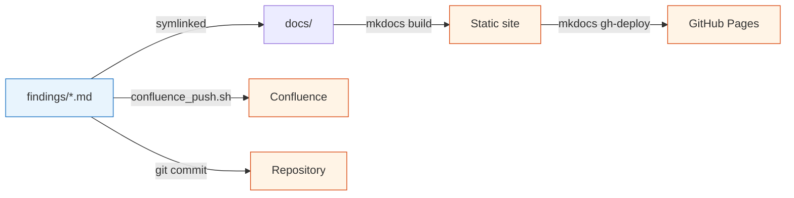

# Lululemon — Data Cleaning & EDA

**Owner:** Ejaz Anwar · **Client:** Lululemon · **Engagement:** Forecast Smart + Size Smart — data onboarding

Welcome. This site is the living knowledge base for the Lululemon data-cleaning / EDA phase. Everything here is generated from the markdown files under `findings/` in the project repo and stays in sync with the [Confluence hub](https://impactanalytics-team-i26gzg0e.atlassian.net/wiki/spaces/~7120208879ed2e673641b6b354fc145398edd5/pages/557057).

---

## Start here

- :material-magnify:{ .lg .middle } **Anomaly Status (top-level summary)**

    ---

    Every data anomaly across the 6 master tables, classified by root cause, with the SQL to re-verify each one.

    [:octicons-arrow-right-24: Anomalies &amp; Status](anomaly_status_with_verification_sql.md)

- :material-source-branch:{ .lg .middle } **Raw → Master Lineage**

    ---

    One-page visual of how the 6 master tables are built from ~10 raw source tables, with join keys and hardcoded stub columns flagged.

    [:octicons-arrow-right-24: Raw → Master Lineage](raw_to_master_lineage.md)

- :material-store:{ .lg .middle } **Location / Store Deep Dive**

    ---

    Everything location-related — 21 tables, identifier zoo, hierarchy, build-logic quirks, modeling filters.

    [:octicons-arrow-right-24: Location Audit](location_audit.md)

- :material-hammer-wrench:{ .lg .middle } **Master Table Build Logic**

    ---

    Column-by-column origin audit for each of the 6 masters — distinguishes "feed gap" from "hardcoded stub" from "logic bug".

    [:octicons-arrow-right-24: Build Logic](master_table_build_logic.md)

---

## The 6 master tables at a glance

| Master | Rows | Size | Status |
|---|---:|---:|---|
| `product_master` | 1.97M | 1.05 GB | 4 issues (1 P0 reframed → launch_date defer) |
| `transaction_master` | 389.9M | 73.5 GB | 8 issues, 2 P0s (cost/msrp feed, build uses non-existent table) |
| `inventory_master` | 7.2B | 650 GB | 8 issues, 1 P0 (9.3B pre-2023 rows dropped by build) |
| `store_master` | 1,853 | <1 MB | 🟢 Cleanest — 4 P1s, 4 P2s |
| `events_master` | 448K | — | 🟢 Clean projection |
| `fiscal_date_mapping` | 4,746 | — | 🟢 Clean through FY27 |

---

## Key numbers

| | |
|---|---|
| Total canonical raw tables | **26** (out of ~300 in the dataset) |
| Raw tables feeding masters | **10** |
| Hardcoded stub columns across all masters | **~44** |
| Verified source-data gaps (P0) | **2** (cost/msrp, inventory history) |
| Cross-table integrity breaks | **0** (clean referential integrity) |

---

## How the site is organized

| Top-level tab | What lives there |
|---|---|
| **Tables** | Per-master hub — EDA findings, the new hierarchy decoder, the location audit. One sub-section per master. |
| **Anomalies** | The status index (every issue, severity, root cause, verification SQL) and the P0/P1 deep dive. |
| **Pipeline & Lineage** | End-to-end ingestion playbook (S3 → BQ → PG → tool), the Raw → Master DAG, and the column-by-column origin audit. |
| **Reference** | Schema/dataset inventories, the master-table checklist, and the full SQL Queries hub. |
| **Reviews & Decisions** | Open review packages for Ritik / DE / client (Stage 1 WIP today). |

## Navigation tips

- Use the **top nav tabs** above to jump between sections.
- The **search bar** indexes every page — try `CMNTY`, `cost_price`, `LOC_CLOSED_IND`, or a specific column name.
- Every markdown page is the **exact same file** that lives in Confluence — no content drift.

---

## Workflow

Single source of truth: **`findings/*.md`** in the repo. Confluence and this site are downstream renderings.
