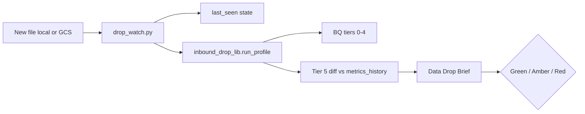

# Inbound Drop Agent — GCS landing → auto-EDA → Data Drop Brief

`Last updated: 2026-06-01.`

**Purpose:** When a client lands files in GCS (IA `YYYY-MM-DD/<view>_*.csv` convention), produce a **governed, repeatable EDA pack** and a one-page **Data Drop Brief** for PL/DI sign-off — without starting from a blank notebook.

**Phase 1:** Manual CLI or Cursor skill `/inbound-drop-eda`.  
**Phase 1b (local watcher):** `drop_watch.py` detects **new files since last_seen**, runs EDA + **diff vs prior drop**.  
**Phase 2:** GCS object-finalize → Cloud Function → Slack / Notion.  
**Phase 3:** CS-wide view profile library + diff history in BQ.

---

## Important: CSV vs BigQuery

The watcher uses the **landed file** (local folder or GCS path) only as a **drop signal** and for `SYNCSTARTDATETIME` metadata. **EDA metrics come from the BQ table** named in [`view_profiles.yaml`](view_profiles.yaml). After a client dump, BQ must reflect the load (extraction DAG or manual load) before the brief is meaningful.

---

## Quick start — manual EDA

```bash
pip install pyyaml   # once

python3 scripts/inbound_drop_eda.py --view inventory_snapshot --write-brief

python3 scripts/inbound_drop_eda.py \
  --view inventory_snapshot \
  --gcs-path "gs://<bucket>/2026-05-28/inventory_snapshot_20260528143000.csv" \
  --write-brief
```

**Output:** `findings/inbound_drop_agent/briefs/<view>_YYYYMMDD_HHMM.md`

**Billing:** `--project_id=lululemon-data-scan` (see `lululemon-bq-context.mdc` G16).

---

## Quick start — Drop Watcher (hourly / cron)

1. Copy config: `cp findings/inbound_drop_agent/watcher_config.example.yaml findings/inbound_drop_agent/watcher_config.yaml`
2. Set `drops_dir` (local) or `bucket` (GCS).
3. Mirror IA layout under the drops folder:

   ```text
   ~/drops/2026-06-01/inventory_snapshot_20260601120000.csv
   ```

4. Run:

   ```bash
   python3 scripts/drop_watch.py --once --source local
   python3 scripts/drop_watch.py --interval 3600 --source gcs
   ```

**Cron (hourly):**

```cron
0 * * * * cd /path/to/Lululemon && python3 scripts/drop_watch.py --once --source local >> /tmp/drop_watch.log 2>&1
```

**State:** [`drop_watcher_state.json`](drop_watcher_state.json) stores `last_seen` and processed paths per source.  
**History / diff:** [`metrics_history.json`](metrics_history.json) stores the last full snapshot per view (schema, row count, orphans, sentinels).

**Smoke test (no BQ):**

```bash
mkdir -p findings/inbound_drop_agent/test_drops/2026-06-01
touch findings/inbound_drop_agent/test_drops/2026-06-01/inventory_snapshot_20260601120000.csv
python3 scripts/drop_watch.py --once --source local \
  --config findings/inbound_drop_agent/watcher_config.test.yaml \
  --state-path findings/inbound_drop_agent/drop_watcher_state.test.json \
  --skip-bq
```

---

## Architecture



---

## Components

| Artifact | Role |
|----------|------|
| [`view_profiles.yaml`](view_profiles.yaml) | Per-view BQ table, grain, date column, join checks |
| [`watcher_config.example.yaml`](watcher_config.example.yaml) | Local / GCS sources (copy → `watcher_config.yaml`) |
| [`drop_watcher_state.json`](drop_watcher_state.json) | Per-source `last_seen` + processed paths |
| [`metrics_history.json`](metrics_history.json) | Last-run snapshot for Tier 5 diff |
| [`data_drop_brief_template.md`](data_drop_brief_template.md) | Brief skeleton |
| [`scripts/drop_watch.py`](../../scripts/drop_watch.py) | New-drop detector + orchestrator |
| [`scripts/lib/inbound_drop_lib.py`](../../scripts/lib/inbound_drop_lib.py) | Shared EDA, diff, brief render |
| [`scripts/inbound_drop_eda.py`](../../scripts/inbound_drop_eda.py) | Manual single-view CLI |
| [`queries/eda/inbound_drop_eda_pack.sql`](../../queries/eda/inbound_drop_eda_pack.sql) | Manual SQL pack |
| [`.cursor/skills/inbound-drop-eda/SKILL.md`](../../.cursor/skills/inbound-drop-eda/SKILL.md) | Agent workflow |
| [`forum_deck_outline.md`](forum_deck_outline.md) | Forum talk track |

---

## Verdict rules (agent / human)

| Verdict | When |
|---------|------|
| **Red** | BQ table missing; grain dup % &gt; 0.1%; row count Δ &gt; 30% vs prior; join orphan &gt; 50%; **column type change** vs prior |
| **Amber** | New/dropped columns; sentinel spike &gt; 10% vs prior; join orphan drift &gt; 5 pp; row Δ 10–30%; BQ touched but row count flat |
| **Green** | Metadata, grain, joins, and drift within bounds |

---

## Diff tier (Tier 5)

Compared on each run vs [`metrics_history.json`](metrics_history.json):

- New / dropped columns; type changes on same name
- Row count % change; BQ `last_modified` vs flat row count
- Join orphan % drift; sentinel null/`\N` spike on sample date
- Grain duplicate % increase

Brief sections: **Changes vs prior drop**, **Anomalies & drift flags**.

---

## Cloud path (Phase 2)

| Step | Work |
|------|------|
| 1 | Same `drop_watch.py --once` in Cloud Run Job |
| 2 | Cloud Scheduler hourly or Eventarc on `object.finalized` |
| 3 | Move `drop_watcher_state.json` to GCS ops bucket (`--state-path`) |
| 4 | `--notify-webhook` for Slack (stub exists) |

---

## Related

- IA GCS naming: `reference_docs/Training/DI_Course_3_Ingestion_Basics_for_Analytics_Teams.md`
- Deep dive EDA: `queries/inventory_snapshot_cleaned_eda.sql`
- Master checklist: `findings/master_table_checklist.md`
