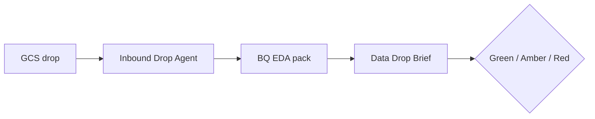

# Forum deck — Inbound Drop Agent (10 minutes)

`Audience: India CS PLs, DSLs, LBAs · Customer Success AI Collaboration Forum`

---

## Slide 1 — Title (30s)

**Inbound Drop Agent**  
*From GCS landing to sign-off brief in 30 minutes, not 2 days*

Ejaz Anwar · Lululemon implementation · Phase 1 demo

---

## Slide 2 — The problem (1 min)

- Client dumps land in **GCS** daily; IA ingestion expects strict paths and `SYNCSTARTDATETIME` lineage.
- Today: implementer opens files, runs ad-hoc SQL, writes Slack summary — **duplicated per team, per client**.
- Cost: delayed DAG runs, repeated surprises (`\N` sentinels, grain dupes, BOOL vs INT).

---

## Slide 3 — The vision (1 min)



**Not** “chat about a CSV.” **Templated** checks + **one-page verdict** for DI/PL.

---

## Slide 4 — What the brief contains (2 min)

Show screenshot or PDF of [`examples/inventory_snapshot_example_brief.md`](examples/inventory_snapshot_example_brief.md):

1. What arrived (rows, GB, last modified)
2. Grain & duplicate %
3. Date coverage
4. Sentinel / null hotspots
5. Join readiness sample (e.g. SKU → `product_master`)
6. **Green / Amber / Red** + next actions

---

## Slide 5 — Live demo flow (3 min)

```bash
python3 scripts/inbound_drop_eda.py --view inventory_snapshot --write-brief
```

- `view_profiles.yaml` = client-specific config (table, grain, joins)
- Runner = cheap metadata first, then filtered scans
- Cursor skill `/inbound-drop-eda` fills narrative + verdict

**Talking point:** Same pattern on Signet/Levi — swap YAML profile, keep the pack.

---

## Slide 6 — Phase roadmap (1 min)

| Phase | Capability |
|-------|------------|
| **1** | Manual trigger + brief (now) |
| **2** | Week-over-week diff vs prior drop |
| **3** | GCS event → auto-run |
| **4** | CS shared profile library |

---

## Slide 7 — Ask the room (1 min)

1. Which **3 views** cause the most pain on your accounts?
2. Should **Red** block extraction DAG or only warn?
3. Want a **shared CS repo** for `view_profiles.yaml`?

---

## Slide 8 — Close (30s)

- Participation → Organisation Building competency
- Repo path: `findings/inbound_drop_agent/`
- Offer: pairing session to add your client’s first profile

---

## Backup Q&A

| Question | Answer |
|----------|--------|
| Cost? | Tier 0 metadata ~$0; grain/join on **filtered** sample dates |
| PII? | Brief stays in client repo; no credentials in markdown |
| vs Dataplex / DLP? | Complements — we add **IA grain + join policy** checks |
| Who approves Red? | PL + DI; agent does not auto-stop DAG in Phase 1 |
