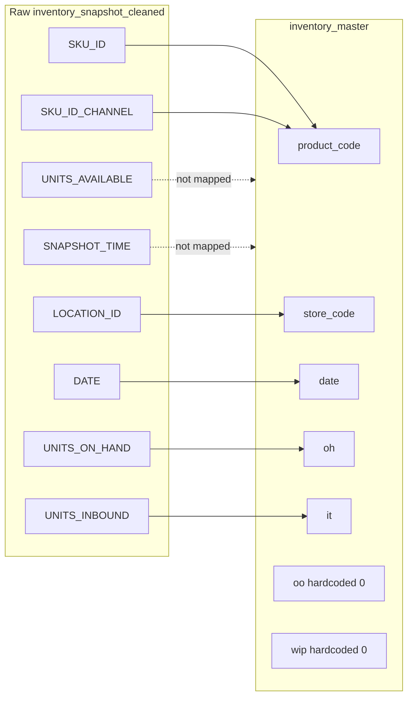

# Inventory Schema Alignment: Lululemon

`Last updated: 2026-06-25. Project: lululemon-01042025.`

Maps the IA generic inventory ingestion schema to Lululemon's raw inventory feeds and the derived master table. Covers two layers:

1. **Raw feeds:** GCS [`inventory_snapshot`](raw_inventory_snapshot_dec04_eda.md) (7 columns) and upstream [`inventory_snapshot_cleaned`](inventory_snapshot_cleaned_eda.md) (9 columns).
2. **Master table:** [`inventory_master`](schema_inventory.md) (10 columns), built per [`master_table_build_logic.md`](master_table_build_logic.md).

**Related:** [`raw_inventory_snapshot_dec04_eda.md`](raw_inventory_snapshot_dec04_eda.md), [`inventory_raw_distribution_eda_20260626.md`](inventory_raw_distribution_eda_20260626.md), [`inventory_snapshot_cleaned_eda.md`](inventory_snapshot_cleaned_eda.md), [`master_table_build_logic.md`](master_table_build_logic.md), [`raw_to_master_lineage.md`](raw_to_master_lineage.md)

## Feed identity

| Attribute | Value |
|---|---|
| Raw feed | `inventory_snapshot` (GCS, 7 cols) |
| GCS path | `gs://client_data_lululemon/Historic/s3_to_gcs/<drop>/outbound/inventory_snapshot/new/inventory_snapshot*.csv` |
| Latest batch | DEC04, tag `20251204`, drop folder `2025-12-05` (224 shards, ~474 GB) |
| Cleaned upstream | `lululemon-01042025.lululemon_souricng_outbound.inventory_snapshot_cleaned` (9 cols, adds `CHANNEL`, `SKU_ID_CHANNEL`) |
| Master | `lululemon-01042025.lulu_ingestion_dev.inventory_master` (10 cols) |
| Cadence | Daily snapshot |
| Grain (raw) | `(SKU_ID, LOCATION_ID, DATE)`; verified 1.0x unique on DEC04 (7,930,649,631 rows) |
| Grain (master) | `(product_code, store_code, date)`; pre-2023 raw history dropped in master build |

## Row-level availability (DEC04 canonical, 7,930,649,631 rows)

Canonical source for row stats: DEC04 GCS batch ([`raw_inventory_snapshot_dec04_eda.md`](raw_inventory_snapshot_dec04_eda.md)). Focus is whether **every row** carries the field with meaningful values, not column existence alone.

| IA field | Lululemon column | Column on every row? | Row-level notes |
|---|---|---|---|
| SKU ID | `SKU_ID` | Yes | 0% null/empty on all 7,930,649,631 rows |
| Location ID | `LOCATION_ID` | Yes | 0% null/empty; 1,574 distinct locations |
| Inventory Date | `DATE` | Yes | 0% null/empty; daily 2023-01-01 to 2025-12-04 (1,069 dates, no gaps) |
| Pack ID | n/a | No | Not in feed; SKU-level inventory only |
| OnHand Qty | `UNITS_ON_HAND` | Yes | Every row populated; 0.67% `-1` sentinel, 31.7% zero, median 1 |
| InTransit Qty | `UNITS_INBOUND` | Yes | Column present on every row; 92.1% zero, 7.9% with inbound > 0 |
| OnOrder Qty | n/a | No | Not in feed; master hardcodes `oo = 0` |
| Reserved Qty | n/a | No | Not in feed |
| Shrink / RFID | n/a | No | Not in feed |
| Created Timestamp | n/a | No | No created-at field |
| Updated Timestamp | `SNAPSHOT_TIME` | Yes | 100% populated; proxy only (typically +1 day after business `DATE`) |

**Lululemon-only:** `UNITS_AVAILABLE` on every row (not in IA template); same `-1` sentinel as OH (~0.81%). Not mapped to master today.

**Not canonical for periodic ingestion:** `lulu_sourcing_dev.inventory_snapshot` (33 snapshot dates, 2024 gap, dupes). Use consolidated DEC04 for reload sign-off.

## Alignment table

| Key Information | Data Field | Definition | Mandatory | Data available? | Data Type | Lululemon fields / doubts |
|---|---|---|---|---|---|---|
| Primary key (unique at this level) | SKU ID | Unique identifier of the product. Ties to SKUID in Product Master | Yes | Yes | alphanumeric | **Raw:** `SKU_ID` (numeric string, e.g. `145350546`). **Cleaned:** same + `SKU_ID_CHANNEL` (e.g. `145328501_RETAIL`); 33,700,000 rows missing channel. **Master:** `product_code` = `SKU_ID_CHANNEL` after PGH join. Join bare SKU to `product_master` via `SPLIT(product_code,'_')[0]`: 0% orphan on the 2025-12-04 sample. |
| Primary key | Location ID | Unique identifier of the store/DC. Ties to Location ID in Location Master | Yes | Yes | alphanumeric | **Raw:** `LOCATION_ID` (e.g. `22501`, not zero-padded). **Master:** `store_code` (often zero-padded, e.g. `0000010355`). Join raw to `location_details.id` (0% orphan). Do not join raw `LOCATION_ID` directly to `store_master.store_code` without a format mapping (100% mismatch on tested join). |
| Primary key | Inventory Date | Snapshot date of the inventory - daily | Yes | Yes | Date | **Raw:** `DATE` (`YYYY-MM-DD`). **Master:** `date` (partition key). DEC04 batch: daily continuity 2023-01-01 to 2025-12-04 (1,069 dates, no gaps). |
| Primary key | Pack ID | If applicable and inventory is in packs | No | No | alphanumeric | **Not in feed.** Inventory is at bare SKU level. Pack ID appears in the InventorySmart allocation UI but is absent from `inventory_snapshot` / `inventory_snapshot_cleaned`. |
| Important units (daily cadence) | OnHand Qty | Quantity physically on hand in the store/DC | Yes | Yes | Integer | **Raw:** `UNITS_ON_HAND` (CSV STRING; cast to INT64). **Master:** `oh` (direct map). Sentinel `-1` = unknown (~0.67%); treat as NULL downstream. Real negatives also exist (~0.20%). p50 = 1 unit. |
| Important units | InTransit Qty | Quantity physically moving into locations within the same channel (DC to Store, Store to Store, Store to DC, DC to DC) | Yes | Partial | Integer | **Raw:** `UNITS_INBOUND`. **Master:** `it` (direct map); platform build treats inbound as in-transit. Sparse: ~92% of DEC04 rows = 0. Open question: confirm with Lululemon whether `UNITS_INBOUND` covers all IA in-transit semantics or only a subset (vs a `transfer_orders` feed). |
| Important units | OnOrder Qty | Quantity from POs written to external vendors | Yes | No | Integer | **Not in `inventory_snapshot`.** **Master:** `oo` hardcoded to `0` (see [`master_table_build_logic.md`](master_table_build_logic.md)). Candidate separate feeds: `purchase_orders` (~21,000,000 rows), `transfer_orders` (~710,000,000 rows) per [`raw_to_master_lineage.md`](raw_to_master_lineage.md). Gap vs IA mandatory schema: flag for client alignment. |
| Important units | Reserved Qty | Inventory reserves that should not be considered for fulfillment | No | No | Integer | **Not in feed.** DC reserved inventory lives in the InventorySmart Constraints module only; no raw column. Master has no reserved field. |
| Additional data fields | Shrink, RFID etc. | If present and relevant, metrics like shrink, RFID etc. can refine the on-hand picture | No | No | Integer | **Not in feed.** No shrink/RFID columns in `inventory_snapshot` or the cleaned variant. |
| Periodic ingestion | Created Timestamp | Recorded timestamp when the record was created | Yes | No | datetime | **Not in feed.** No separate created timestamp; only `SNAPSHOT_TIME` exists. Proposed: use `SNAPSHOT_TIME` as a proxy, or request a distinct field from the client. |
| Periodic ingestion | Updated Timestamp | Recorded timestamp when the record was last updated | Yes | Partial | datetime | **Raw:** `SNAPSHOT_TIME` (ISO UTC, e.g. `2023-09-04T07:11:42Z`). **Master:** not carried. Capture is typically +1 calendar day after business `DATE` (71%); 28.5% same-day; 0.33% negative lag (backfill artifact). |

## Lululemon-only fields (not in the IA template)

| Raw field | Master mapping | Notes |
|---|---|---|
| `UNITS_AVAILABLE` | Not mapped to master | Available qty distinct from on-hand. 6.1% of rows have OH > 0 and AV = 0. Same `-1` sentinel as OH (~0.81%). Relevant for allocation; recommend adding to the alignment doc as a Lululemon extension. |
| `CHANNEL` | Used in cleaned join only | Present in `inventory_snapshot_cleaned`; absent from the raw GCS 7-col feed. 33,700,000 rows missing channel in the cleaned table. |
| `SKU_ID_CHANNEL` | -> `product_code` | Channel-suffixed SKU key (e.g. `145328501_RETAIL`). Required for the master build join to PGH. |

## Raw to master transform

From [`master_table_build_logic.md`](master_table_build_logic.md):

- `oh` <- `UNITS_ON_HAND`
- `it` <- `UNITS_INBOUND`
- `oo`, `wip`, `initial_oh_quantity` <- hardcoded `0`
- `total_units` <- `UNITS_ON_HAND` (duplicate of `oh`, not OH + IT + OO)

## Mandatory-field gap summary (for stakeholder discussion)

| IA field | Mandatory | Lululemon status | Recommendation |
|---|---|---|---|
| OnHand Qty | Yes | Present | Map `UNITS_ON_HAND`; handle `-1` sentinel |
| InTransit Qty | Yes | Partial | Map `UNITS_INBOUND`; confirm semantics; 92% sparse |
| OnOrder Qty | Yes | Missing | Align: add PO/transfer feed join, or mark IA mandatory as N/A with client sign-off |
| Created Timestamp | Yes | Missing | Use `SNAPSHOT_TIME` proxy or request a new field |
| Updated Timestamp | Yes | Partial | `SNAPSHOT_TIME` only |
| Pack ID | No | N/A | Document as not applicable (SKU-level feed) |
| Reserved Qty | No | N/A | Document as IS module only |
