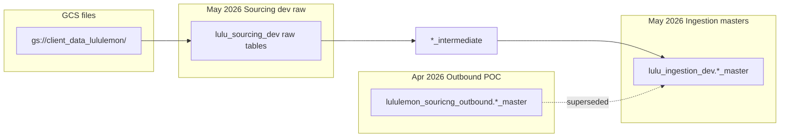

# Lululemon EDA inventory (deduplicated)

`Last updated: 2026-07-02.`

Single index of all exploratory data analysis on the **7 GCS extraction tables** in `lulu_sourcing_dev`, their downstream outputs, and related GCS/inbound-drop work. Use this doc to find the **canonical** artifact per table and avoid re-running duplicate analysis.

**Related:** [`lulu_sourcing_dev_tables.md`](lulu_sourcing_dev_tables.md) (table list + row counts), [`README.md`](README.md) (findings index).

## How to use this doc

**Canonical rule:** prefer the **newest dataset-specific** artifact. Mark older generations as historical reference only.

| Generation | Dataset | When | Status |
|------------|---------|------|--------|
| Outbound POC masters | `lululemon_souricng_outbound` | Apr 2026 | Historical |
| Raw GCS extractions | `lulu_sourcing_dev` | May 2026 | **Canonical for raw tables** |
| Ingestion masters | `lulu_ingestion_dev` | May 2026 | **Canonical for masters** |
| GCS bucket scan | `gs://client_data_lululemon/` | Jun 2026 | Complements BQ (file layer) |

## 1. Canonical EDA per table (7 GCS extraction tables)

| Table | Canonical artifact | Date | One-line summary | Do not duplicate with |
|-------|-------------------|------|------------------|----------------------|
| `product_group_hierarchy` | [`raw_product_group_hierarchy_eda.md`](raw_product_group_hierarchy_eda.md) | 2026-05-18 | 18.2M EAV rows, ~2x duplication, pivot spine for product build | [`product_master_eda.md`](product_master_eda.md) (outbound); [`gcs_eda_2026/`](gcs_eda_2026/) (file layer) |
| `sku_details` | [`raw_sku_details_eda.md`](raw_sku_details_eda.md) | 2026-05-18 | 3.96M rows; all prices zero, `DUMMY_CURRENCY`, season `25-4WI` | Outbound [`queries/sku_details_raw_eda_phase1_consolidated.sql`](../queries/sku_details_raw_eda_phase1_consolidated.sql) targets outbound table |
| `sku_details` (GCS root cause) | [`sku_details_gcs_batch_pricing_scan.md`](sku_details_gcs_batch_pricing_scan.md) | 2026-06-16 | Aug 2025 batch ~100% priced; Sep/Nov 2025 0%; May DAG loaded Nov batch | **Not duplicate** of raw BQ EDA: extends with batch diagnosis |
| `product_attribute_s` | [`raw_product_attribute_s_eda.md`](raw_product_attribute_s_eda.md) | 2026-05-18 | 3x triplicate load (internal DE); 100 cols, FLEX_STATUS Drop ~29% | **Superseded by** [`product_attribute_s_eda_20260702.md`](product_attribute_s_eda_20260702.md) (Jul 2 reload: 86K deduped) |
| `location_group_hierarchy` | [`raw_location_group_hierarchy_eda.md`](raw_location_group_hierarchy_eda.md) | 2026-05-18 | 1,853 rows, 44 cols; brand/market/channel/geo hierarchy | [`location_audit.md`](location_audit.md), [`store_master_eda.md`](store_master_eda.md) |
| `location_details` | [`raw_location_details_eda.md`](raw_location_details_eda.md) | 2026-05-18 | 1,853 rows, 1:1 with LGH on `loc_id` | Same as above |
| `sales_transactions` | [`raw_sales_transactions_eda.md`](raw_sales_transactions_eda.md) | 2026-05-18 | 683,582,361 rows, 2015 to 2025; synthetic order IDs; zero-qty patterns | [`transaction_master_eda.md`](transaction_master_eda.md) (outbound, narrower) |
| `returns_transactions` | [`raw_returns_transactions_eda.md`](raw_returns_transactions_eda.md) | 2026-06-24 | 733,682,768 rows; mirror of sales (`\|RETURNS` suffix); ~14% net return rate; join validated | Not in sourcing dev yet; outbound `returns_transactions_20251119` used for BQ EDA |
| `inventory_snapshot` | [`raw_inventory_snapshot_eda.md`](raw_inventory_snapshot_eda.md) | 2026-05-18 | 404M rows, 2x dupes, date spikes; **live build uses cleaned, not this table** | [`inventory_snapshot_cleaned_eda.md`](inventory_snapshot_cleaned_eda.md) |
| `inventory_snapshot` (DEC04 GCS batch) | [`raw_inventory_snapshot_dec04_eda.md`](raw_inventory_snapshot_dec04_eda.md) | 2026-06-24 | Latest batch: 7,930,649,631 rows, 1.0× grain, 1,069 daily dates 2023 to 2025; not in BQ | [`inventory_snapshot_batch_compare.md`](inventory_snapshot_batch_compare.md) |
| `inventory_snapshot` (IA schema mapping) | [`inventory_schema_alignment_lululemon.md`](inventory_schema_alignment_lululemon.md) | 2026-06-25 | IA inventory alignment table: raw + master field mapping, mandatory-field gaps (OnOrder, timestamps) | [`master_table_build_logic.md`](master_table_build_logic.md) |

**SQL companion (all 7 tables, not a separate EDA):** [`queries/sourcing/post_extraction_diagnostics.sql`](../queries/sourcing/post_extraction_diagnostics.sql)

## 1b. ForecastSmart sourcing feeds (Jun 2026 load)

Canonical BQ EDA for Req 11, 13, 14 tables landed from `2026-06-25/` GCS batch.

| Table | Canonical artifact | Date | One-line summary |
|-------|-------------------|------|------------------|
| `planned_sales` | [`forecastsmart_req11_13_14_eda_20260630.md`](forecastsmart_req11_13_14_eda_20260630.md) | 2026-06-30 | 115.7M rows; planned units not pricing; SO×store×week grain |
| `product_attribute_s_seasonal` | same doc | 2026-06-30 | 650K rows; style×quarter; ~73% sparse FLEX_STATUS |
| `product_attribute_so_seasonal` | same doc | 2026-06-30 | 1.2M rows; SO×quarter colourway attrs |
| `eligibility` | same doc | 2026-06-30 | 242M rows; PSO×store×week; 4.66% grain dupes |

**SQL:** [`queries/sourcing/forecastsmart_req11_13_14_eda.sql`](../queries/sourcing/forecastsmart_req11_13_14_eda.sql) · **JSON metrics:** [`forecastsmart_req11_13_14_eda_20260630.json`](forecastsmart_req11_13_14_eda_20260630.json)

## 1c. `product_attribute_s` (Req 12, Jul 2026 reload)

| Table | Canonical artifact | Date | One-line summary |
|-------|-------------------|------|------------------|
| `product_attribute_s` | [`product_attribute_s_eda_20260702.md`](product_attribute_s_eda_20260702.md) | 2026-07-02 | 86,135 styles; 102 cols; PA superset of PGH (+42K Drop-heavy styles); GCS/BQ match |

**SQL:** [`queries/sourcing/product_attribute_s_eda.sql`](../queries/sourcing/product_attribute_s_eda.sql)

GCS streaming baseline (pre-BQ): [`gcs_feed_eda_review_20260629.md`](gcs_feed_eda_review_20260629.md)

## 2. GCS file-level EDA (complements BQ raw EDAs)

Single initiative: **not a duplicate** of the `raw_*_eda.md` files (different layer: file inventory vs BQ profiling).

| Artifact | Path | Date |
|----------|------|------|
| Index | [`gcs_eda_2026/README.md`](gcs_eda_2026/README.md) | 2026-06-22 |
| Batch report | [`gcs_eda_2026/batch_folder_report.md`](gcs_eda_2026/batch_folder_report.md) | 2026-06-23 |
| Bucket structure | [`gcs_eda_2026/gcs_bucket_structure.md`](gcs_eda_2026/gcs_bucket_structure.md) | 2026-06-22 |
| Historic catalog | [`gcs_eda_2026/catalog_historic.csv`](gcs_eda_2026/catalog_historic.csv) | 2026-06-23 |
| Batch × feed matrix | [`gcs_eda_2026/batch_feed_matrix.csv`](gcs_eda_2026/batch_feed_matrix.csv) | 2026-06-23 |
| Batch inventory detail | [`gcs_eda_2026/batch_inventory_detail.csv`](gcs_eda_2026/batch_inventory_detail.csv) | 2026-06-23 |
| Historic headers | [`gcs_eda_2026/headers_historic.txt`](gcs_eda_2026/headers_historic.txt) | 2026-06-22 |
| Foundation catalog | [`gcs_eda_2026/catalog_foundation.csv`](gcs_eda_2026/catalog_foundation.csv) | 2026-06-22 |
| Regenerator script | [`scripts/historic_batch_inventory.py`](../scripts/historic_batch_inventory.py) | n/a |

All 7 GCS feeds appear in historic batches. See batch report for overlap and ingestion guidance.

## 3. Downstream table EDAs

### Synced / alternate paths

| Table | Canonical artifact | Date | One-line summary |
|-------|-------------------|------|------------------|
| `inventory_snapshot_cleaned` | [`inventory_snapshot_cleaned_eda.md`](inventory_snapshot_cleaned_eda.md) | 2026-05-06 | 16.4B rows; 9 cols; dupes, negatives, `UNITS_AVAILABLE`, `SNAPSHOT_TIME` backfill |
| `inventory_snapshot_cleaned` (SQL) | [`queries/inventory_snapshot_cleaned_eda.sql`](../queries/inventory_snapshot_cleaned_eda.sql) | 2026-05-06 | Phases 1 to 6 query workbook |
| `calendar_hierarchy` | [`fiscal_calendar_eda.md`](fiscal_calendar_eda.md) | 2026-04-20 | 4,746 rows, 37 cols; 53-week years; 2yr future gap vs 5yr spec |
| `calendar_hierarchy` (SQL) | [`queries/fiscal_calendar_eda_phase1_consolidated.sql`](../queries/fiscal_calendar_eda_phase1_consolidated.sql) | Apr 2026 | Phase 1 query battery |

### Intermediate tables (no standalone EDA files)

| Intermediate | Best coverage | Gap |
|--------------|---------------|-----|
| `product_intermediate` | [`master_product_master_eda.md`](master_product_master_eda.md) | No intermediate-only grain/completeness pass |
| `store_intermediate` | [`master_store_master_eda.md`](master_store_master_eda.md) | Same |
| `inventory_intermediate` | [`master_inventory_master_eda.md`](master_inventory_master_eda.md) | Single-date POC only (2025-08-28) |
| `transaction_intermediate` | [`master_transaction_master_eda.md`](master_transaction_master_eda.md) | Aggregation logic not isolated |
| `fiscal_calendar_intermediate` | [`fiscal_date_mapping_pipeline.md`](fiscal_date_mapping_pipeline.md) | Row-count parity only; not profiled |

### Ingestion masters (current)

| Master | File | Built from | Date |
|--------|------|------------|------|
| Product | [`master_product_master_eda.md`](master_product_master_eda.md) | `product_intermediate` | 2026-05-18 |
| Store | [`master_store_master_eda.md`](master_store_master_eda.md) | `store_intermediate` | 2026-05-18 |
| Inventory | [`master_inventory_master_eda.md`](master_inventory_master_eda.md) | `inventory_intermediate` | 2026-05-18 |
| Transaction | [`master_transaction_master_eda.md`](master_transaction_master_eda.md) | `transaction_intermediate` | 2026-05-18 |
| Health check (delta) | [`master_bq_health_check_2026-05-20.md`](master_bq_health_check_2026-05-20.md) | All 4 masters | 2026-05-20 |

### Outbound POC masters (historical: superseded)

Use `master_*_eda.md` for current state. Keep these for POC-era stub context only.

| Master | File | Date |
|--------|------|------|
| Product | [`product_master_eda.md`](product_master_eda.md) | 2026-04-20 |
| Store | [`store_master_eda.md`](store_master_eda.md) | 2026-04-20 |
| Transaction | [`transaction_master_eda.md`](transaction_master_eda.md) | 2026-04-20 |
| Inventory | [`inventory_master_eda.md`](inventory_master_eda.md) | 2026-04-20 |

**Outbound SQL companions:** see [`docs/queries/index.md`](../docs/queries/index.md)

## 4. Inbound Drop Agent

Framework profiles `inventory_snapshot`, `sales_transactions`, and `sku_details`. **Only inventory briefs were generated.**

| Artifact | Status | Notes |
|----------|--------|-------|
| [`inbound_drop_agent/README.md`](inbound_drop_agent/README.md) | Framework | GCS signal → BQ EDA → Data Drop Brief |
| [`briefs/inventory_snapshot_20260528.md`](inbound_drop_agent/briefs/inventory_snapshot_20260528.md) | Historical | RED: 2.17% grain dupes on `inventory_snapshot_cleaned` |
| [`briefs/inventory_snapshot_20251204.md`](inbound_drop_agent/briefs/inventory_snapshot_20251204.md) | **Canonical DEC04 brief** | GREEN: GCS DEC04 batch; 1.0× grain, full 2023 to 2025 continuity |
| `briefs/inventory_snapshot_20260601_1200.md` | Exclude | Test failure (BQ table not found) |
| `briefs/inventory_snapshot_20260602_1400.md` | Exclude | Test failure (BQ table not found) |
| [`examples/inventory_snapshot_example_brief.md`](inbound_drop_agent/examples/inventory_snapshot_example_brief.md) | Exclude | Demo template only |

**Scripts / SQL:** [`scripts/inbound_drop_eda.py`](../scripts/inbound_drop_eda.py), [`queries/eda/inbound_drop_eda_pack.sql`](../queries/eda/inbound_drop_eda_pack.sql), [`.cursor/skills/inbound-drop-eda/SKILL.md`](../.cursor/skills/inbound-drop-eda/SKILL.md)

**Dedup:** `20260528` = historical cleaned-table brief (RED). `20251204` = canonical DEC04 GCS batch brief (GREEN). Overlaps metrics in `inventory_snapshot_cleaned_eda.md` / `raw_inventory_snapshot_dec04_eda.md` but each is drop-specific.

## 5. Cross-cutting synthesis (index only: not full EDAs)

| Doc | Role |
|-----|------|
| [`lululemon_client_open_questions.md`](lululemon_client_open_questions.md) | Client questions with EDA evidence; PM #1 to 10 rechecks (Jun 2026) |
| [`queries/lululemon_client_open_questions.sql`](../queries/lululemon_client_open_questions.sql) | Consolidated recheck SQL |
| [`consolidated_p0_p1_issues.md`](consolidated_p0_p1_issues.md) | P0/P1 rollup across all masters |
| [`anomaly_status_with_verification_sql.md`](anomaly_status_with_verification_sql.md) | V1 to V15 verification status |
| [`product_master_hierarchy_decoded.md`](product_master_hierarchy_decoded.md) | L0 to L8 hierarchy semantics |
| [`location_audit.md`](location_audit.md) | Location dependency map + QA |
| [`de_review_stage1_wip.md`](de_review_stage1_wip.md) | DE build-logic questions (not statistical EDA) |

## 6. Duplicate / superseded map

| Use this | Not this | Why |
|----------|----------|-----|
| `raw_*_eda.md` (May 2026) | `*_master_eda.md` (Apr 2026 outbound) | Sourcing-dev tables are what the live pipeline loads |
| `master_*_eda.md` (May 2026) | Outbound `*_master_eda.md` | Ingestion dev is current master state |
| `inventory_snapshot_cleaned_eda.md` | `raw_inventory_snapshot_eda.md` for build decisions | Live inventory master built from cleaned |
| `sku_details_gcs_batch_pricing_scan.md` + `raw_sku_details_eda.md` | Re-running pricing scan without new batch | BQ state + GCS batch cause are complementary |
| `gcs_eda_2026/` | Re-listing GCS manually | Machine-readable catalogs already exist |
| `briefs/inventory_snapshot_20260528.md` | Example brief or failed test briefs | Only live drop EDA |

**Highest-overlap pairs (same topic, different layer: keep both):**

- `raw_sku_details_eda.md` ↔ `sku_details_gcs_batch_pricing_scan.md`
- `raw_inventory_snapshot_eda.md` ↔ `inventory_snapshot_cleaned_eda.md`
- `gcs_eda_2026/` ↔ all `raw_*_eda.md`

## 7. Deduplicated count

| Category | Unique EDAs | Exclude as duplicate |
|----------|------------:|----------------------|
| Raw BQ (7 GCS tables) | 7 | n/a |
| GCS bucket scan | 1 initiative | Not duplicate of BQ EDAs |
| sku_details GCS pricing | 1 extension | Complements raw sku_details EDA |
| inventory_snapshot_cleaned | 1 | Overlaps raw inventory + inbound brief |
| calendar_hierarchy | 1 | n/a |
| Ingestion masters | 4 + 1 health check | Supersedes 4 outbound master EDAs |
| Inbound drop briefs | 1 live | Exclude 2 test briefs + 1 example |
| Intermediate-only | 0 | **Gap** |

**Total unique statistical EDAs: ~18** (7 raw + 1 GCS initiative + 1 pricing + 1 cleaned + 1 calendar + 4 masters + 1 health check + 1 inbound brief + 4 outbound historical)

## 8. Gaps (not yet done)

| Gap | Notes |
|-----|-------|
| Standalone EDA for `product_intermediate`, `store_intermediate`, `inventory_intermediate`, `transaction_intermediate`, `fiscal_calendar_intermediate` | Infer from master EDAs + build SQL |
| Inbound drop briefs for `sales_transactions`, `sku_details`, `product_group_hierarchy` | Profiles in `view_profiles.yaml`; only inventory briefs generated |
| Full `fiscal_calendar_intermediate` profile | Pipeline doc only |

## 9. Archive scan

`archive/` is in `.cursorignore` but was scanned via shell (2026-06-23). **No EDAs on the 7 GCS tables** found in archive. Only SizeSmart-related EDAs:

- `archive/sizesmart/findings/master_store_level_buy_qty_master_eda.md`
- `archive/sizesmart/findings/master_size_range_library_master_eda.md`

Out of scope for this inventory (forecasting / data-transfer focus).

## 10. Historical chat sessions

EDA work and rechecks referenced in Lululemon workspace transcripts:

| Session | Focus |
|---------|-------|
| [093c5479](093c5479-ed9d-4e3b-9a20-4cc4bf4f98c4) | Open questions consolidation; PM #1 to 10 BQ rechecks; sourcing table inventory |
| [558bd952](558bd952-e09d-4a94-b35d-93688383d1fa) | GCS EDA / bucket structure |
| [e8bfc7c3](e8bfc7c3-bd58-445d-a67c-c4c626a40559) | Master EDA / ingestion pipeline |
| [3d4f200d](3d4f200d-b724-4c01-9982-63642acd6507) | Raw table EDA / extraction |
| [e889edf8](e889edf8-ad60-4b0a-a023-5ef8b228c79a) | Product / PGH analysis |
| [773ba561](773ba561-a6ea-45be-9e08-94d5d367718f) | Inventory / transaction EDA |
| [8801de65](8801de65-0aca-4d4b-9164-c71f14241264) | Inbound drop agent / inventory briefs |

Transcript root: `~/.cursor/projects/Users-ejazanwarmd-Desktop-Tapestry-Lululemon-code-workspace/agent-transcripts/`
