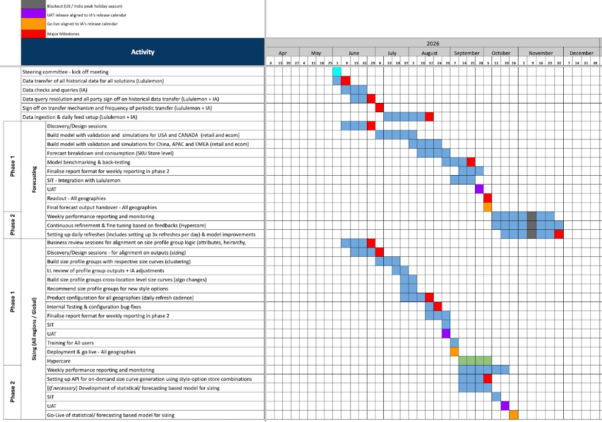

# Lululemon × Impact Analytics SOW — summary

`Last updated: 2026-05-25 (project timeline chart added).`

**Sources:**
- Contract: [`reference_docs/Lululemon/Contract/lululemon_impact_analytics_sow_2026-05-04_redlines.pdf`](../reference_docs/Lululemon/Contract/lululemon_impact_analytics_sow_2026-05-04_redlines.pdf) (19 pages, MSA template v25 dated 04/03/2026, redline draft).
- **Timeline (authoritative for dates):** [`findings/assets/lululemon_ia_sow_timeline_2026.png`](./assets/lululemon_ia_sow_timeline_2026.png) — Apr–Dec 2026 Gantt; supersedes the partial Apr/May dates in the PDF Section 12 table.

**Purpose:** Agent-readable scope anchor. When contract language conflicts with handbook/OOTB docs, treat this SOW as the signed engagement boundary once executed.

---

## Headline scope

| Dimension | What the SOW says |
|-----------|-------------------|
| **Vendor** | Impact Analytics, Inc. |
| **Kick-off** | **8 June 2026** (timeline chart); PDF still lists SOW start 20 April 2026 — use chart for planning |
| **Services** | **Sizing + demand forecasting implementation** — demand-based size curves and explainability outputs to support merchandise planning and allocation |
| **Consumption model** | **Offline forecasts** — 13-week forward horizon; lululemon consumes outputs without an IA UI for forecast interaction (Section 5) |
| **Geography** | Global retail footprint: NAM (US, CA), APAC (17 countries/territories), Europe (15 countries) |
| **Channels** | Physical retail + ecommerce |
| **Instances** | Template lists **3 regional instances** (NAM, EMEA, APAC); Section 13 also states **1 single instance** across channels — reconcile at design sign-off |
| **Work location** | Vendor premises (checked); remote/lululemon premises unchecked |

This SOW is **not** a full Inventory Smart platform rollout document. It centers on **forecast + sizing model deliverables**, data feeds, and implementation methodology. Inventory Smart handbook work in this repo remains relevant as **downstream consumer / parallel IA product context**, not as contractual scope unless referenced in a separate order.

---

## Acceptance criteria (Section 2c)

- Forecasting and sizing outputs must show **meaningful differentiation** across products, locations, and time; convergence must be **statistically explainable**.
- Vendor provides documentation/evidence on request.
- lululemon may require remediation for over-reliance on fallbacks or insufficient differentiation.
- Key personnel must complete lululemon onboarding and participate in business reviews (vendor cost).

---

## Deliverables (Section 7) — technical grain

### Data refresh

- **Daily regional refreshes:** APAC/China, NAM, EMEA — schedule agreed in writing before go-live.

### Forecasting track

| Phase | Grain / requirement |
|-------|---------------------|
| **Phase 1 — Forecasting MVP (interim)** | **PSS × Store/DC × Week** (primary — drives inventory placement) |
| | **PSS × Store/DC × Day** — statistically valid disaggregation with intra-week signals |
| **Responsiveness** | Forecasts must react to **current-week** demand signals; non-responsive outputs may be **rejected** |
| **Explainability** | Drivers at each granularity; explain forecast changes over time; format suitable for lululemon independent validation |
| **Audit** | Complete audit trail of forecast outputs |
| **Phase 2 — Forecasting pilot (flowstate)** | Unit-level demand forecasts with **confidence intervals**, all products/markets |

### Sizing track

| Phase | Grain / requirement |
|-------|---------------------|
| **Phase 1 — Size curves MVP (interim)** | **PSO × Submarket Channel × Week** |
| **Cadence** | Interim delivered **quarterly** aligned to GTM milestones until Phase 3 full rollout; redline mentions **April 14** milestone date |
| **Phase 2 — Sizing pilot (flowstate)** | Header references **June** (incomplete in PDF) |
| **UAT** | **Three UAT iterations** before go-live; vendor fixes critical bugs |
| **Aggregation ownership** | **lululemon owns all aggregation** (e.g. submarket curves from store-level). Vendor delivers **atomic outputs only** — no grouping/transform beyond defined grain |

### Re-inference (forecast + sizing)

| Mode | Requirement |
|------|-------------|
| **Incremental (delta)** | Partial input updates; **≥3 inference cycles per day per region**; no full recompute required |
| **Full batch** | Periodic full recompute (daily or on request) |
| **Consistency** | Incremental vs batch directionally consistent; material diffs explainable; incremental updates without breaking prior outputs |

---

## Project timeline (Apr–Dec 2026)

**Legend:** blue = activity duration · red = milestone · purple = UAT release (IA release calendar) · orange = go-live · grey = blackout (US/India peak holiday, Nov) · green = hypercare

### Critical dates

| Date | Event |
|------|-------|
| **2026-06-08** | Kick-off |
| **2026-06-22** | Data checks & queries · Forecasting Phase 1 discovery/design · Sizing logic alignment |
| **2026-06-29** | Sign-off on data transfer · Sizing design sessions |
| **2026-08-17** | Data ingestion & daily feed setup · Sizing cross-location curves / product config |
| **2026-08-24** | Sizing product configuration milestone |
| **2026-09-07** | Model benchmarking & back-testing · SIT & report finalization (both tracks) |
| **2026-09-28** | **UAT release** — Forecasting Phase 1 + Sizing Phase 1 (IA release calendar) |
| **2026-10-05** | Forecasting readout & handover |
| **2026-10-12** | **Phase 1 go-live** — Forecasting + Sizing |
| **2026-10-19** | Sizing Phase 2 — API setup for on-demand curves |
| **2026-11-16** | Sizing Phase 2 UAT release |
| **2026-11-30** | **Sizing Phase 2 go-live** (statistical model) |
| **2026-12-21** | Forecasting Phase 2 final milestone |

### Foundational data (Jun–Aug)

| Activity | Window | Milestone |
|----------|--------|-----------|
| Historical data transfer | Jun | — |
| Data checks & queries | mid–late Jun | **Jun 22** |
| Sign-off on data transfer | late Jun | **Jun 29** |
| Data ingestion & daily feed setup | Jul – mid-Aug | **Aug 17** |

### Forecasting

**Phase 1**

| Activity | Window |
|----------|--------|
| Discovery / design | Jun |
| Model building — USA/Canada | Jul |
| Model building — China / APAC / EMEA | late Jul – mid-Aug |
| Forecast breakdown (SKU × store level) | Aug |
| Benchmarking & back-testing | late Aug – early Sep |
| SIT & report finalization | Sep |
| UAT release | **Sep 28** |
| Readout & handover | early Oct |
| **Go-live** | **Oct 12** |

**Phase 2**

| Activity | Window |
|----------|--------|
| Weekly reporting, refinement (hypercare), daily refresh setup | mid-Oct – Dec |
| Blackout | first 3 weeks Nov |
| Final milestone | **Dec 21** |

### Sizing (all regions / global)

**Phase 1**

| Activity | Window |
|----------|--------|
| Logic alignment & design sessions | Jun |
| Build size profile groups & curves | Jul |
| Review & adjustments | late Jul – early Aug |
| Cross-location curves & product configuration | Aug |
| SIT & report finalization | Sep |
| UAT release | **Sep 28** |
| Training & deployment | early Oct |
| **Go-live** | **Oct 12** |
| Hypercare | mid-Oct – early Nov |

**Phase 2**

| Activity | Window |
|----------|--------|
| Weekly reporting | Oct – Nov |
| API setup for on-demand curves | Oct (**Oct 19**) |
| Statistical model development (if needed) | Oct – early Nov |
| SIT | early Nov |
| UAT release | **Nov 16** |
| **Go-live (statistical model)** | **Nov 30** |

---

## Data transfer obligations

**Preferred mechanisms:** GCS buckets / SFTP, REST APIs, adapters (Snowflake, secure system connections).

**Superseded PDF dates (Section 12 — keep for contract traceability only):** historical transfer 4/20, IA checks 5/4, sign-off 5/11, mechanism 5/18. **Planning uses the chart above** (Jun kick-off, Jun 29 data sign-off, Aug 17 ingestion live).

**Operational constraints:**

- IA needs **≥3 hours** to ingest each data drop; late/incomplete feeds → IA not liable for refresh delays.
- UAT environment: **bi-weekly downtime Thu–Fri** during UAT cycles (Appendix B release calendar referenced but not attached).

**lululemon must provide:** data dictionary, IT SPOC, business SPOC, accurate timely data in agreed formats.

---

## Implementation phases (Section 6 methodology)

Design → ingestion pipeline design/sign-off → build/test/stabilize → model development → product config → unit/SIT/UAT → training → go-live → **12-week hypercare** → MSA steady-state support.

Notable clauses:

- Design sign-off delay extends timeline; post-sign-off design changes → **CR**.
- First forecast cut refined through UAT + hypercare; accuracy metrics agreed in design doc.
- **2 complimentary reclassifications** during implementation + **2/year** in support; standard reclass = **2 weeks / $65k** if beyond included.
- Training: **15 hours per solution** (≈9 pre-UAT, ≈2 pre-go-live, ≈4 hypercare office hours); train-the-trainer; recorded sessions.
- Go-live blockers vs non-blockers defined; non-blockers fixed in hypercare.

---

## lululemon stakeholder time (Section 9)

| Role | Commitment |
|------|------------|
| Executive sponsor | 1–2 h / 2 weeks |
| Project manager | **20 h/week** during data, design, UAT |
| Super users | **20 h/week** first 8 weeks (data/design); **10–12 h/week** UAT; ~4 h/week go-live window |
| IT support | 4–6 h/week data/design; **10–20 h/week** SIT |

Meeting cadence (Section 10): design 3–4×2h/week early; data playback 3–4h/week × 2–3 weeks; bi-weekly status 1h; UAT review 3–4h/week.

---

## Commercial & change control

| Topic | Detail |
|-------|--------|
| **Implementation effort** | ~8–12 weeks, ~40 h/week, ~480 h total; monthly fixed fee per Schedule **1A** (not in PDF) |
| **Invoicing** | Monthly arrears, itemized; **Net 60** |
| **Expedited CR fee** | **USD 200,000** in addition to effort fees for CRs during implementation |
| **Reclass (beyond included)** | **USD 65,000** / 2 weeks |
| **Stabilization** | 3 months post-go-live before non-critical enhancements typically scheduled |
| **Termination for convenience** | After design sign-off, lululemon may stop at phase boundaries; pay only accepted work |
| **Client delay billing** | Waiting/rework due to lululemon delays billed T&M via CR |

---

## Implications for this repo’s data work

| SOW requirement | Repo touchpoint |
|-----------------|-----------------|
| Daily regional data refresh | BQ masters + sourcing DAG + Postgres `sync_*` / `generic_master_mapping` |
| PSS / PSO grains | `product_master` hierarchy (L0–L8, PSS/PSO fields), channel suffix on `product_code` |
| Store/DC × time | `store_master`, `transaction_master`, `inventory_master`, **`fiscal_date_mapping`** |
| Explainability / audit | Downstream IA platform tables — not yet in Lululemon PG scope |
| Offline delivery | File/API export from IA instance — ingestion design doc TBD |
| 3 h ingestion SLA | Data completeness + pipeline stability gates in `postgres_lulu_dev_diagnostics.sql` |

**Near-term alignment:** fiscal calendar master (`fiscal_date_mapping`) supports week/day forecast grains. **Data sign-off target is now Jun 29**; daily feed setup milestone **Aug 17** — masters + Postgres sync should be stable before Jul model-building window.

---

## Gaps / redline artifacts to watch

1. **Section 6 “Product Details” feature list** referenced for CR boundary but **missing** from this PDF.
2. **PDF Section 12 dates superseded** by timeline chart (Jun–Dec 2026); PDF table still shows Apr/May data milestones.
3. **Schedule 1A** (fees) and **Appendix B** (release calendar) not included.
4. **Instance count** contradiction (3 vs 1).
5. Template boilerplate (optimization engine, UI testing) mixed with offline-forecast objective — clarify at design sign-off.
6. Signature page **unsigned** — treat as draft until executed.

---

## Quick reference links

- PDF: [`reference_docs/Lululemon/Contract/lululemon_impact_analytics_sow_2026-05-04_redlines.pdf`](../reference_docs/Lululemon/Contract/lululemon_impact_analytics_sow_2026-05-04_redlines.pdf)
- Knowledge bank: [`lululemon_knowledge_bank.md`](./lululemon_knowledge_bank.md)
- Masters health: [`master_bq_health_check_2026-05-20.md`](./master_bq_health_check_2026-05-20.md)
- Postgres ingestion: `.cursor/rules/lululemon-postgres-ingestion.mdc`
