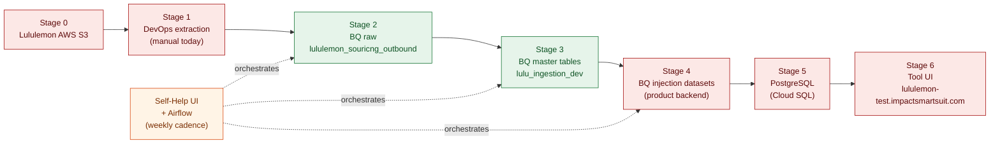

# Lululemon Ingestion — End-to-End Playbook

**As of:** 2026-04-27
**Owner:** Ejaz Anwar
**Purpose:** Single source of truth for how Lululemon data flows from their AWS S3 bucket all the way to the tool surface (`lululemon-test.impactsmartsuit.com`). Each stage is annotated with **what we know** (cited) and **what's still a black box** (with the named owner to interview).

> Scope note: this is the **Lululemon-specific** wiring, not a generic "any client" SOP. The next client onboarding will reuse the open-questions list at the bottom as its kickoff agenda.

---

## TL;DR

Six stages, three of them well-documented, three of them thin. The three well-documented stages (raw landing, raw → master, master schema) are where IA's CS team operates today; the three thin stages (S3 hand-off, injection → PostgreSQL, Self-Help / Airflow) are owned by DevOps + Sri Harsha and need an interview pass before we can write the next-client playbook.

**Legend:** green = well-documented today · red = thin (one-line mentions only) · orange = orchestration layer

---

## Reference baseline: Signet (gold-standard implementation)

As of **2026-04-28** we have a stashed snapshot of the production Signet repo at `reference_docs/Signet Reference/{sourcing,ingestion}/` (10 source feeds, ~342 files of SQL + 6 orchestration JSONs). **Lululemon ingestion is being set up to follow Signet** — Signet is the source-of-truth for layout, naming, partitioning, and SQL patterns.

The 11 confirmed IA-platform conventions extracted from that repo are catalogued in [`findings/ia_bq_patterns.md`](ia_bq_patterns.md). Throughout the rest of this playbook, items that *were* black boxes but are now resolved by Signet are marked with `!!! success`. Items still genuinely external (S3 hand-off, Airflow location, PG hop, Self-Help UI) remain `!!! danger`.

**Boundary of what Signet's repo covers**: BigQuery SQL layer only. It does **not** contain Airflow DAGs, schema JSONs, GCS→BQ load configuration, or BQ→PG injection — those still need Sri Harsha + Akib.

---

## Stage 0 — Client → IA hand-off

### What it is

Lululemon's data warehouse is **AWS S3**. Their data lands there from their internal systems. Impact Analytics needs that same data to land inside our GCP project (`lululemon-01042025`) before any of our pipelines can run.

### What we know

| Item | Value |
|---|---|
| Client storage | AWS S3 bucket (Lululemon-owned) |
| IA storage | GCP — project `lululemon-01042025` |
| PC-era mechanism | **Manual DevOps extraction** from S3 → GCS, ad-hoc per-feed |
| Refresh cadence target | **Weekly** (inventory positioning, sales, product/store deltas) |
| Current data freshness | Most feeds up to **September 2025** (one-time catch-up) |

Source: `PROJECT_CONTEXT.md` lines 60, 78, 247, 369–379.

### What we don't know yet

!!! danger "Black box — owner: **Sri Harsha**"
    - Which S3 bucket(s) and prefix layout Lululemon writes to
    - Credentials hand-off (IAM cross-account role? signed URLs? client-side push?)
    - File format on the wire (CSV? Parquet? gzip-CSV?)
    - Schedule the client commits to (do they push EOD weekly? or do we pull?)
    - Whether the manual DevOps process is documented anywhere
    - **Open pitches to Lululemon:** (a) client dumps directly into IA's GCS bucket, (b) API streaming. Neither is committed yet.

---

## Stage 1 — Raw landing in BigQuery

### What it is

Whatever lands from S3 gets loaded as **raw tables** in the `lululemon_souricng_outbound` dataset (note: typo `souricng` is the actual schema name, not a doc bug).

### What we know

| Item | Value |
|---|---|
| Project | `lululemon-01042025` |
| Raw dataset | `lululemon_souricng_outbound` (~300 tables, ~45 are "real", rest are backups/versions/scenarios) |
| Refresh suffix convention | `_20251119` = the major refresh-date suffix; canonical variant when multiple exist |
| "Cleaned" suffix | `_cleaned` or `_cleaned_20251119` indicates a dedup/cleanup pass already done |
| Empty raw tables | `dc_store_mapping`, `anaplan_allocation_calender` (misspelled), `eligibility_new` |
| Spelling traps | `anaplan_allocation_calender` (raw, empty) vs `anaplan_allocation_calendar_cleaned` (populated, "a" vs "e") |

Sources: `PROJECT_CONTEXT.md` lines 99, 162–168, 256, [`findings/dataset_inventory.md`](dataset_inventory.md), [`findings/schema_inventory.md`](schema_inventory.md).

### Canonical raw tables that feed masters (10 of ~45)

| Raw table | Rows | Feeds master |
|---|---:|---|
| `product_group_hierarchy_cleaned_20251119` | 11.5M | product_master, transaction_master |
| `product_group_hierarchy_cleaned` (no suffix) | 11.5M | inventory_master |
| `sku_details_cleaned_20251119` | 1.97M | product_master, transaction_master (CTE) |
| `product_attribute_s_20251119` | 86K | product_master |
| `sales_transactions_4y_cleaned_20251119` | ~400M | transaction_master |
| `inventory_snapshot_cleaned` | 63.5B | inventory_master |
| `location_group_hierarchy_cleaned_20251119` | 1,853 | store_master, transaction_master (transitive) |
| `location_details_cleaned_20251119` | 1,853 | store_master |
| `promotional_events_cleaned` | 448K | events_master |
| `calendar_hierarchy` | 4,746 | fiscal_date_mapping |

Cross-reference: [`findings/raw_to_master_lineage.md`](raw_to_master_lineage.md) Section 3.

### What we don't know yet

!!! warning "Thin — owner: **Sri Harsha** + the Ritik/Shrian Shara raw-data team"
    - The actual load mechanism from GCS files → BigQuery raw tables (bq load? Dataflow? a custom Airflow operator?)

!!! success "Resolved by Signet baseline"
    - **Platform convention is `ia_<feed>` raw table + a `SYNCSTARTDATETIME` column** (not date-suffixed table names). See [`ia_bq_patterns.md`](ia_bq_patterns.md) Section 5. Our `_20251119` table-suffix convention is a **Lululemon-specific deviation** — flag for cleanup before going to weekly cadence.
    - The dataset typo `souricng` (vs Signet's `signet_sourcing_prod`) is also Lululemon-specific. **Cleanup ticket** before downstream queries bake it in.

---

## Stage 2 — Raw → Master tables (the part we own end-to-end)

### What it is

The CS team turns raw tables into **6 master tables** via SQL DDL scripts. This is the layer we have full visibility into.

### What we know — landing zone

The masters were written to `lulu_ingestion_dev` (not the suffixed names hinted at in the DDL). Verified from `__TABLES__` metadata:

| Master | Rows | Size | Built (last_modified) |
|---|---:|---:|---|
| `lulu_ingestion_dev.product_master` | 1,891,494 | 1.08 GB | 2025-12-15 10:43 |
| `lulu_ingestion_dev.transaction_master` | 389,872,378 | 73.5 GB | 2025-12-15 10:48 |
| `lulu_ingestion_dev.inventory_master` | 7,214,258,665 | 790.4 GB | 2025-12-09 08:00 |
| `lulu_ingestion_dev.store_master` | 1,750 | <1 MB | 2025-12-15 10:46 |
| `lululemon_souricng_outbound.events_master` | 433,528 | 22 MB | 2025-09-12 13:46 |
| (calendar) `calendar_hierarchy` / `fiscal_date_mapping` | 4,746 | 1.5 MB | — (no rebuild) |

### What we know — partition / cluster layout

| Table | Partition | Cluster |
|---|---|---|
| `inventory_master` | `date` | `store_code` |
| `transaction_master` | `date` | `channel` |
| `anaplan_transit_calender_cleaned` | `Datestring` | — |
| `anaplan_allocation_calendar_cleaned` | — | `SKU_ID` |
| `assortment_plan_cleaned` | — | `SKU_ID` |

**Rule:** queries on `inventory_master` or `transaction_master` should always filter by `date`.

### What we know — build logic

The DDL scripts live in `reference_docs/Lululemon/Master Table Build Logic/master_table_build_queries_20251119.csv`. The column-by-column audit and the lineage diagram are the canonical references:

- Lineage diagram → [`findings/raw_to_master_lineage.md`](raw_to_master_lineage.md)
- DDL audit → [`findings/master_table_build_logic.md`](master_table_build_logic.md)

**Critical takeaway:** ~44 columns across the 6 masters are **hardcoded NULL/0/constant** in the DDL — they have no raw source. ~70% of issues flagged as "data anomalies" trace back to these stubs, not to dirty raw data. See [`findings/raw_to_master_lineage.md`](raw_to_master_lineage.md) Section 4.

### Suspected build bugs to fix before next refresh

1. `transaction_master.cost / msrp` averaged via CTE over `sku_details_cleaned_20251119` (where COST_PRICE/SELLING_PRICE = 0 for all rows) — kills cost/msrp downstream
2. `inventory_master` filters out pre-2023 raw data (drops 9.3B rows that exist in `inventory_snapshot_cleaned`)
3. `inventory_master` uses `product_group_hierarchy_cleaned` (no `_20251119`) while other masters use the `_20251119` variant — inconsistent snapshot
4. `store_master.active = LOC_CLOSED_IND` — name-vs-meaning mismatch (verified semantically correct, just confusing)

Full ghost-dependency list: [`findings/raw_to_master_lineage.md`](raw_to_master_lineage.md) Section 5.

### What we don't know yet

!!! note "Thin — owner: **Sri Harsha**"
    - **Where** these DDL scripts are registered for execution (Airflow DAG path? Self-Help UI form?)
    - Why `events_master` lives in `lululemon_souricng_outbound` while the other masters live in `lulu_ingestion_dev` — historical accident or by design?

!!! success "Resolved by Signet baseline"
    - **Build artifacts are standalone `.sql` files**, one per feed, with paired `_historic.sql` for backfill. Signet ships ~10 of these in `sourcing/`. Lululemon's master-build SQL (currently inline in `findings/master_table_build_logic.md`) needs to be promoted to the same file shape under `queries/master_build/` before going weekly. See [`ia_bq_patterns.md`](ia_bq_patterns.md) Section 1.
    - **Steady-state pattern** is build-temp → `MERGE` upsert → `DROP temp`, NOT `CREATE OR REPLACE` (our current style). See [`ia_bq_patterns.md`](ia_bq_patterns.md) Section 2.
    - **Date windows** are driven by a `mapping` config table inside the dataset, not hard-coded. We need a `lulu_ingestion_dev.mapping` table. See [`ia_bq_patterns.md`](ia_bq_patterns.md) Section 3.
    - **Physical layout** = `PARTITION BY DATE(SYNCSTARTDATETIME) CLUSTER BY <high-card>` is the standard. See [`ia_bq_patterns.md`](ia_bq_patterns.md) Section 4.

---

## Stage 3 — Master → Injection datasets

### What it is

Master tables get further transformed into **"injection datasets"** — the BigQuery tables that match the schema the product backend expects. These are the last BQ-resident stop before data is shipped to PostgreSQL.

### What we know

> "Injection datasets (product backend tables)" — from `PROJECT_CONTEXT.md` line 66.
>
> "Computation: Happens in BigQuery during ingestion, then data is copied from GCP to PostgreSQL and inserted there" — line 76.

That's it. We have one line.

### What we don't know yet

!!! danger "Black box — owner: **Sri Harsha** / **Akib Khan**"
    - Which dataset name(s) hold the injection tables
    - Whether they're 1:1 with masters or further denormalized / aggregated
    - The transformation logic from master → injection (DDL? stored proc? dbt? Airflow task?)
    - Schemas (column names + types as the product backend expects them)
    - Whether injection tables are versioned per refresh

---

## Stage 4 — Injection → PostgreSQL (Cloud SQL)

### What it is

The product (Forecast Smart, Size Smart) is **not powered by BigQuery** — it queries a PostgreSQL instance running on Cloud SQL. Data has to be copied across the GCP→Cloud SQL boundary on each refresh.

### What we know

| Item | Value |
|---|---|
| Tool DB | PostgreSQL on Cloud SQL |
| Cost rationale | "PostgreSQL is free for number of hits; runs on a snapshot from Cloud SQL" |
| Sync mechanism | "Data is copied from GCP to PostgreSQL and inserted there" |

Source: `PROJECT_CONTEXT.md` lines 67–77.

### What we don't know yet

!!! danger "Black box — owner: **Akib Khan** + DevOps"
    - The actual sync tool (Datastream? federated queries? a custom export → COPY job?)
    - PG schema (database name, schemas, tables — does it mirror injection 1:1?)
    - Snapshot mechanism on the Cloud SQL side ("runs on a snapshot from Cloud SQL" — read replica? PITR?)
    - Reload semantics — full refresh vs incremental? How are deltas applied?
    - Connection details for the tool to read from PG

---

## Stage 5 — Tool surface

### What it is

The end users (Lululemon planners, IA reviewers) interact with one of three environments. Each environment has its own URL backed by its own PostgreSQL instance.

### What we know

| Environment | URL | Purpose |
|---|---|---|
| **UAT** (current) | `lululemon-test.impactsmartsuit.com` | Where Forecast Smart is built today |
| **Dev** | `lululemon-devs.impactsmartsuit.com` | Internal IA dev / debug |
| **Prod** (future) | `lululemon.impactsmartsuit.com` | Post-go-live |

Source: `PROJECT_CONTEXT.md` lines 81–86.

### What we know — current product status

- **Forecast Smart:** built and live in UAT
- **Size Smart:** not enabled in UAT yet; supposed to be in test
- **Inventory Smart:** declined by Lululemon

### What we don't know yet

!!! note "Thin — owner: **Uttkash** / Akib Khan"
    - Which Lululemon personas have access to UAT today
    - The auth model (SSO? local accounts?)
    - How config/parameters get pushed into the tool (separate from data ingestion?)

---

## Stage 6 — Orchestration & refresh cadence

### What it is

The whole pipeline (Stages 1–4) is meant to run on a **weekly** schedule, orchestrated by **Airflow**, with a **Self-Help UI** sitting in front of Airflow that lets someone create tables and set execution order without touching DAG code.

### What we know

| Item | Value |
|---|---|
| Orchestrator | Apache Airflow |
| Front-end | Self-Help UI (lets you "create tables, set execution order") |
| Cadence target | Weekly |
| What needs refreshing weekly | Inventory positioning, sales data, product/store deltas |

Source: `PROJECT_CONTEXT.md` lines 78–79.

### What we don't know yet

!!! danger "Black box — owner: **Sri Harsha**"
    - Where Self-Help UI lives (URL? Internal IA tool?)
    - Whether DAGs are parameterized per-client or hand-rolled per-client
    - DAG names for the Lululemon pipelines (so we can find them when something fails)
    - How a new feed/table is added — UI form, or PR to a repo?
    - Whether the weekly refresh is currently running, or paused since the PC

!!! success "Resolved by Signet baseline"
    - **Failure/completion notifications** = HTTPS POST to an internal Cloud Run service (`core-backend-*.run.app/api/v2/notifications/send_email`) with a JSON payload listing recipients. See [`ia_bq_patterns.md`](ia_bq_patterns.md) Section 10. Lululemon needs a `lululemon_completion_mail.json` registered with project-specific recipients. **Open Sri Harsha question narrows to: is the Cloud Run service multitenant and where is the registration form?**

---

## Data scope — what flows through the pipe

### IA Data Requirements catalog (21 feeds, must-have priority)

The full catalog is in `PROJECT_CONTEXT.md` lines 200–222. Summary of must-haves:

| # | Feed | Forecasting | Size Smart |
|---|---|---|---|
| 1 | Location Master | Must Have | Must Have |
| 2 | Product Master | Must Have | Must Have |
| 3 | Fiscal Calendar | Must Have | Must Have |
| 4 | Inventory Data | Must Have | Must Have |
| 5 | Transaction Data | Must Have | Must Have |
| 11 | Product Time Dependent Attributes | Must Have | Good to Have |
| 12 | SKU-Store Allocation Eligibility | Must Have | Must Have |
| 10 | Product Attributes | Good to Have | Must Have |
| 18 | Store Level Buy Qty | No | Must Have |
| 19 | Size Range Library | No | Must Have |
| 20 | Buy Season Calendar | No | Must Have |
| 21 | StyleColor-Store Buy Eligibility | No | Must Have |

**5 common must-haves** (1–5), **2 Forecasting-only** (11, 12), **5 Size-only** (10, 18–21).

### Client Data Checklist mapping (39 rows)

The internal checklist that maps each requested feed → the actual BigQuery table in `lululemon_souricng_outbound`. Highlights of what's **present** vs **missing**:

**Present (15 of 39):** Location Master, Product Master, Fiscal Calendar, Inventory, Transaction (`sales_transactions`), Holidays/Closure (`promotional_events`), Purchase Order, Receipts (`transfer_orders_*`), Product Attributes, SKU-Store Eligibility, Allocations (`anaplan_fdod_*`, `min_pres_eol`), Transit (`anaplan_transit_calender`), Store Level Buy Qty (`assortment_plan`), Buy Season Calendar (`calendar_hierarchy`), StyleColor Eligibility, DC-Store Mapping (`dc_store_mapping_cleaned`).

**Critical missing must-haves:**

- **Product Time Dependent Attributes** (Forecasting Must Have)
- **Size Range Library** (Size Smart Must Have)
- **Location Attributes** (Good to Have)
- **Product DC Mapping** (in dict but no data)

Full mapping: `PROJECT_CONTEXT.md` lines 258–298.

---

## Phase timeline & sign-off gates (Wk1–Wk16)

The current implementation timeline (from `LL Forecasting and Sizing Timelines.xlsx`) front-loads ingestion in the first 16 weeks. Sign-off-bearing gates are bolded.

| Wk | Activity | Owner | Sign-off artifact (best-effort) |
|---|---|---|---|
| 1 | Steering committee kick-off | Both | Kick-off deck |
| 1 | Sample data for all datasets (Lululemon) | Lululemon | S3 manifest of sample files |
| 2–3 | **Sample data verification & sign-off** | IA (CS) | ❓ Sample-EDA report (template TBD) |
| 4–5 | Historical data transfer (Lululemon) | Lululemon | S3 / GCS bulk load |
| 5–8 | **Data checks and queries (IA)** ← **YOU ARE HERE** | IA (CS) | EDA findings docs (this site) |
| 7–9 | **Data query resolution & sign-off** | Both | ❓ Resolved-issues log |
| 9 | **Sign off on transfer mechanism & frequency** | Both | ❓ Transfer-mechanism MoU |
| 9–16 | **Data ingestion & daily feed setup** | IA (DevOps) | ❓ Airflow DAGs running on weekly schedule |
| 5–10 | InventorySmart design sessions | Both | (declined for Lulu — N/A) |
| 9–20 | Product configuration & internal testing | IA | UAT environment ready |
| 5–6 | Forecast design sessions | Both | Forecast spec |
| 8–17 | Forecast breakdown & consumption (SKU Store) | IA | Forecast outputs in UAT |
| 21–24 | SIT | Both | SIT sign-off |
| 25 | Training super users for UAT | IA | Training deck |
| 26–29 | UAT | Lululemon | UAT sign-off |
| 30 | Training all users | IA | — |
| 31 | Deployment & go live | Both | Go-live cutover |
| 32–37 | Hypercare & handover | IA | Hypercare runbook |

The four ❓ gates are documented in the timeline but we don't have a template for what the artifact looks like. **Producing those four templates** is a candidate for the next-client playbook.

Source: `PROJECT_CONTEXT.md` lines 687–707.

---

## Open questions to close (interview list)

Consolidated from every "What we don't know yet" callout above, **after** subtracting items now answered by the Signet baseline. **This is the trimmed agenda for the Sri Harsha / Akib / DevOps walkthrough.**

### Sri Harsha — still genuinely external (Stages 0, 1, 2, 6)

1. S3 bucket layout, credentials, file format, schedule (Stage 0 — Signet doesn't cover client hand-off)
2. The actual S3→GCS extraction job — manual today, what's the path to weekly automation?
3. **GCS → BQ raw load mechanism** — Signet shows raw tables exist as `ia_<feed>` but not *how* GCS files become those tables (`bq load`? Self-Help UI? Cloud Function?)
4. **Airflow DAG location** — repo URL + Lululemon-specific DAG name(s). Signet's repo has zero DAG `.py` files, so DAGs live elsewhere.
5. **Self-Help UI** — URL, demo, how a new feed is registered (UI form vs PR vs config table)
6. **`mapping` config table** — who writes to it? Self-Help UI form, manual, or Airflow callback?
7. **Schema JSONs** — where do per-feed BQ schemas live for an existing client? (Signet's repo has none.)
8. Why `events_master` lives in `lululemon_souricng_outbound` instead of `lulu_ingestion_dev`
9. Whether the weekly refresh is currently running for Lululemon, or paused since the PC
10. The `core-backend` notification Cloud Run — is it multitenant, and how do we register Lululemon recipients?

### Akib Khan (Stages 3, 4 — Signet repo gives zero coverage here)

11. Injection dataset name(s), DDL, transformation logic
12. BQ → PostgreSQL sync tool + schema layout on PG
13. Refresh semantics on PG (full reload? deltas?)
14. Snapshot mechanism for PG ("runs on a snapshot from Cloud SQL" — what does this mean operationally?)

### Uttkash (Stage 5)

15. Tool environment access list for Lululemon personas
16. Auth model
17. Config / parameter push mechanism (separate path from data ingestion?)

### Cross-cutting

18. Templates for the 4 sign-off gates (sample-EDA report, resolved-issues log, transfer-mechanism MoU, Airflow-DAG live-on-schedule proof)
19. Whether anything from the **PC-era** ingestion is reusable for the **revival** (April 2026 onwards), or are we starting from scratch?

### Resolved by the Signet baseline (no longer to be asked)

| Was open | Now answered by | Resolution summary |
|---|---|---|
| File-shape of master-build scripts | `Signet Reference/sourcing/create_*.sql` | Standalone `.sql` files, regular + `_historic` pair |
| Steady-state vs backfill pattern | [`ia_bq_patterns.md`](ia_bq_patterns.md) Section Section 1, 2 | Temp-table → MERGE upsert → DROP, with `_historic.sql` for backfill |
| Date-window driver | [`ia_bq_patterns.md`](ia_bq_patterns.md) Section 3 | `mapping` table inside the dataset (still need to know who writes it — Q6 above) |
| Partition / cluster convention | [`ia_bq_patterns.md`](ia_bq_patterns.md) Section 4 | `PARTITION BY DATE(SYNCSTARTDATETIME) CLUSTER BY high-card` |
| Lineage column | [`ia_bq_patterns.md`](ia_bq_patterns.md) Section 5 | `SYNCSTARTDATETIME` is universal — switch from `_20251119` table-suffix |
| Dedup recipe | [`ia_bq_patterns.md`](ia_bq_patterns.md) Section 6 | `ROW_NUMBER() OVER (PARTITION BY <natural key> ORDER BY SYNCSTARTDATETIME DESC)` |
| Numeric type handling | [`ia_bq_patterns.md`](ia_bq_patterns.md) Section 7 | `SAFE_CAST` for every numeric, NULL-on-failure |
| Special-character handling for tool layer | [`ia_bq_patterns.md`](ia_bq_patterns.md) Section 8 | `__ia_char_NN` UDF — apply to every text column surfaced to UI |
| Notification mechanism | [`ia_bq_patterns.md`](ia_bq_patterns.md) Section 10 | HTTPS POST to internal Cloud Run, JSON payload (Q10 above narrows to "is it multitenant?") |
| Naming taxonomy | [`ia_bq_patterns.md`](ia_bq_patterns.md) Section 11 | Two cleanup items — `souricng` typo + raw-table-suffix vs column convention |

---

## Source artifacts

- Project context (single source for most facts above) → `PROJECT_CONTEXT.md`
- **IA platform patterns extracted from Signet** → [`findings/ia_bq_patterns.md`](ia_bq_patterns.md)
- **Signet production repo (read-only baseline)** → `reference_docs/Signet Reference/{sourcing,ingestion}/`
- Lineage diagram (Stage 2) → [`findings/raw_to_master_lineage.md`](raw_to_master_lineage.md)
- DDL audit (Stage 2) → [`findings/master_table_build_logic.md`](master_table_build_logic.md)
- Dataset inventory (Stage 1) → [`findings/dataset_inventory.md`](dataset_inventory.md)
- Schema inventory (Stage 1+2) → [`findings/schema_inventory.md`](schema_inventory.md)
- Ground-truth master DDLs → `reference_docs/Lululemon/Master Table Build Logic/master_table_build_queries_20251119.csv`
- IA SOP template (data checks) → `reference_docs/Lululemon/Project Context Docs/Data Checklist and EDA - Updated.docx`
- Implementation timeline → `reference_docs/Lululemon/Timelines/LL - Forecasting and Sizing Timelines.xlsx`
- Transfer Engine slides → `reference_docs/Lululemon/Output Presentation/Lululemon Transfer Engine Process Overview.pptx`
- Levi's-style alignment template (for client-side data contract) → `reference_docs/Levi's Reference/Levi's - Data Ingestion Alignment Document.md`
