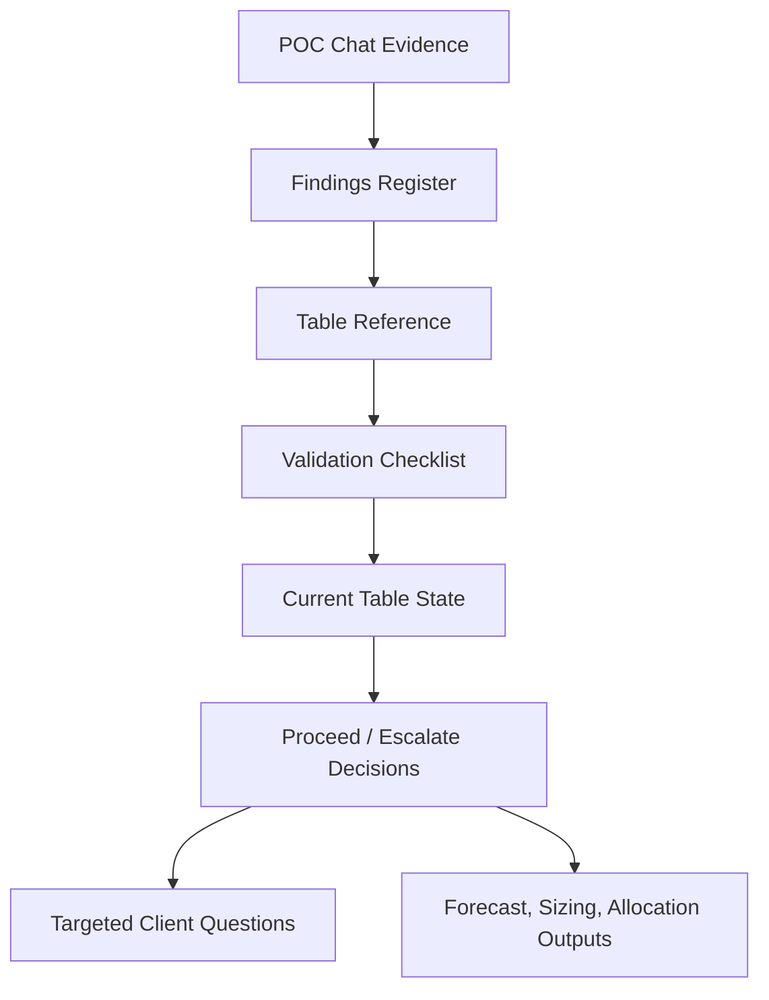

# Lululemon POC Chat Mining Pack

This pack turns the copied POC Google Chat into reusable working memory for the current Lululemon project. It is meant for project onboarding, data readiness checks, forecast/sizing QA, and client-question prep.

## Files In This Pack

| File | Use it for |
|---|---|
| [`lululemon_poc_chat_findings.md`](lululemon_poc_chat_findings.md) | Decisions, assumptions, known issues, and high-level takeaways from the POC chat. |
| [`lululemon_poc_chat_table_reference.md`](lululemon_poc_chat_table_reference.md) | Table names, grains, join keys, version caveats, and table pitfalls mentioned in the chat. |
| [`lululemon_poc_chat_validation_checklist.md`](lululemon_poc_chat_validation_checklist.md) | Read-only validation checks for product, transaction, inventory, price, discount, forecast, LSI, and events. |
| [`lululemon_poc_chat_client_questions.md`](lululemon_poc_chat_client_questions.md) | Client-facing questions and internal caveats derived from unresolved POC issues. |

## Suggested Reading Order

1. Start with [`lululemon_poc_chat_findings.md`](lululemon_poc_chat_findings.md) to understand the main decisions and risks.
2. Use [`lululemon_poc_chat_table_reference.md`](lululemon_poc_chat_table_reference.md) when choosing a table or debugging a join.
3. Run checks from [`lululemon_poc_chat_validation_checklist.md`](lululemon_poc_chat_validation_checklist.md) before refreshing metrics, deck numbers, or final outputs.
4. Pull questions from [`lululemon_poc_chat_client_questions.md`](lululemon_poc_chat_client_questions.md) only after the validation checks show which gaps are still real.

## Highest-Impact Current Reuse

### Data Readiness

Prioritize these checks before trusting refreshed tables:

- Transaction weekly trend by geography/channel.
- Inventory min/max date and weekly totals, especially against `inventory_master_old` if available.
- Product master vs planned-sales style option coverage.
- Price book MSRP outliers and future discount table bounds.

### Forecast And Allocation

Before comparing IA forecast against Lululemon forecast:

- Confirm the authoritative client forecast table, likely `anaplan_demand_forecast_cleaned`, not `inseason_demand_forecast_20251119` unless re-confirmed.
- Confirm the horizon, especially whether the analysis uses 16 future weeks, 20 future weeks, or 10 holdout weeks plus future weeks.
- Use `future_discount_selection_v2` only after checking grain, week range, and discount bounds.
- Keep week-level forecast as source of truth unless day-level output has been explicitly regenerated and QAed.

### Sizing

Before final sizing outputs:

- Confirm PSS / planning style size grain is still accepted.
- Quantify missing planned-sales style options from product master.
- Verify size range source, especially `planned_sales_20251119` and `planned_size_range`.
- Treat 2024 size-curve comparisons as recalculation work unless the table has since been created.

## Key POC Lessons To Keep Visible

- Many issues were feed or table-version issues, not model defects.
- Inventory needed multiple fixes and had both duplicate aggregation and partial-feed problems.
- Transaction refreshes changed historical sales enough to affect downstream outputs.
- Planned sales and product master did not fully align.
- Discount table logic affected forecasts materially and required store-level grain plus `workstream IS NOT NULL`.
- Price book anomalies could create unrealistic forecast spikes.
- Lululemon often confirmed data was "as-is"; that should be documented as source-truth caveat, not forgotten.

## Recommended Current Workflow

## Minimal Go / No-Go Gate

Before publishing any current forecast, sizing, or allocation output, the team should be able to answer:

1. Which table versions were used?
2. What are their min/max dates or week ranges?
3. Did product, transaction, inventory, price, eligibility, forecast, and planned-sales tables come from the same refresh cycle?
4. What filters define in-scope demand and stores?
5. Which known POC caveats still apply?
6. Which client assumptions were confirmed vs carried forward?

## Maintenance Notes

- Add new findings to the specific file they belong in, then update this index only if a new artifact is added.
- When a table is replaced or renamed, update the table reference and any related validation query in the same pass.
- When a client answers one of the questions, move it from open question to decision/assumption in the findings register.
