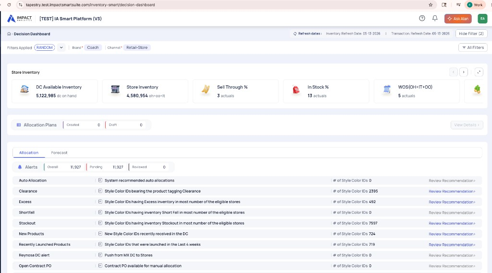
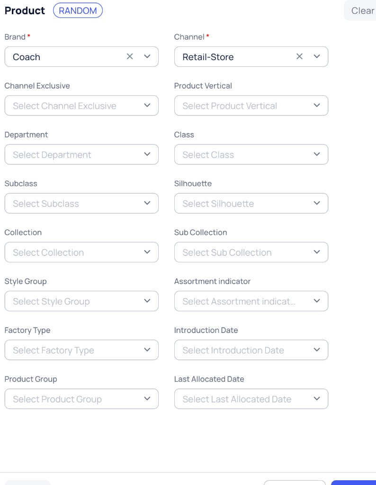
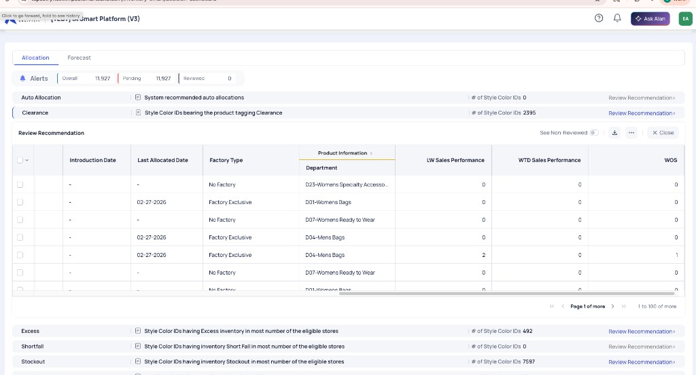
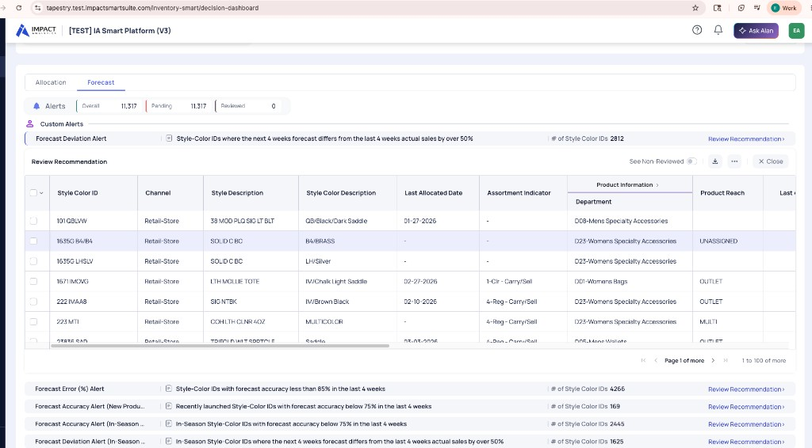
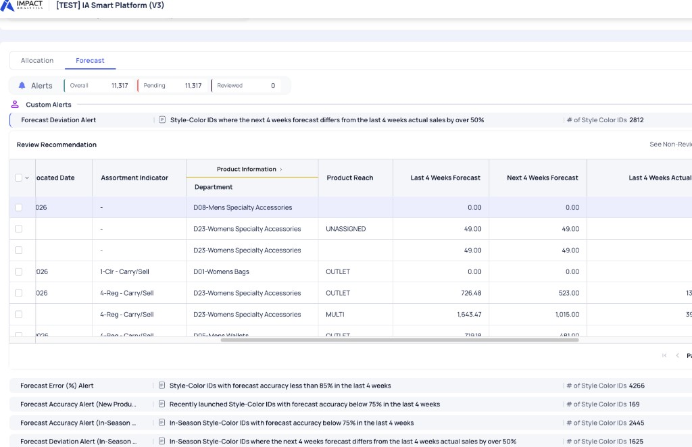
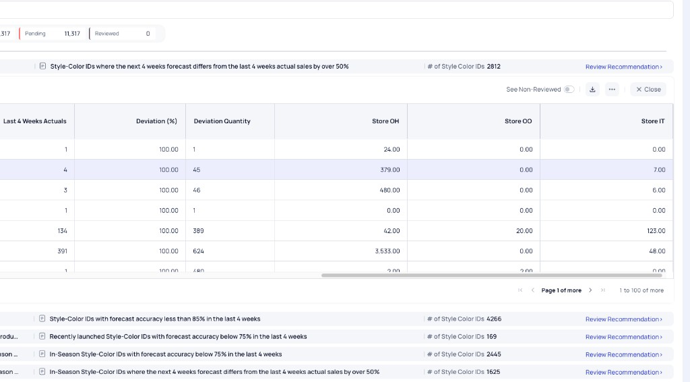

# Decision Dashboard — UI Walkthrough

`Last updated: 2026-05-22`

**Purpose:** UI walkthrough of the Inventory Smart **Decision Dashboard** — mapped to platform behaviour and data sources.

**Reference env:** Tapestry TEST (Coach / Retail-Store) · IA Smart Platform V3

**Confluence:** [Decision Dashboard Handbook](https://impactanalytics.atlassian.net/wiki/spaces/IA/pages/1484390440/Decision+Dashboard+Handbook)

**Handbook mirror:** `reference_docs/Lululemon/InventorySmart_Handbook/` · user story `2696611453`



---

## On this page

1. [Overview](#1-overview)
2. [Page layout](#2-page-layout-top--bottom)
2.1. [Product filters](#21-product-filters-all-filters--product-panel)
3. [KPI carousel](#3-kpi-carousel)
4. [Allocation Plans](#4-allocation-plans)
5. [Alerts](#5-alerts) — shared pattern → Allocation tab → Forecast tab
6. [Details table](#6-details-table)
7. [Data sources (Lululemon)](#7-data-sources-lululemon)
8. [Reference](#8-reference)

---

## 1. Overview

The Decision Dashboard is the **landing page** after login. It answers:

1. **How healthy is inventory?** → KPI cards
2. **What needs attention?** → Alerts (Allocation | Forecast tabs)
3. **What can I act on?** → Plans, drill-downs, Create New Allocation / ADA

**Filter rule:** Brand, channel, and hierarchy chips scope **everything** on the page — KPIs, alerts, and the details table all recompute when filters change.

---

## 2. Page layout (top → bottom)

| Zone | What you see | Notes |
|------|--------------|-------|
| **Platform chrome** | TEST banner, Ask Alan, left nav → Decision Dashboard | Default allocator entry point |
| **Header** | Refresh dates, Hide Filter, All Filters | Inventory + Transaction as-of dates |
| **Filter chips** | Brand, Channel, hierarchy | `fc_name`: InventorySmartDashboard |
| **KPI carousel** | Scrollable metric tiles | From `Article_inventory_dashboard` |
| **Allocation Plans** | Created / Draft → View Details | Drafts may purge overnight |
| **Alerts** | Allocation \| Forecast tabs | Overall / Pending / Reviewed |
| **Details table** | Style-color grid (scroll down) | Export, Create Allocation |

---

## 2.1 Product filters (All Filters → Product panel)

Opened from **All Filters** in the header. Scopes **every** dashboard zone (KPIs, alerts, details). Values come from **`global.product_attributes_filter`** (eligible products only). Reference: Tapestry TEST — **Coach** + **Retail-Store**.



**Lululemon OOTB** uses **L0–L4** (+ store S0) instead of Tapestry merch labels (`fc_name`: `InventorySmartDashboard`).

### Filter reference (Tapestry TEST)

| Filter | Req? | What it means | Example dropdown values | Backend column (Tapestry) | Example on one style–color |
|--------|------|---------------|-------------------------|---------------------------|----------------------------|
| **Brand** | Yes | Corporate brand | `Coach`, `Kate Spade` | `l0_name` / `brand` | `Coach` |
| **Channel** | Yes | Product channel (SKU suffix) | `Retail-Store`, `Outlet-Store` | `l1_name` / `channel` | `Retail-Store` |
| Channel Exclusive | No | Plan / selling channel the style is tied to | `Coach Retail`, `Retail ECom`, `Specialty`, `Coach Factory Stores`, `Outlet`, `Outlet ECom` | Plan (`chnl_desc` / exclusivity) | `Coach Retail` |
| Department | No | Merch department | `D04-Mens Bags`, `D11-…`, `D19-…` | `l2_name` | `D04-Mens Bags` |
| Class | No | Category under department | `Handbags`, `Wallets`, … | `l3_name` | `Handbags` |
| Subclass | No | Finer product type | `Crossbody`, `Tote`, … | `l4_name` | `Crossbody` |
| Collection | No | Collection name | `Mothers Day Pearl`, … | `l6_name` ← `COLLECT_DESC` | `Mothers Day Pearl` |
| Style Group | No | Style grouping (`STY_GRP`) | Client style-group labels | `l8_name` ← `STY_GRP` | (varies) |
| Factory Type | No | Factory vs non-factory | `Factory Exclusive`, `No Factory` | `factory_type` | `Factory Exclusive` |
| Product Group | No | Dept rollup for reporting | From `department_group_mapping` | `Dept_Grouping` | (client rollup) |
| Product Vertical | No | Strategic product line | Vertical code + desc; KS may show `NA` | `product_vertical`, `product_vertical_desc` | `NA` |
| Silhouette | No | Shape / form | `Tote`, `Satchel`, `Crossbody`, … | `l5_name` ← `SILHOUETTE_DESC` | `Tote` |
| Sub Collection | No | Sub-line within collection | `Trompe L'oeil on Signature`, `FLU Fluoro Leather`, … | `l7_name` ← `SUBCOLLECT_DESC` | `Trompe L'oeil on Signature` |
| Assortment indicator | No | In-assortment flag + class | `1-Carry`, `2-Key Item`, … | `assortment_indicator` | `1-Carry` |
| Introduction Date | No | Launch / intro date | `2025-03-15`, `2024-11-01`, `—` | `intro_date` / `launch_date` | `2025-03-15` |
| Last Allocated Date | No | Last allocation run date | `02-27-2026`, `01-15-2026`, … | `last_allocation_date_table` | `02-27-2026` |

### Panel controls

| Control | Behavior |
|---------|----------|
| **RANDOM** | TEST helper — fills filters with random valid values |
| **Clear** | Resets all Product panel dropdowns |
| **Apply** | Recomputes KPIs, alerts, and details for matching `article`s |

### Grain examples

| Field | Example |
|-------|---------|
| **Style Color ID** (`article`) | `CBH07-D04-Retail-Store` · base `CBH07` = `article_orig` |
| **SKU** (`product_code`) | `12345678901-Retail-Store` (UPC + channel suffix) |
| **Clearance drill-down row** | Dept `D04-Mens Bags` · Channel `Retail-Store` · Last Allocated `02-27-2026` · Product Reach `MULTI` / `OUTLET` / `UNASSIGNED` |

### Lululemon (when not on Tapestry TEST)

| Filter | Example values |
|--------|----------------|
| L0 Name (mandatory) | `lululemon` (client label) |
| L1 Name (mandatory) | Region / channel group per GSM |
| L2–L4 Name | Category tree — not `D04-Mens Bags` |

---

## 3. KPI carousel

Horizontal scroll of tiles. Tapestry TEST shows five; clients configure which appear.

| KPI | Meaning |
|-----|---------|
| DC Available Inventory | DC on-hand available to allocate (ATA) |
| Store Inventory | Store OH + OO + IT |
| Sell Through % | Sales velocity vs on-hand |
| In Stock % | Size integrity (% sizes in stock) |
| WOS (OH+IT+OO) | Weeks of supply at stores |

### KPI deep-dive: WTD Sales Units

Optional client tile · **317,279** actuals (Tapestry example)

| Field | Meaning |
|-------|---------|
| **WTD** | Week-to-date net sales units from fiscal week start through latest transaction refresh |
| **actuals** | Real transactions — not forecast |

- **Aggregation:** `SUM(wtd_sales_units)` at filter level from `Article_inventory_dashboard`
- **Source:** `transaction_master` · `qty` where date ∈ current fiscal week
- **Related tiles:** LW Sales Units (`sales_1_ago`), Sales Units L4W

---

## 4. Allocation Plans

| Element | Meaning |
|---------|---------|
| Created / Draft | Intra-day plans not yet finalized |
| View Details > | Review, edit, finalize, or delete drafts |

Unfinalized drafts may be **deleted at start of next day** (client-configurable).

---

## 5. Alerts

### 5.1 Shared pattern (both tabs)

| Control | Meaning |
|---------|---------|
| Overall / Pending / Reviewed | Workflow counters across alert rows |
| Review Recommendation > | Expands **inline table** under that alert row |
| See Non-Reviewed | Filter to unreviewed items |
| Download / ⋯ / Close | Export, column config, collapse |

**Reviewed rule:** Opening Review Recommendation and viewing the drill-down marks items reviewed.

**Pagination:** 100 rows per page (e.g. 1–100 of 2,395).

| Tab | Primary action | Backend |
|-----|----------------|---------|
| **Allocation** | Select rows → **Create New Allocation** | `inventory_smart.alerts_product_level` / `alerts_product_store_level` |
| **Forecast** | Select rows → **Go to ADA Dashboard** | `inventory_smart.forecast_alerts` (weekly refresh) |

Columns are **client-configurable** via `tc_name` per alert in Application Configurator.

---

### 5.2 Allocation tab

**Summary (Tapestry TEST):** Overall 11,927 · Pending 11,927 · Reviewed 0

| Alert | Count | Rule | Backend flag |
|-------|------:|------|--------------|
| Auto Allocation | 0 | System plans pending approval | auto_alloc_alert |
| Clearance | 2,395 | Product tagged clearance | `clearance_alert_flag=1` |
| Excess | 492 | Overstock in most eligible stores | excs_flg |
| Shortfall | 0 | Shortfall in most stores | shrtfl_flg |
| Stockout | 7,597 | Stockout in most stores | stckout_flg |
| New Products | 724 | Recently received at DC | newly_launched_alert_flag |
| Recently Launched | 719 | Launched in last 4 weeks | — |
| Reynosa DC | 0 | Client-specific MX DC push | — |
| Open Contract PO | 0 | Open PO lines for manual allocation | — |

**Exclusivity:** A style-color in Clearance cannot appear in other allocation alerts **except** Auto Allocation and PO/ASN.

#### Clearance drill-down — columns by scroll band



**Band A — Identity & product attributes** (left)

| Column | Meaning |
|--------|---------|
| Style Color ID | Planning grain → `article` |
| Channel | Store channel (Retail-Store) |
| Style / Style Color Description | Product labels |
| Product_tagging | Lifecycle tag (Clearance) |
| Product Reach | OUTLET, MULTI, UNASSIGNED, … |
| Assortment Indicator | Carry/sell class |
| Store Group | Eligibility group |
| Introduction Date | Launch date (— if blank) |

**Band B — Allocation & merch** (scroll right)

| Column | Backend |
|--------|---------|
| Last Allocated Date | `last_allocation_date_table` |
| Factory Type | Product attribute |
| Product Information / Department | Merch department (e.g. D04-Mens Bags) |

**Band C — Sales & inventory** (scroll further right)

| Column | Backend |
|--------|---------|
| LW Sales Performance | `sales_1_ago` |
| WTD Sales Performance | `wtd_sales_units` |
| WOS | `wos` |

**Example row:** D04-Mens Bags — Last Allocated 02-27-2026, LW 2, WTD 0, WOS 1.

---

### 5.3 Forecast tab



**Summary (Tapestry TEST):** Overall 11,317 · Pending 11,317 · Reviewed 0

| Alert | Count | Rule |
|-------|------:|------|
| **Forecast Deviation Alert** | 2,812 | Next 4W forecast vs last 4W actuals **> 50%** |
| Forecast Error (%) Alert | 4,266 | Accuracy **< 85%** last 4 weeks |
| Forecast Accuracy (New Product) | 169 | Recently launched · accuracy **< 75%** |
| Forecast Accuracy (In-Season) | 2,445 | In-season · accuracy **< 75%** |
| Forecast Deviation (In-Season) | 1,625 | In-season · **> 50%** deviation |

**OOTB mapping:** Forecast Deviation Alert ≈ **Recent Deviation** (`recent_deviation_flag=1`, `tc_name`: `recent_deviation_alert_table`).

#### Forecast Deviation drill-down — columns by scroll band

**Band A — Identity** (left): Style Color ID, Channel, Style descriptions, Last Allocated Date, Assortment Indicator, Department, Product Reach

**Band B — Forecast quantities** (scroll right)



| Column | Field |
|--------|-------|
| Last 4 Weeks Forecast | `past_4_weeks_forecast` |
| Next 4 Weeks Forecast | Forward 4-week total (used in rule) |
| Last 4 Weeks Actual / Actuals | `past_4_weeks_actual` |

**Band C — Deviation & store inventory** (scroll further right)



| Column | Field / meaning |
|--------|-----------------|
| Deviation (%) | `forecast_deviation` |
| Deviation Quantity | ≈ Next 4W Forecast − Last 4W Actuals |
| Store OH / OO / IT | `oh`, `oo`, `it` |

**Example rows:**

| Actuals | Dev % | Dev Qty | OH | Read |
|--------:|------:|--------:|---:|------|
| 4 | 100% | 45 | 379 | 49 − 4; high OH, weak sell-through |
| 391 | 100% | 624 | 3,533 | 1,015 − 391; fix forecast + consider allocation hold |

---

## 6. Details table

Below the alerts section. Style-color grain.

| What it shows | Purpose |
|---------------|---------|
| Sales (LW, L4W, L8W), OH/IT/OO, DC inv, WOS | Full choice-level snapshot |
| Choice Status store counts | Excess / Normal / Shortfall / Stockout per choice |
| Row select + Create Allocation | Opens CNA with choices pre-selected |

---

## 7. Data sources (Lululemon)

| UI area | Depends on |
|---------|------------|
| KPIs + Details | `inventory_master`, `product_master`, `store_master`, `transaction_master`, forecast feeds |
| Allocation alerts | `Article_inventory_dashboard`, `alerts_product_*` |
| Forecast alerts | `forecast_alerts`, MFP if integrated |
| Filters | PG `product_attributes_filter`, `store_attributes_filter` |

Ingestion quality issues surface here as wrong KPIs or empty alerts.

---

## 8. Reference

### User flow

```text
Login → Filters → KPIs → Plans → Alerts → Review Recommendation
  Allocation tab → Create New Allocation → Finalize
  Forecast tab → Go to ADA Dashboard → adjust forecast
```

### Glossary

| Term | Meaning |
|------|---------|
| OH / IT / OO | On hand / In transit / On order |
| WOS | Weeks of supply |
| Style Color ID | Planning choice (style–color) |
| ATA | Available to allocate (DC) |

### Client config vs OOTB

| Varies by client | Usually stable |
|------------------|----------------|
| Alert names, KPI tile set, WOS thresholds | Page layout, tab structure, drill-down pattern |
| Column labels (`tc_name`) | `Article_inventory_dashboard` as core feed |

### Build checklist

- [ ] Refresh dates match last ingestion
- [ ] Filters recompute KPIs + alerts
- [ ] Allocation + Forecast alert rows match config
- [ ] Drill-down columns match signed user story
- [ ] CNA / ADA handoff works from drill-down

---

## Changelog

| Date | Change |
|------|--------|
| 2026-05-22 | **Product filters** — All Filters Product panel with example values (Tapestry TEST) |
| 2026-05-21 | **Restructured** — outline, deduped drill-downs, column scroll bands |
| 2026-05-21 | Forecast + Clearance drill-down content from Tapestry TEST screenshots |
