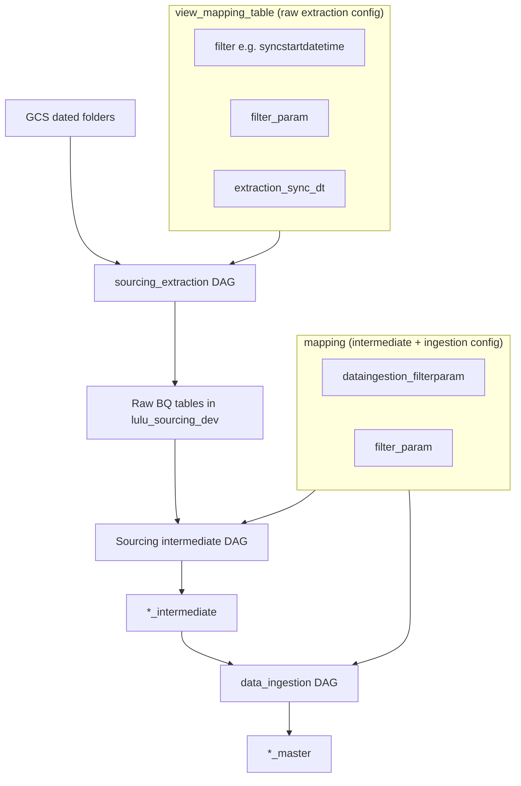
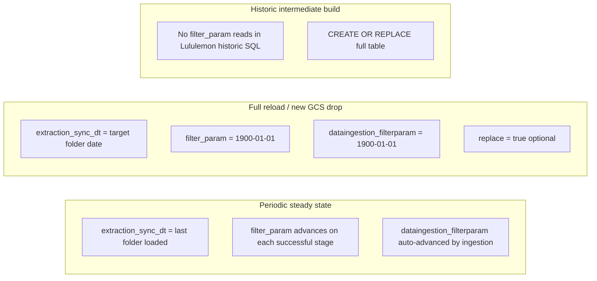

# Platform Checkpoint Columns: Validated Definitions

`Last updated: 2026-06-29.`

Reference for IA Platform mapping columns used in sourcing and ingestion pipelines. Researched from DI Course 3, Confluence (ISP), Lululemon operational evidence, and multi-client SQL patterns.

---

## Source hierarchy (most to least authoritative)

| Rank | Source | What it covers |
|---|---|---|
| 1 | [DI Course 3: Ingestion Basics](../reference_docs/Training/DI_Course_3_Ingestion_Basics_for_Analytics_Teams.md) (lines 760-810, 2207-2209) | Official training definitions for `dataingestion_filterparam` and `view_mapping_table.filter_param` |
| 2 | [Confluence: Sourcing pipeline Prerequisite](https://impactanalytics.atlassian.net/wiki/spaces/ISP/pages/778928129/Sourcing+pipeline+Prerequisite) (2022, still current) | Original combined-mapping definitions separating sourcing vs ingestion checkpoints |
| 3 | [Confluence: Data Ingestion Client onboarding checklist](https://impactanalytics.atlassian.net/wiki/spaces/ISP/pages/904626177) (2024) | Authoritative DDL: which table owns which column |
| 4 | [Confluence: API Contracts for Sourcing](https://impactanalytics.atlassian.net/wiki/spaces/ISP/pages/910885035) | Platform API treats all three as updatable mapping fields |
| 5 | Lululemon operational evidence | [ia_platform_mapping_table_lulu_dev.csv](../reference_docs/Lululemon/ia_platform_mapping_table_lulu_dev.csv), [sourcing_pre_ingestion_baseline_20260625.md](sourcing_pre_ingestion_baseline_20260625.md), Airflow logs from Jun 25/30 runs |
| 6 | Multi-client SQL (Signet, FIGS, Tapestry EU) | Confirms runtime behavior when formal docs are silent |

**Not available:** Gmail (no Gmail MCP in workspace). No additional Confluence page defines `extraction_sync_dt` in prose; only schema/API references exist.

---

## Where the columns live (current platform schema)

The platform split the old single `mapping` table into two BQ config tables (Confluence onboarding checklist, 2024):



| Column | Table | Type on Lululemon |
|---|---|---|
| `extraction_sync_dt` | `view_mapping_table` only | DATETIME |
| `filter_param` | **Both** `view_mapping_table` and `mapping` | DATETIME (view) / TIMESTAMP (mapping) |
| `dataingestion_filterparam` | `mapping` only | DATETIME |

The platform UI CSV export ([ia_platform_mapping_table_lulu_dev.csv](../reference_docs/Lululemon/ia_platform_mapping_table_lulu_dev.csv)) shows all three on one row because it joins both tables.

Related column: `filter` (on `view_mapping_table`) is the **name** of the lineage column on raw rows (almost always `syncstartdatetime`), not a checkpoint value.

---

## Column 1: `dataingestion_filterparam`

### Official definition

> Stores the datetime value for the latest data synced for **ingestion**.

Source: DI Course 3, line 777.

Older Confluence wording (same meaning, more explicit about pipeline split):

> Contains the datetime value at which the latest data started to sync. **Used for the data ingestion pipeline.**

Source: [Sourcing pipeline Prerequisite](https://impactanalytics.atlassian.net/wiki/spaces/ISP/pages/778928129), item xi.

### What it represents

A **checkpoint for the ingestion layer** (intermediate tables → master tables via `data_ingestion` DAG and GSM/QC). It answers: "What is the latest datetime the ingestion pipeline has already processed?"

### What the pipeline looks for

- **Ingestion DAG:** Uses this to pull only rows from intermediate tables that are newer than the checkpoint (platform-managed; not hand-written in Lululemon SQL).
- **Periodic intermediate SQL (fallback):** When `mapping.filter_param` is null, Lululemon periodic builds use `COALESCE(filter_param, TIMESTAMP(dataingestion_filterparam))` as the active watermark ([lululemon_periodic_sourcing_setup.md](lululemon_periodic_sourcing_setup.md), line 36).
- **Bootstrap value:** Set at table registration, e.g. `2026-05-01` in the Lululemon mapping CSV for all core feeds.
- **Re-ingest after QC failure:** Must be **reverted** to its previous value before re-running ingestion; the platform auto-advances it on each successful ingest (DI Course 3 FAQ, line 2209).

### Example values (Lululemon)

| Feed | Value | Meaning |
|---|---|---|
| All core feeds (CSV) | `2026-05-01` | Bootstrap checkpoint set at registration |
| Full reload override | `1900-01-01` | Reset so all rows pass incremental gates downstream |

---

## Column 2: `filter_param`

### Official definition

> Holds the latest sync datetime for **sourcing**.

Source: DI Course 3, line 797 (documented on `view_mapping_table`).

Older Confluence wording:

> Contains the datetime value at which the latest data started to sync. **Used for the data sourcing pipeline.** Null for views where `pull_type = 'full'`.

Source: [Sourcing pipeline Prerequisite](https://impactanalytics.atlassian.net/wiki/spaces/ISP/pages/778928129), item xii.

Works with the `filter` column (e.g. `syncstartdatetime`) so the pipeline "only extracts new or updated data after each run" (DI Course 3, line 809).

### What it represents

An **incremental watermark**: the latest lineage timestamp already processed at a given pipeline stage. There are **two instances** with different scopes:

| Instance | Table | Stage | Answers |
|---|---|---|---|
| Extraction checkpoint | `view_mapping_table.filter_param` | GCS/SFTP/Snowflake → raw BQ | "What is the latest `SYNCSTARTDATETIME` already extracted into raw BQ?" |
| Intermediate checkpoint | `mapping.filter_param` | Raw BQ → `*_intermediate` | "What is the latest `SYNCSTARTDATETIME` / `SNAPSHOT_TIME` already merged into intermediate?" |

### What the pipeline looks for

**Extraction (platform DAG, not client SQL):**

- Compares raw-row lineage (`filter` column, typically `syncstartdatetime`) against `view_mapping_table.filter_param`.
- Incremental predicate conceptually: `syncstartdatetime > filter_param`.
- For GCS file-based sources, `SYNCSTARTDATETIME` is derived from filename timestamp, or from the **folder name** (`YYYY-MM-DD`) if the filename has no timestamp (DI Course 3, lines 680-683, 726-729).

**Intermediate periodic SQL (Lululemon):**

- Reads `COALESCE(mapping.filter_param, TIMESTAMP(dataingestion_filterparam))`.
- Filters with **`>`** on lineage columns:
  - Inventory: `SNAPSHOT_TIME > filter_param`
  - Product/store/transaction: `SYNCSTARTDATETIME > filter_param`
- After a successful periodic MERGE, platform ops should advance `mapping.filter_param` (and matching `view_mapping_table.filter_param`) to the max processed timestamp ([lululemon_periodic_sourcing_setup.md](lululemon_periodic_sourcing_setup.md), line 113).

**Full reload pattern:** Reset both `filter_param` instances to `1900-01-01` alongside `dataingestion_filterparam` reset ([sourcing_pre_ingestion_baseline_20260625.md](sourcing_pre_ingestion_baseline_20260625.md), lines 40-43).

### Example values (Lululemon CSV)

| Feed | `view_mapping.filter_param` | Notes |
|---|---|---|
| `inventory_snapshot` | `2026-05-08` | Matches `extraction_sync_dt`; raw rows all stamped `2026-05-08` |
| `product_group_hierarchy` | `2026-05-19T09:21:05` | **Ahead of** `extraction_sync_dt` (`2026-05-08`): intermediate processing ran further than last GCS extract |
| `sales_transactions` | `2026-05-19T09:23:11` | Same pattern |

**Active checkpoint formula** (when debugging which value drives intermediate builds):

```sql
COALESCE(m.filter_param, TIMESTAMP(m.dataingestion_filterparam), TIMESTAMP(v.filter_param))
```

Source: [inventory_sourcing_stepwise.sql](../queries/inventory_sourcing_stepwise.sql), lines 183-186.

---

## Column 3: `extraction_sync_dt`

### Official definition

**No prose definition exists in Confluence or DI Course 3.** It appears only in:

- `view_mapping_table` DDL ([Client onboarding checklist](https://impactanalytics.atlassian.net/wiki/spaces/ISP/pages/904626177))
- Platform API payload ([API Contracts for Sourcing](https://impactanalytics.atlassian.net/wiki/spaces/ISP/pages/910885035))

### Validated operational definition (inferred from schema placement + runtime evidence)

> The platform-recorded datetime of the **last GCS dated-folder batch successfully extracted** into raw BQ. It drives **which `YYYY-MM-DD/` folder prefixes** the extraction DAG scans on the next run, and aligns with the `SYNCSTARTDATETIME` stamped on landed raw rows when folder-based dating is used.

### What the pipeline looks for

**GCS folder discovery (`sourcing_extraction_1` DAG):**

- Files are organized as `YYYY-MM-DD/<view>_*.csv` (DI Course 3, lines 660-674).
- The DAG scans dated GCS folder prefixes starting from **`extraction_sync_dt + 1 day`** forward (observed in Jun 30 Airflow logs: with cursor at `2026-06-25`, it looked for `2026-06-26/` through `2026-06-30/` and skipped `2026-06-25/`).
- On successful load from folder `2026-06-25/`, raw rows get `SYNCSTARTDATETIME = 2026-06-25T00:00:00` and `extraction_sync_dt` advances to that date.

**Relationship to `filter_param`:**

- Often equal after a clean extract (inventory: both `2026-05-08`).
- Can **diverge** when intermediate processing advances `filter_param` but no new GCS extract has occurred (product feeds: `extraction_sync_dt = 2026-05-08`, `filter_param = 2026-05-19`).

**Full reload / point-in-time load:**

- Set `extraction_sync_dt` to the **target drop folder date** (e.g. `2026-06-25`) to tell extraction which dated folder to pull.
- Reset `filter_param` and `dataingestion_filterparam` to epoch (`1900-01-01`) so downstream incremental gates do not skip rows.

**Signet client pattern (batch pin, not incremental):** Some feeds read `extraction_sync_dt` from `mapping` and filter with `SYNCSTARTDATETIME = filter_param` (exact batch match), not `>` ([create_mfp.sql](../reference_docs/Signet%20Reference/sourcing/create_mfp.sql)).

### Example values (Lululemon)

| Scenario | `extraction_sync_dt` | Effect |
|---|---|---|
| Steady state (CSV) | `2026-05-08` | Raw BQ tables all stamped `2026-05-08`; matches `Historic/s3_to_gcs/2026-05-08/` batch |
| Planned replace run | `2026-06-25` | Target `gs://client_data_lululemon/2026-06-25/` folder |
| Jun 30 failed run | Already past `2026-06-25` | DAG scanned `2026-06-26+` only; found `prefixes: []`; **no load** despite Airflow SUCCESS |

---

## How the three interact across load modes



| Load mode | `extraction_sync_dt` | `filter_param` | `dataingestion_filterparam` |
|---|---|---|---|
| **Periodic incremental** | Last loaded GCS folder date | Watermark; `>` predicate on lineage | Fallback if `filter_param` null; auto-advanced by ingestion |
| **Historic first build** | Set to initial batch | Often null or bootstrap | Bootstrap date (e.g. `2026-05-01`) |
| **Full replace / re-stage** | Set to **target folder date** | Reset to `1900-01-01` | Reset to `1900-01-01` |
| **Signet batch-pin feeds** | Exact batch selector | Read as `extraction_sync_dt`; `=` not `>` | Separate ingestion checkpoint |

---

## Worked example: Lululemon Jun 25/30 extraction runs

### Context

Eight new feeds were copied to `gs://client_data_lululemon/2026-06-25/` (674 CSV files, ~743.6 GB). A manual extraction run on **2026-06-30** (`sourcing_extraction_1`, run `manual__2026-06-30T17:22:29`) marked all Airflow tasks SUCCESS but loaded **zero rows** for any feed.

### Config state before the failed run

From [sourcing_pre_ingestion_baseline_20260625.md](sourcing_pre_ingestion_baseline_20260625.md):

- Raw tables stamped `SYNCSTARTDATETIME = 2026-05-08` (prior batch).
- `view_mapping_table.extraction_sync_dt = 2026-05-08` (or already advanced past `2026-06-25` from an earlier partial run).

### Intended replace-run config

To load the new folder:

| Column | Target value | Why |
|---|---|---|
| `extraction_sync_dt` | `2026-06-25` | Point extraction at the dated GCS folder |
| `filter_param` | `1900-01-01` | Do not skip rows by incremental watermark |
| `dataingestion_filterparam` | `1900-01-01` | Same for downstream gates |
| `replace` | `true` | Overwrite raw tables instead of append |

### What went wrong (Jun 30)

The extraction DAG scans GCS folder prefixes from **`extraction_sync_dt + 1 day`** forward. If `extraction_sync_dt` was already at `2026-06-25` before the run:

- DAG looked for `2026-06-26/`, `2026-06-27/`, ... `2026-06-30/`
- Skipped `2026-06-25/` where the files actually live
- Log showed `prefixes: []` for every feed
- Airflow still reported SUCCESS (no folders found is not treated as task failure)

### Successful pattern (Jun 25 reference)

When `extraction_sync_dt` was set correctly for folder `2026-06-25/`:

```
Prefixs looking for : 2026-06-25/
prefixes: ['2026-06-25/']
Row count after loading: 683,582,361  (sales_transactions)
```

Raw `MAX(SYNCSTARTDATETIME)` moved to match the folder date.

### Fix options

1. Reset `extraction_sync_dt` back to `2026-06-24` (or `2026-05-08`) so the next run includes `2026-06-25/`.
2. Copy files to a new dated folder the cursor will scan (e.g. `2026-06-30/`).
3. Manual `bq load` from `gs://client_data_lululemon/2026-06-25/` (bypasses platform cursor logic).

---

## Practical debugging checklist (Lululemon)

When extraction "succeeds" but no data loads:

1. Check `view_mapping_table.extraction_sync_dt`: has the cursor already moved **past** the folder where files live?
2. Check GCS layout: files must be under `gs://client_data_lululemon/YYYY-MM-DD/` (dated folder), not only at bucket root or under `consolidated/`.
3. Compare `MAX(SYNCSTARTDATETIME)` on raw BQ table vs `extraction_sync_dt` vs `filter_param`.
4. For intermediate builds, query the `active_checkpoint` COALESCE from [inventory_sourcing_stepwise.sql](../queries/inventory_sourcing_stepwise.sql).
5. Run [post_extraction_diagnostics.sql](../queries/sourcing/post_extraction_diagnostics.sql) (read-only).

---

## One-line summary

| Column | One-liner |
|---|---|
| `dataingestion_filterparam` | Ingestion-layer checkpoint: latest datetime already processed into master tables |
| `filter_param` | Sourcing-layer incremental watermark (two copies: extraction on `view_mapping_table`, intermediate on `mapping`); pipeline pulls rows where lineage timestamp **>** checkpoint |
| `extraction_sync_dt` | Extraction-layer GCS folder cursor: last (or target) `YYYY-MM-DD/` batch loaded into raw BQ; drives which dated folders the extraction DAG scans next |

---

## Related files

| File | Purpose |
|---|---|
| [lululemon_periodic_sourcing_setup.md](lululemon_periodic_sourcing_setup.md) | Periodic intermediate runbook |
| [sourcing_pre_ingestion_baseline_20260625.md](sourcing_pre_ingestion_baseline_20260625.md) | Pre-reload baseline + config overrides |
| [post_extraction_diagnostics.sql](../queries/sourcing/post_extraction_diagnostics.sql) | Post-DAG checkpoint vs raw table checks |
| [inventory_sourcing_stepwise.sql](../queries/inventory_sourcing_stepwise.sql) | Active checkpoint COALESCE query |
