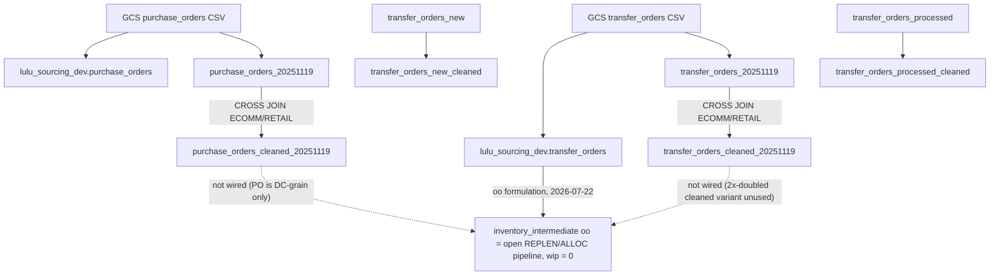

# PO and Transfer Orders Cleaning Audit

`Audit date: 2026-07-16` · `Project: lululemon-01042025`

Scope: all purchase-order and transfer-order variants in `lululemon_souricng_outbound`, plus the newly landed raw tables in `lulu_sourcing_dev`.

Sources: recovered BQ job history (`bquxjob_578a087_19e218df505.csv`), `INFORMATION_SCHEMA`, `__TABLES__`, [`schema_inventory.md`](schema_inventory.md), [`gcs_feed_eda_review_20260629.md`](gcs_feed_eda_review_20260629.md), [`master_table_build_logic.md`](master_table_build_logic.md), [`Cleaned Table Builds/README.md`](../reference_docs/Lululemon/Cleaned%20Table%20Builds/README.md).

---

## Executive summary

**Verdict: the POC "cleaning" for PO and transfer orders is minimal and mostly unsafe for direct master use.**

For the canonical Nov 2025 builds (`*_cleaned_20251119`), the only verified transformation is **artificial channel expansion**: every raw row is duplicated for `ECOMM` and `RETAIL` via `CROSS JOIN UNNEST`, with `sku_id_code = CONCAT(SKU_ID, '_', channel)`. There is:

- **No** join to `store_master` or location master for channel (unlike `sales_transactions_4y_cleaned_20251119`)
- **No** type casting in the verified SQL (outbound raw is already typed INT64/DATE)
- **No** deduplication, status filtering, sentinel scrubbing, or grain normalization
- **No** wiring into any master table today (`inventory_master.oo` / `wip` remain hardcoded 0); **update 2026-07-22:** `inventory_intermediate.oo` (a level below `inventory_master`) is now wired to `lulu_sourcing_dev.transfer_orders` in the v2 scripts — see R2 below. `wip` is still unresolved.

**Row impact:** both dated cleaned tables are exactly **2.00×** their raw `_20251119` sources.

**Recommendation:** treat `lulu_sourcing_dev.purchase_orders` and `lulu_sourcing_dev.transfer_orders` as the live raw sources. Do **not** reuse outbound `*_cleaned_20251119` for forecasting or inventory without rebuilding cleaning logic. Derive channel from receiving location via `store_master`, not blind ECOMM/RETAIL duplication.

---

## 1. Verified cleaning SQL (authoritative)

Recovered from BQ job history, author `aniket.nichat@impactanalytics.co`, 2025-11-24.

### Purchase orders

```sql
CREATE OR REPLACE TABLE
  `lululemon-01042025.lululemon_souricng_outbound.purchase_orders_cleaned_20251119` AS
SELECT
  a.*,
  channel,
  CONCAT(a.SKU_ID, '_', channel) AS sku_id_code
FROM lululemon-01042025.lululemon_souricng_outbound.purchase_orders_20251119 a
CROSS JOIN UNNEST(['ECOMM','RETAIL']) AS channel;
```

Job: `bquxjob_31f7ba1a_19ab5bcf745` · Source rows: 10,401,503 · Dest rows: 20,803,006

### Transfer orders

```sql
CREATE OR REPLACE TABLE
  `lululemon-01042025.lululemon_souricng_outbound.transfer_orders_cleaned_20251119` AS
SELECT
  a.*,
  channel,
  CONCAT(a.SKU_ID, '_', channel) AS sku_id_code
FROM lululemon-01042025.lululemon_souricng_outbound.transfer_orders_20251119 a
CROSS JOIN UNNEST(['ECOMM','RETAIL']) AS channel;
```

Job: `bquxjob_15a68ef3_19ab5b1642b` · Source rows: 355,135,587 · Dest rows: 710,271,174

**Not checked into repo:** there is no `purchase_orders_cleaned_20251119.sql` or `transfer_orders_cleaned_20251119.sql` under `reference_docs/Lululemon/Cleaned Table Builds/` (unlike sales, location, and PGH builds).

---

## 2. Table lineage map



---

## 3. Variant inventory

Schema: `lululemon_souricng_outbound` unless noted.

### Purchase orders

| Table | Rows | Size (GB) | Columns | Cleaning status |
|---|---:|---:|---:|---|
| `purchase_orders` | 8,226,768 | 0.90 | 14 | Raw older POC load; no `PO_LINE_STATUS` |
| `purchase_orders_20251119` | 10,401,503 | 1.22 | 15 | Raw Nov snapshot; typed INT64/DATE |
| `purchase_orders_cleaned` | 8,226,768 | 1.10 | 16 | **Different build** (store-derived channels, see Section 4) |
| `purchase_orders_cleaned_20251119` | 20,803,006 | 2.92 | 17 | Verified 2× channel UNNEST |
| `lulu_sourcing_dev.purchase_orders` | 10,401,503 | 1.29 | 16 | Live raw GCS load; all STRING types |

**Dev raw matches outbound `_20251119` exactly:** 10,401,503 rows, 1,504,979 POs, 679,440 SKUs.

### Transfer orders

| Table | Rows | Size (GB) | Columns | Cleaning status |
|---|---:|---:|---:|---|
| `transfer_orders_20251119` | 355,135,587 | 26.24 | 11 | Raw Nov snapshot |
| `transfer_orders_cleaned_20251119` | 710,271,174 | 68.92 | 13 | Verified 2× channel UNNEST |
| `transfer_orders_new` | 37,946,792 | 2.73 | 11 | Status split: "new" |
| `transfer_orders_new_cleaned` | 75,893,552 | 8.12 | 12 | Inferred 2× UNNEST + STRING casts |
| `transfer_orders_processed` | 296,804,590 | 21.39 | 11 | Status split: "processed" |
| `transfer_orders_processed_cleaned` | 593,600,338 | 76.79 | 15 | Inferred 2× UNNEST + date parts from `DATE_CREATED` |
| `lulu_sourcing_dev.transfer_orders` | 355,135,587 | 28.20 | 12 | Live raw GCS load; all STRING types |

**Dev raw matches outbound `_20251119` exactly:** 355,135,587 rows.

---

## 4. Reconciliation: what cleaning actually changes

### 4.1 Verified `_cleaned_20251119` builds (PO and transfer)

| Transform | Applied? | Detail |
|---|---|---|
| Channel expansion | **Yes** | Every row duplicated for `ECOMM` and `RETAIL` (50% / 50%) |
| `sku_id_code` | **Yes** | `CONCAT(SKU_ID, '_', channel)` |
| Type casting | **No** in SQL | Outbound raw already INT64/DATE |
| ID padding (`LPAD`) | **No** | Unlike location/sales cleaning idioms |
| Sentinel scrub (`\N`) | **No** | |
| Dedup (`SELECT DISTINCT`) | **No** | |
| Status filter | **No** | Cancelled PO rows retained |
| Store/location join | **No** | Unlike sales clean (uses `store_master` for channel) |
| Date window filter | **No** | Full history retained |

**Channel verification (BQ):**

| Table | ECOMM rows | RETAIL rows | Non-standard channel |
|---|---:|---:|---:|
| `purchase_orders_cleaned_20251119` | 10,401,503 | 10,401,503 | 0 |
| `transfer_orders_cleaned_20251119` | 355,135,587 | 355,135,587 | 0 |

**Grain after cleaning:**

| Table | Rows | Distinct grain + channel | Duplicates |
|---|---:|---:|---:|
| `purchase_orders_cleaned_20251119` | 20,803,006 | 20,803,006 | 0 |
| `transfer_orders_cleaned_20251119` | 710,271,174 | 710,236,740 | 34,434 (0.005% of rows) |

Raw PO grain `(PO, SKU, receiving loc)` is unique at 10,401,503 rows (no dupes in `_20251119`). Raw transfer grain has ~17,217 dupes (0.005% of 355.1M).

### 4.2 Legacy `purchase_orders_cleaned` (unsuffixed, different recipe)

This is **not** the same as the verified `_20251119` build.

| Property | `purchase_orders_cleaned` | `purchase_orders_cleaned_20251119` |
|---|---|---|
| Rows | 8,226,768 (same as raw `purchase_orders`) | 20,803,006 (2× raw) |
| ID types | STRING lowercase cols | INT64 uppercase cols |
| Channel source | **Store-derived** (7 channel values) | **Artificial** ECOMM/RETAIL only |
| Key column | `sku_id_channel` | `sku_id_code` |

**Channel distribution in legacy `purchase_orders_cleaned`:**

| Channel | Rows | % of rows |
|---|---:|---:|
| ECOMM | 5,480,647 | 66.62% |
| RETAIL | 2,426,154 | 29.49% |
| STRAT | 261,800 | 3.18% |
| CMNTY | 23,065 | 0.28% |
| Other (FO, COMMUNITY, NA) | 42,102 | 0.51% |

**Inference:** legacy build joined receiving location to store/location master and emitted the real `channel` per row (no 2× multiplication). SQL not recovered from job history.

### 4.3 Transfer `new` / `processed` cleaned (inferred)

No build SQL recovered. Inferred from schema + row math:

| Build | Raw rows | Cleaned rows | Ratio | Extra columns |
|---|---:|---:|---:|---|
| `new` → `new_cleaned` | 37,946,792 | 75,893,552 | 2.00× | `sku_id_channel`; IDs cast to STRING |
| `processed` → `processed_cleaned` | 296,804,590 | 593,600,338 | 2.00× | `day`, `month`, `year` from `DATE_CREATED`; `sku_id_channel` |

**Small row deficits vs perfect 2×:**

| Variant | Expected 2× | Actual cleaned | Gap |
|---|---:|---:|---:|
| `new_cleaned` | 75,893,584 | 75,893,552 | -32 |
| `processed_cleaned` | 593,609,180 | 593,600,338 | -8,842 |

Likely minor null-key drops during cast/key construction; not material at this scale.

**`processed_cleaned` date parts:** `day`, `month`, `year` are derived from **`DATE_CREATED`**, not receive or ship date. Easy to misuse for receipt timing.

### 4.4 Transfer status splits vs full load

| Relationship | Rows |
|---|---:|
| `transfer_orders_new` | 37,946,792 |
| `transfer_orders_processed` | 296,804,590 |
| `new` + `processed` | 334,751,382 |
| `transfer_orders_20251119` (full) | 355,135,587 |
| Gap (full minus splits) | 20,384,205 (5.7% of full) |
| `new` ∩ `processed` | 0 (disjoint) |
| `new` rows found in full | 37,946,573 / 37,946,792 (99.9994%) |
| `processed` rows found in full | 296,767,786 / 296,804,590 (99.9876%) |

**Conclusion:** `new` and `processed` are disjoint status partitions from an older GCS layout (Aug 2025 had both folders; Nov 2025 consolidated to `new/` only). The full `_20251119` table is the canonical Nov snapshot, not a simple union of the two splits.

### 4.5 Live sourcing dev vs outbound typed raw

| Aspect | `lulu_sourcing_dev.*` | Outbound `*_20251119` |
|---|---|---|
| Row counts | Match exactly | Same Nov consolidated load |
| Column types | All STRING (+ `SYNCSTARTDATETIME`) | INT64 IDs, DATE dates (PO); transfer `DATE_SHIPPED` is STRING |
| Cleaning applied | None (direct GCS extraction) | Minimal channel UNNEST only on cleaned siblings |

**Implication:** any new intermediate build must include explicit `SAFE_CAST` / `PARSE_DATE` from dev raw. Do not assume outbound typing.

---

## 5. Raw data quality (pre-cleaning)

### Purchase orders

From `lulu_sourcing_dev.purchase_orders` (matches GCS consolidated EDA):

| Metric | Value |
|---|---|
| Rows | 10,401,503 |
| Grain | PO × SKU × receiving location (unique; 0 dupes) |
| PO line ID | **Absent** |
| `UNITS_ALLOCATED` | 100% zero |
| `UNITS_RECEIVED > 0` | 8,681,717 (83.47% of rows) |
| `PO_LINE_STATUS = CLOSED` | 8,710,858 (83.75% of rows) |
| `PO_LINE_STATUS = CANCELLED` | 1,023,364 (9.84% of rows) |
| Date range (`DATE_CREATED`) | 2001-09-09 to 2025-11-18 |

PO is a **usable vendor order feed** with meaningful receive history. Much stronger receipt signal than transfers.

### Transfer orders

From `lulu_sourcing_dev.transfer_orders` and outbound `_20251119`:

| Metric | Value |
|---|---|
| Rows | 355,135,587 |
| Grain dupes | ~17,217 (0.005% of rows) |
| `DATE_SHIPPED` blank | 353,631,592 (99.58% of rows) |
| `UNITS_RECEIVED > 0` | 735,386 (0.21% of rows) |
| Pipeline: ordered only | 345,372,716 (97.25% of rows) |
| Pipeline: received | 735,386 (0.21% of rows) |
| Open pipeline since 2024 | 135,037,077 rows; 415.4M open units |
| Dominant flow | REPLEN/ALLOC: VIRTUAL_DC → RETAIL |

Transfer orders are primarily an **open pipeline / on-order signal**, not a receipt log. Receipt fields only became meaningful in late 2025.

---

## 6. Semantic and downstream risks

### R1. Artificial channel doubling (critical)

Every raw row becomes two cleaned rows (`_ECOMM` and `_RETAIL`) regardless of actual store channel. This will:

- **Double-count** units if aggregated naively
- Create **false product keys** that may not exist in `product_master`
- Break joins unless filtered to the correct channel for each receiving location

**Contrast:** `sales_transactions_4y_cleaned_20251119` derives channel from `store_master` join (one row per transaction, real channel). PO/transfer cleaning does not.

### R2. No master wiring (critical) — `oo` resolved 2026-07-22, `wip` still open

Per [`master_table_build_logic.md`](master_table_build_logic.md):

- `inventory_intermediate.oo` = **resolved 2026-07-22** in the v2 build (`create_inventory_intermediate_historic_v2.sql` and `create_inventory_intermediate_periodic.sql`) — open `REPLEN`/`ALLOC` transfer-order pipeline from `lulu_sourcing_dev.transfer_orders` (live raw, not `purchase_orders_cleaned_20251119`/`transfer_orders_cleaned_20251119`, per this doc's own R1/R4 warnings), running balance closed on `DATE_RECEIVED` rather than `UNITS_SHIPPED`/`DATE_SHIPPED` (the latter populated on <1% of rows even when clearly fulfilled). Verified against the live 4.42B-row table: 0 diffs on every other column. **Not yet promoted to the live table** — script-only change pending a separate promotion step. See [`lululemon_intermediate_builds_v2_reference.md`](lululemon_intermediate_builds_v2_reference.md) Section 3 for the full formulation and its known `oo`/`it` overlap limitation.
- `inventory_intermediate.wip` = **still hardcoded 0** — not addressed by this change; PO data was ruled out as a source at store grain (its `location_id_receiving` are DC codes only, confirmed by join against `store_intermediate.dc_flag`), and no other WIP signal has been identified yet.

PO and transfer cleaned tables (the `_cleaned_20251119` outbound variants) remain future candidates for other use cases per [`raw_to_master_lineage.md`](raw_to_master_lineage.md), but are still never consumed as-is — the `oo` formulation above reads `lulu_sourcing_dev.transfer_orders` directly, bypassing the 2x-channel-doubled cleaned variants entirely.

### R3. Receipt spec mismatch (high)

ForecastSmart Req 10 wants SKU × Receipt ID × Receipt Date.

| Feed | Receipt ID | Receipt completeness |
|---|---|---|
| PO | No (use `PURCHASE_ORDER_ID`) | Strong: 83.47% rows with `UNITS_RECEIVED > 0` |
| Transfer | No (use `TRANSFER_ORDER_ID`) | Weak: 0.21% rows with `UNITS_RECEIVED > 0` |

Neither feed meets spec grain. PO is the better receipt proxy.

### R4. Two incompatible PO cleaning recipes (high)

`purchase_orders_cleaned` (legacy, store-derived channel, no row multiplication) vs `purchase_orders_cleaned_20251119` (2× ECOMM/RETAIL). Using the wrong one silently changes row counts and channel logic.

### R5. Transfer cleaned is 2× but not a union of splits (medium)

Do not assume `transfer_orders_cleaned_20251119` = clean(`new`) + clean(`processed`). The full Nov load has 20.4M rows not in either split.

### R6. Cancelled PO rows retained (medium)

1,023,364 cancelled rows (9.84% of PO raw) pass through cleaning with no filter. Downstream on-order logic must exclude `PO_LINE_STATUS = 'CANCELLED'`.

### R7. Type inconsistency across variants (medium)

| Variant | ID types | `DATE_SHIPPED` |
|---|---|---|
| Outbound `_20251119` raw | INT64 | DATE (PO) / STRING (transfer) |
| Outbound `new/processed` raw | INT64 | DATE |
| Outbound `new/processed` cleaned | STRING | DATE |
| `lulu_sourcing_dev` raw | STRING | STRING |

### R8. Legacy PO channels include non-standard values (low)

STRAT, CMNTY, FO, etc. in `purchase_orders_cleaned` do not match the ECOMM/RETAIL binary used in masters.

---

## 7. Recommended canonical usage

### For the live pipeline (sourcing dev)

| Use case | Source | Cleaning to apply |
|---|---|---|
| Vendor PO EDA / on-order | `lulu_sourcing_dev.purchase_orders` | Cast types; exclude CANCELLED; derive channel from receiving loc via `store_master`; do **not** 2× UNNEST |
| Transfer pipeline / in-transit | `lulu_sourcing_dev.transfer_orders` | Cast types; compute `open_units = ordered - received`; filter by `TYPE_NAME` (REPLEN/ALLOC); no 2× UNNEST |
| Receipt proxy (Req 10) | PO raw, not transfer | Use `DATE_RECEIVED` + `UNITS_RECEIVED > 0`; document PO ID as receipt proxy |
| Join to product master | Derive `product_code = CONCAT(SKU_ID, '_', channel)` | Channel from store, not UNNEST |

### Do not use without rebuild

| Table | Why |
|---|---|
| `purchase_orders_cleaned_20251119` | Artificial 2× channel; doubles all metrics |
| `transfer_orders_cleaned_20251119` | Same 2× issue; weak receipt signal anyway |
| `transfer_orders_new_cleaned` / `processed_cleaned` | Inferred 2× UNNEST; superseded by full Nov load |
| `purchase_orders_cleaned` (legacy) | Older/smaller source (8.2M rows); different schema |

### Before populating `inventory_master.oo` / `wip`

1. Build `purchase_orders_intermediate` and `transfer_orders_intermediate` in `lulu_sourcing_dev`
2. Derive channel from receiving location (join `location_details` / `store_master`)
3. Exclude cancelled PO lines
4. Reconcile open pipeline units vs `inventory_snapshot.UNITS_INBOUND` on a sample date
5. Confirm with client: PO `UNITS_RECEIVED` vs transfer `UNITS_RECEIVED` as receipt definitions

---

## 8. Comparison to canonical cleaning idioms

From [`Cleaned Table Builds/README.md`](../reference_docs/Lululemon/Cleaned%20Table%20Builds/README.md):

| Idiom | Sales / location / PGH | PO / transfer `_cleaned_20251119` |
|---|---|---|
| ID padding (`LPAD`) | Yes | **No** |
| Sentinel scrub (`\N`) | Yes | **No** |
| Channel from store join | Yes (sales) | **No** |
| Channel UNNEST (2×) | Yes (PGH only) | **Yes (PO + transfer)** |
| Type casting | Yes | **No** (relies on pre-typed raw) |
| Dedup | Sometimes | **No** |
| Status filter | Sometimes | **No** |

PO and transfer cleaning is the **lightest** of any recovered build: channel UNNEST only.

---

## 9. Open actions

| # | Action | Owner |
|---|---|---|
| A1 | Recover or re-document SQL for `purchase_orders_cleaned`, `transfer_orders_new_cleaned`, `transfer_orders_processed_cleaned` via `queries/get_jobs_by_user_list.sql` Query B | DE / analytics |
| A2 | Check into repo: `purchase_orders_cleaned_20251119.sql`, `transfer_orders_cleaned_20251119.sql` | Analytics |
| A3 | Build `create_purchase_orders_intermediate.sql` and `create_transfer_orders_intermediate.sql` with store-derived channel | Analytics |
| A4 | Client sign-off: PO vs transfer as receipt proxy; confirm cancelled-row handling | Client |
| A5 | Reconcile open transfer pipeline vs `inventory_snapshot.UNITS_INBOUND` | Analytics |

---

## Appendix: verified SQL source references

| Build | Job ID | Timestamp | Source table |
|---|---|---|---|
| `purchase_orders_cleaned_20251119` | `bquxjob_31f7ba1a_19ab5bcf745` | 2025-11-24 12:00 UTC | `purchase_orders_20251119` |
| `transfer_orders_cleaned_20251119` | `bquxjob_15a68ef3_19ab5b1642b` | 2025-11-24 11:48 UTC | `transfer_orders_20251119` |

Recovery file: `/Users/ejazanwarmd/Downloads/bquxjob_578a087_19e218df505.csv` (lines 4538-4561).
