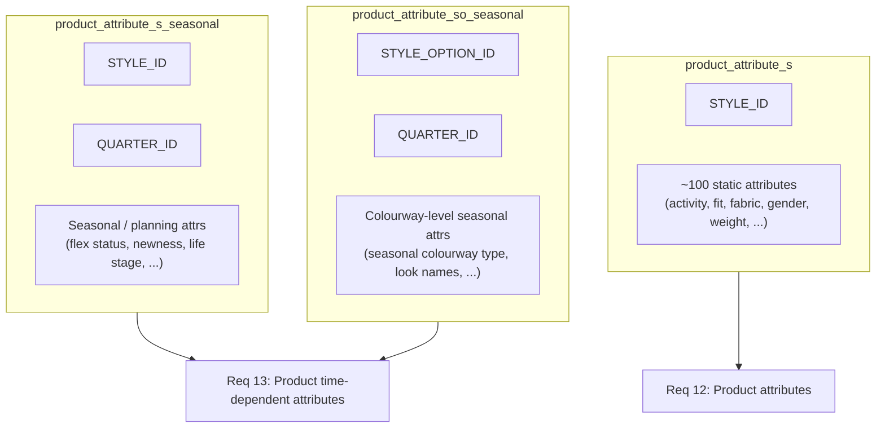

# Product Attribute Feeds: How They Differ

`Prepared: 2026-06-29` · `GCS isolation applied: 2026-06-29`

Source checked: `gs://client_data_lululemon/2026-06-25/` (one representative shard per feed, plus BQ schemas and prior EDA from [`gcs_feed_eda_review_20260629.md`](gcs_feed_eda_review_20260629.md)).

Related: [`raw_product_attribute_s_eda.md`](raw_product_attribute_s_eda.md) · [`forecastsmart_data_requirements_coverage.md`](forecastsmart_data_requirements_coverage.md)

---

## At a glance

Schema: `lulu_sourcing_dev` · Project: `lululemon-01042025`

| Feed | Filename pattern | Shards | ~Size | CSV cols | BQ table | Grain | Rows (BQ or EDA) |
|---|---|---:|---:|---:|---|---|---:|
| **`product_attribute_s`** | `product_attribute_s20251118_153511_*_*.csv` | 16 | 67 MB | **102** | `product_attribute_s` | **1 row per STYLE** | **86,135** (reload 2026-07-02) |
| **`product_attribute_s_seasonal`** | `product_attribute_s_seasonal20251118_153525_*_*.csv` | 16 | 89 MB | **20** | `product_attribute_s_seasonal` | **STYLE × QUARTER** | **650,404** |
| **`product_attribute_so_seasonal`** | `product_attribute_so_seasonal20251118_153550_*_*.csv` | 16 | 82 MB | **9** | `product_attribute_so_seasonal` | **STYLE_OPTION × QUARTER** | **1,196,146** |

All three are separate client extracts from the **2025-11-18 batch**, but with different embedded timestamps in the filename (`153511`, `153525`, `153550`).

---

## 1. What each feed is for



| Feed | Business meaning | ForecastSmart requirement |
|---|---|---|
| `product_attribute_s` | **Broad, mostly time-invariant style master attributes** (activity, fit, fabric, gender, silhouette, weight, etc.) | **Product attributes** (Req 12) |
| `product_attribute_s_seasonal` | **Style attributes that change by fiscal quarter** (flex status, seasonal newness, life stage, size range by quarter) | **Product time-dependent attributes** (Req 13), partial |
| `product_attribute_so_seasonal` | **Style-option (colourway) attributes by quarter** (seasonal colourway type, product seasonal newness at SO level) | **Product time-dependent attributes** (Req 13), partial |

They are **not** the same table split across files. They are **three different views** at different grains with different column sets.

---

## 2. Column structure

### `product_attribute_s` (102 columns)

**Key:** `STYLE_ID` (one row per style in each shard; ~2,647 rows in shard `0_0_0`; ~86K styles total historically).

**Sample columns (first / last):**

- Start: `STYLE_ID`, `ACTIVITY`, `ACTIVITY_CATEGORY`, `ACTIVITY_DETAILS`, ...
- End: `TECHNOLOGY`, `WAISTBAND_TYPE`, `WARMTH_INDICATOR`, `WATERPROOF`, **`WEIGHT`**

**Example row:** `LW9AAFS`, activity = Athletic Activity, many `\N` sentinels.

This is the **wide static attribute dictionary** for styles.

### `product_attribute_s_seasonal` (20 columns)

**Key:** `STYLE_ID` + **`QUARTER_ID`**

**Header:**
`STYLE_ID`, `QUARTER_ID`, `DEMAND_PLAN_SELF_FABRIC_FAMILY`, `DESIGNER`, `DESIGN_LINE`, `FLEX_SEASON_CODE`, `FLEX_STATUS`, `GLOBAL_PRODUCT_SEASONAL_NEWNESS_STYLE`, `GUEST_FACING_NEWNESS_INDEX`, `HIGH_ATTENTION_STYLE`, `PATTERN_ENGINEER`, `PRODUCT_DEVELOPER`, `PRODUCT_ENTERPRISE_REPORTING_2LY`, `PRODUCT_ENTERPRISE_REPORTING_LY`, `PRODUCT_ENTERPRISE_REPORTING_TY`, `PRODUCT_LIFE_STAGE_STYLE`, `PRODUCT_SEASONAL_NEWNESS_STYLE_CATEGORY`, `SEASONAL_STYLE_TYPE`, `SIZE_RANGE`, `TECHNICAL_DEVELOPER`

**Example row:** `LW1CTGS`, quarter `20221`, flex season codes, seasonal newness fields.

Quarter range (full feed EDA): **`20151` to `20274`**.

### `product_attribute_so_seasonal` (9 columns)

**Key:** `STYLE_OPTION_ID` + **`QUARTER_ID`**

**Header:**
`STYLE_OPTION_ID`, `QUARTER_ID`, `FLEX_SEASON_CODE`, `FLEX_STATUS`, `GLOBAL_PRODUCT_SEASONAL_NEWNESS_STYLE_OPTION`, `LOOK_NAMES`, `PRODUCT_LIFE_STAGE_STYLE_OPTION`, `PRODUCT_SEASONAL_NEWNESS`, `SEASONAL_COLOURWAY_TYPE`

**Example row:** `LM3AV2S-033085`, quarter `20182`, season `18-2SU`, flex status `Active`.

Quarter range (full feed EDA): **`20151` to `20273`**.

---

## 3. Column overlap (not duplicates)

**Shared between `product_attribute_s` and `product_attribute_s_seasonal`:** 9 columns only

`STYLE_ID`, `DEMAND_PLAN_SELF_FABRIC_FAMILY`, `DESIGNER`, `DESIGN_LINE`, `FLEX_SEASON_CODE`, `FLEX_STATUS`, `PATTERN_ENGINEER`, `PRODUCT_DEVELOPER`, `TECHNICAL_DEVELOPER`

**Seasonal-only (11 columns):** includes **`QUARTER_ID`** plus fields like `GLOBAL_PRODUCT_SEASONAL_NEWNESS_STYLE`, `PRODUCT_LIFE_STAGE_STYLE`, `SEASONAL_STYLE_TYPE`, `SIZE_RANGE`, enterprise reporting LY/TY/2LY, etc.

**`product_attribute_s` only:** **93 columns** not in seasonal (activity, fit, fabric, gender, weight, waterproof, etc.)

**`product_attribute_so_seasonal` vs the other two:** uses **`STYLE_OPTION_ID`** instead of `STYLE_ID`; no column overlap with the 102-col static feed except conceptually similar names (`FLEX_SEASON_CODE`, `FLEX_STATUS`) at a different grain.

| Comparison | Result |
|---|---|
| Same rows? | **No** (different grains: style vs style×quarter vs style-option×quarter) |
| Same columns? | **No** (102 vs 20 vs 9) |
| Subset relationship? | Seasonal shares **9** column names with static `_s`, but values are **quarter-specific** and row count is **~7.5×** larger (650K vs ~86K) |

---

## 4. Row volume and grain

| Feed | Approx rows | Distinct keys (EDA) | Duplicate note |
|---|---:|---|---|
| `product_attribute_s` | ~86K (historical BQ) | ~86K `STYLE_ID` | One row per style |
| `product_attribute_s_seasonal` | 650,404 | ~83,557 styles × ~52 quarters | 675 grain dupes (0.10% of rows) on STYLE×QUARTER |
| `product_attribute_so_seasonal` | 1,196,146 | ~431,554 style options × quarters | 0 grain dupes on SO×QUARTER |

Seasonal feeds are **much row-heavier** because the same style (or style option) repeats across **`QUARTER_ID`** values.

---

## 5. Filename / prefix collision (why `product_attribute_s` load failed)

All three originally lived in the **same flat folder**: `gs://client_data_lululemon/2026-06-25/`

**Current layout:** `_s` → `2026-07-02/` only; `_s_seasonal` and `_so_seasonal` → `2026-06-25/` only (no cross-folder overlap).

The extraction DAG matches files by **view name prefix**:

| View configured | Prefix used | Files matched |
|---|---|---|
| `product_attribute_s` | `product_attribute_s` | `product_attribute_s20251118_*.csv` **AND** `product_attribute_s_seasonal20251118_*.csv` |
| `product_attribute_s_seasonal` | `product_attribute_s_seasonal` | seasonal files only |
| `product_attribute_so_seasonal` | `product_attribute_so_seasonal` | SO seasonal files only |

Because **`product_attribute_s_seasonal` starts with `product_attribute_s`**, the static `_s` loader also picks up seasonal files and applies the **102-column schema** (expecting column 101 = `WEIGHT`) to a **20-column** seasonal file. That caused the Jul 1 failure and left `product_attribute_s` at **0 rows**.

The seasonal feeds themselves loaded fine because their prefixes are longer and do not collide.

---

## 6. Requirement mapping (exact tables)

| Requirement | Primary table(s) |
|---|---|
| **Product attributes (Req 12)** | `lululemon-01042025.lulu_sourcing_dev.product_attribute_s` (**86,135 rows**, reload 2026-07-02) |
| | `lululemon-01042025.lulu_sourcing_dev.sku_details` (loaded) |
| | `lululemon-01042025.lulu_sourcing_dev.product_group_hierarchy` (loaded) |
| **Product time-dependent attributes (Req 13)** | `lululemon-01042025.lulu_sourcing_dev.product_attribute_s_seasonal` (loaded) |
| | `lululemon-01042025.lulu_sourcing_dev.product_attribute_so_seasonal` (loaded) |

---

## 7. Practical takeaway

- **`product_attribute_s`** = wide static style dictionary (102 attrs, style grain).
- **`product_attribute_s_seasonal`** = narrow seasonal/planning attrs at **style × quarter**.
- **`product_attribute_so_seasonal`** = narrow seasonal attrs at **style option × quarter**.

They differ in **purpose, grain, column count, and row volume**. The load failure is **not** because the files are malformed versions of each other; it is because **prefix matching in a flat GCS folder treats `_seasonal` files as part of `_s`**.

---

## 8. Remediation: split feeds across dated folders (2026-06-29)

To unblock reload without changing platform prefix logic, **static `_s` and seasonal feeds were split across two dated folders** so no folder mixes colliding prefixes.

### GCS layout (current)

Each feed lives in **one folder only**; no cross-folder duplicates.

| Dated folder | Feeds present | Shards | Notes |
|---|---|---:|---|
| `gs://client_data_lululemon/2026-06-25/` | `product_attribute_s_seasonal`, `product_attribute_so_seasonal` | 16 + 16 | Seasonal feeds only; static `_s` removed from this folder |
| `gs://client_data_lululemon/2026-07-02/` | `product_attribute_s` | 16 | Static `_s` only; no seasonal files (no prefix collision) |

Removed 2026-06-29: archive subfolder `2026-06-25/product_attribute_s/` and the 16 `_s` shards from `2026-06-25/` flat root (redundant once `_s` moved to `2026-07-02/`).

Verified: shard `0_0_0` in `2026-07-02/` has **102 columns**.

### Reload steps (platform)

Set mapping for **`product_attribute_s` only** before triggering `sourcing_extraction_1`:

| Checkpoint | Value |
|---|---|
| `extraction_sync_dt` | `2026-07-01` (DAG scans from sync date + 1 day → picks up `2026-07-02/`) |
| `filter_param` | `1900-01-01` |
| `dataingestion_filterparam` | `1900-01-01` |
| `replace` | `true` |

Leave **`product_attribute_s_seasonal`** and **`product_attribute_so_seasonal`** checkpoints unchanged (already loaded from `2026-06-25/`).

### Post-reload verification

```sql
SELECT COUNT(*) AS row_count,
       COUNT(DISTINCT STYLE_ID) AS distinct_styles
FROM `lululemon-01042025.lulu_sourcing_dev.product_attribute_s`;
```

Expected: ~86K rows, ~86K distinct `STYLE_ID`, single `SYNCSTARTDATETIME` matching the reload run.

Also confirm no duplicate load:

```sql
SELECT SYNCSTARTDATETIME, COUNT(*) AS rows
FROM `lululemon-01042025.lulu_sourcing_dev.product_attribute_s`
GROUP BY 1
ORDER BY 1 DESC;
```

### Longer-term fix options

1. **Client / ops:** stage `_s`, `_s_seasonal`, and `_so_seasonal` in separate dated folders or use non-colliding filename prefixes.
2. **Platform:** tighten file matching (exact view prefix + delimiter, or longest-prefix wins) so `_seasonal` files never match the `_s` view.
