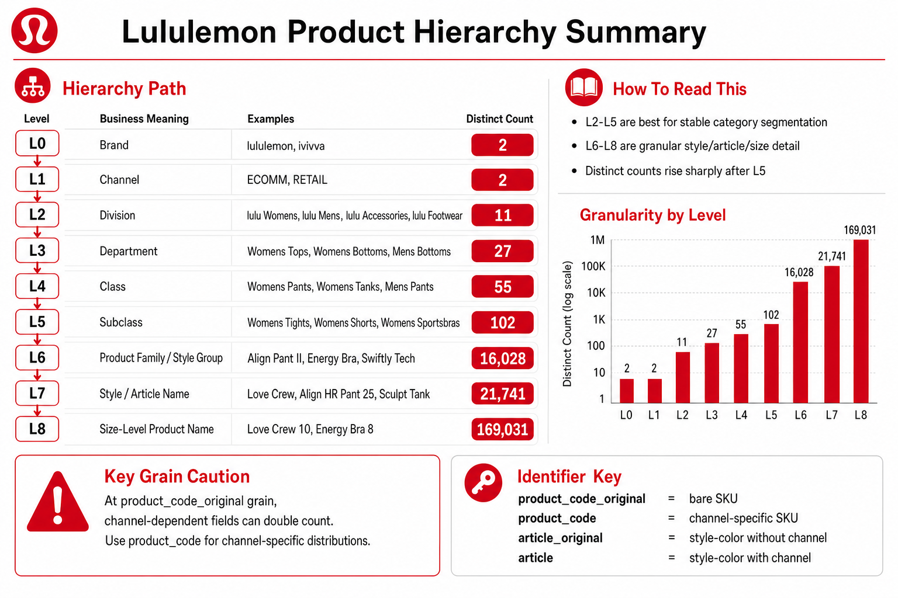

# Product Master — Hierarchy Decoded (L0–L8 + non-hierarchical columns)

| Field | Value |
|-------|-------|
| **Table** | `lululemon-01042025.lulu_ingestion_dev.product_master` (canonical; was `lululemon_souricng_outbound` in earlier notes) |
| **Companion docs** | [`product_master_eda.md`](product_master_eda.md), [`schema_inventory.md`](schema_inventory.md), [`master_table_build_logic.md`](master_table_build_logic.md), [`master_bq_health_check_2026-05-20.md`](master_bq_health_check_2026-05-20.md) |
| **Status** | ✅ Decoded against sample; counts refreshed 2026-05-20 |
| **Owner** | Ejaz Anwar |
| **Last Updated** | 2026-05-20 |

---

## Hierarchy summary (visual)



BQ-regenerated chart (matplotlib): [`lululemon_product_hierarchy_summary.png`](assets/lululemon_product_hierarchy_summary.png).

**Combined PDF** (designed hierarchy + channel suffix reference): [`assets/lululemon_masters_reference_guide.pdf`](assets/lululemon_masters_reference_guide.pdf).

Regenerate after `product_master` rebuild:

```bash
python3 scripts/generate_product_hierarchy_summary_image.py
# After updating either PNG, rebuild PDF:
python3 scripts/combine_lululemon_reference_pdf.py
```

Source: live `COUNT(DISTINCT l0_name..l8_name)` on `lulu_ingestion_dev.product_master` (1,977,528 rows).

---

## TL;DR (read this first)

1. **L0 carries brand, not just tenant** — `lululemon = 100`, `ivivva = 200`. Filter `l0_name` to separate the two brand namespaces.
2. **L2 is brand × business unit** — `Lab Womens` and `lulu Footwear` live as their own L2s under the `lululemon` L0. Lab is **not** a flag; it's an L2-level split.
3. **`gender` is unreliable for filtering** — use `l2_name` / `l3_name` instead. Many obviously-gendered rows have `gender = '\N'`.
4. **L5 encodes planning fit-splits** — Tights/Non-Tights, Sportsbras/Intimates, Fixed/Pull-On — that don't exist at L4.
5. **~10% of articles use a short legacy alphabetic code** at L8 (`AGG`, `HAADL`, `HGU`, `MU`…). They have no L7 prefix and no color suffix. **Filtering articles by `LIKE 'L%'` will silently drop them.**
6. **L6 has two ID-numbering schemes coexisting** — most are 6-digit, a small set is 9-digit (`912xxx`, `932xxx`).
7. **L0–L5 IDs follow a "Russian doll" prefix pattern** — `LIKE '100100300%'` pulls the entire Accessories branch.
8. **`flex_status = 'Drop'` is your lifecycle signal** — exclude these from forward-looking forecasts.

---

## The 9-level merchandise tree

Reading top-down (broadest → most specific):

| Level | Role | Example values | ID column | ID format |
|---|---|---|---|---|
| **L0** | **Brand / tenant** | `lululemon`, `ivivva` | `l0_id` | 3-digit (`100`, `200`) |
| **L1** | **Channel** | `ECOMM`, `RETAIL` | *(none — L1 is text-only)* | — |
| **L2** | **Brand × business unit** | `lulu Womens`, `Lab Womens`, `lulu Footwear`, `ivivva` | `l2_id` | L0 + 3 digits (e.g. `100110`) |
| **L3** | **Division** | `Womens Tops`, `Mens Bottoms`, `Accessories`, `ivivva Girls` | `l3_id` | L2 + 3 digits |
| **L4** | **Department** | `Socks`, `Womens Pants`, `Mens Underwear` | `l4_id` | L3 + 3 digits |
| **L5** | **Class (gender × dept × planning split)** | `Womens Socks`, `Womens Tights`, `Mens Pull On` | `l5_id` | L4 + 3 digits |
| **L6** | **Subclass / planning concept** | `Cable-Knit Socks`, `SP25 U OTM SOCK QTR TREND` | `l6_id` | 6-digit numeric, occasional 9-digit (`912xxx`, `932xxx`) — **no longer prefix-based** |
| **L7** | **Style / Article family** | `LU9ADVS`, `LW9AWPS`, `XW3019S` | `l7_id` | 7-char alphanumeric — **this is `STYLE_ID`** |
| **L8** | **SKU / Article-Color × Channel** *(leaf)* | `LU9ADVS-036715_ECOMM` | `l8_id` | `<L7>-<color>_<channel>` for ~90% of rows; short legacy codes (`AGG_RETAIL`) for the rest |

> **Note:** there is no `l1_id` column. Channel is stored only as text in `l1_name`.

---

## L0 — Brand namespaces

| `l0_id` | `l0_name` | Notes |
|---|---|---|
| `100` | `lululemon` | Main brand |
| `200` | `ivivva` | Deprecated kids' brand — explains the ~8M ivivva inventory rows seen elsewhere |

---

## L2 — Brand × business unit catalog

| `l2_id` | `l2_name` | What's inside |
|---|---|---|
| `100100` | `lulu Accessories` | Socks, bags, equipment, headwear, mats |
| `100110` | `lulu Womens` | Main women's apparel |
| `100120` | `lulu Mens` | Main men's apparel |
| `100140` | `lulu Footwear` | Shoes (split by gender at L3) |
| `100220` | `Lab Womens` | **Experimental sub-brand** — own L2 namespace, still under `lululemon` at L0 |
| `200170` | `ivivva` | All ivivva (girls) under one L2 |

**Filter recipes** (use these instead of `gender`):

```sql
-- Reliable women's filter
WHERE l2_name IN ('lulu Womens', 'Lab Womens')

-- Reliable men's filter
WHERE l2_name = 'lulu Mens'
   OR (l2_name = 'lulu Footwear' AND l3_name = 'Mens Footwear')

-- Reliable accessories (mostly unisex)
WHERE l2_name = 'lulu Accessories'

-- Just the experimental Lab line
WHERE l2_name LIKE 'Lab%'
```

---

## L3 — Division catalog (under each L2)

| `l2_name` | `l3_name` values seen |
|---|---|
| `lulu Womens` | `Womens Tops`, `Womens Bottoms`, `Womens Outerwear`, `Womens Intimates` |
| `lulu Mens` | `Mens Tops`, `Mens Bottoms` |
| `lulu Accessories` | `Accessories` (single L3) |
| `lulu Footwear` | `Mens Footwear`, `Womens Footwear` (gender split happens at L3 inside footwear) |
| `Lab Womens` | `Lab Womens Tops`, `Lab Womens Bottoms` |
| `ivivva` | `ivivva Girls` |

L3 IDs leave deliberate gaps (e.g. jumping from `100110102` to `100110302`) to reserve space for future divisions.

---

## L4 — Department catalog with IDs

This is the level you'll filter on most often.

| `l4_id` | `l4_name` | Parent (L3) |
|---|---|---|
| `100110101101` | Womens Tanks | Womens Tops |
| `100110101103` | Womens SS-LS Tops | Womens Tops |
| `100110101507` | **Womens 2nd Layers** | Womens Tops (zip-ups, pull-overs) |
| `100110102104` | Womens Pants | Womens Bottoms |
| `100110102106` | Womens Shorts/Skirts | Womens Bottoms |
| `100110302509` | Womens Outerwear | Womens Outerwear |
| `100110327501` | Womens Underwear | Womens Intimates |
| `100110327508` | Womens Swim | Womens Intimates |
| `100110327586` | Womens Bras | Womens Intimates |
| `100120304512` | Mens SS-LS Tops | Mens Tops |
| `100120304513` | **Mens 2nd Layers** | Mens Tops |
| `100120305514` | Mens Pants | Mens Bottoms |
| `100120305515` | Mens Shorts | Mens Bottoms |
| `100120305585` | Mens Underwear | Mens Bottoms |
| `100100300500` | Socks | Accessories |
| `100100300502` | Headwear And Seasonal | Accessories |
| `100100300503` | Bags | Accessories |
| `100100300504` | Equipment | Accessories (mats, water bottles) |

---

## L5 — Where planning fit-splits live

L5 is **not** always finer than L4 — at this level lululemon encodes planning-relevant fit and construction splits that don't exist at coarser levels.

| `l5_id` (suffix) | `l5_name` | Why this split matters |
|---|---|---|
| `...104838` | Womens Tights | Performance product line |
| `...104839` | Womens Non-Tights | Joggers, trousers, flares, wide-legs |
| `...586822` | Womens Sportsbras | Sport bras (Energy, Align, Like a Cloud) |
| `...586826` | Womens Intimates | Bralettes (Wundermost) |
| `...509720` | Womens Light | Light outerwear (jackets) |
| `...509721` | Womens Heavy | Heavy outerwear (trenches, down) |
| `...515732` | Mens Fixed | Fixed-waist shorts (ABC Classic-Fit) |
| `...515733` | Mens Pull On | Pull-on shorts (Pace Breaker, Swim) |
| `...514729` | Mens Fixed | Fixed-waist pants (ABC, Commission) |
| `...514730` | Mens Pull On | Pull-on pants (joggers) |

> Pull-on vs fixed-waist behave very differently in forecasts — keep this split when cohorting.

> **Naming caveat:** L5 says "Womens Socks" even for unisex items. Don't filter by L5 to find women's-only — fall back to L2/L3.

---

## L6 — Subclass / planning concept

Mostly 6-digit numeric IDs (e.g. `115694`, `143298`, `123952`). A small legacy set uses 9-digit IDs:

- `912000298` — Velocity Jacket *G
- `912000171` — Double Back Tank
- `932000876` — Cropt Hoodie (Lab)

These are older planning concepts that survived a numbering migration. They join the same way but explain why range queries on `l6_id` look weird.

L6 also carries **two parallel naming conventions**:
- **Commercial** names (`Cable-Knit Socks`)
- **Planning-cycle** names (`SP25 U OTM SOCK QTR TREND`, `SP25 LICENSE TO TRAIN JACKET SATIN SE`)

The two sometimes share an `l6_id` and sometimes don't — known data hygiene issue in retail merchandising trees.

---

## L7 — Style code prefix decoder

L7 is the alphanumeric `STYLE_ID`, formatted `<2-char prefix><digit><4-char id><1-char suffix>`. The 2-char prefix is the **brand × segment marker**:

| Prefix | Brand × segment | Examples |
|---|---|---|
| `LW` | lululemon Women | `LW9AWPS`, `LW1XXXX` |
| `LM` | lululemon Men | `LM5ARUT` |
| `LU` | lululemon Unisex (mostly accessories) | `LU9ADVS`, `LU9DBWS` |
| `IG` | ivivva Girls | (girls' apparel) |
| `XW` | Lab Women (experimental) | `XW3019S` (Cropt Hoodie under Lab Womens) |

The trailing single character (`S`, `A`, `R`, `T`, `G`, …) appears to indicate fabric / fit / version variant — same product family, different material.

---

## L8 — SKU at channel grain

### Standard form (~90% of rows)

`<L7>-<color_code>_<channel>` — e.g. `LU9ADVS-036715_ECOMM` decomposes as:

- `LU9ADVS` ← L7 (style)
- `036715` ← `color_code` (Laser Red)
- `_ECOMM` ← L1 (channel)

### Channel doubling

Every commercial SKU exists once per channel — same article appears as both `_ECOMM` and `_RETAIL` rows. This is why `product_master.row_count = 2 × distinct_products`.

### Short legacy code anomaly (~10% of rows)

A subset of rows uses a short alphabetic code with **no L7 prefix and no color suffix**. Examples:

| `l8_id` | `product_code` | Real product |
|---|---|---|
| `AGG_RETAIL` | `117400151_RETAIL` | Align HR Crop 21" *Cool |
| `HAADL_RETAIL` | `146403349_RETAIL` | ABC Pant Slim 37"L |
| `HGA_RETAIL` | `147153110_RETAIL` | ABC Classic-Fit 5Pkt Pant 32L |
| `HGU_ECOMM` | `136302057_ECOMM` | ABC Pant Relaxed 34"L |
| `HJN_RETAIL` | `136527609_RETAIL` | Commission Pant Slim 34"L |
| `HJM_ECOMM` | `136527523_ECOMM` | Commission Pant Slim 34"L |
| `HAAEU_ECOMM` | `147154188_ECOMM` | ABC Classic-Fit 5Pkt Pant 34L |
| `MU_ECOMM` | `127825646_ECOMM` | Align HR Jogger |
| `MGCA_RETAIL` | `3742536_RETAIL` | Wunder Under HR Tight 25" *Luon |
| `JY_RETAIL` | `136306778_RETAIL` | Mixed Boxer 3 Pack Long |
| `NAADQ_ECOMM` | `153575552_ECOMM` | Hotty Hot HR Short 2.5" *Lined |

What holds for these rows:

- `article_original = article` minus `_<channel>` (pure alphabetic, e.g. `AGG`)
- L7 still has the normal alphanumeric form (e.g. `LM5ARUT` for the `HAADL` row), so a **L7→L8 prefix join breaks** for these rows
- They cluster heavily in **Mens Fixed pants** (ABC, Commission) — likely a SKU-management quirk on the men's pant side
- Color is **not** encoded in `l8_id`; you have to read `color_code` separately

> **Implication:** never filter SKUs with `WHERE article LIKE 'LW%' OR article LIKE 'LM%'` — you'll silently drop ~10% of catalog. Filter by `l2_name` or `l7_id` instead.

---

## ID-prefix "Russian doll" pattern (L0–L5 only)

L0 → L5 IDs extend by 3 digits at each step:

```
L0:   100
L2:   100100
L3:   100100300
L4:   100100300500
L5:   100100300500700
```

This makes branch-level filtering trivial:

```sql
-- Everything under "Accessories" at any depth
SELECT *
FROM `lululemon-01042025.lululemon_souricng_outbound.product_master`
WHERE l5_id LIKE '100100300%'
LIMIT 100;
```

L6+ break the pattern (different numbering schemes), so prefix matching only works for L0–L5.

---

## Walking the hierarchy for one row

Row 1 — `LU9ADVS-036715_ECOMM`:

```
L0  lululemon                            (id: 100)
└── L1  ECOMM                            (channel — no id)
    └── L2  lulu Accessories             (id: 100100)
        └── L3  Accessories              (id: 100100300)
            └── L4  Socks                (id: 100100300500)
                └── L5  Womens Socks     (id: 100100300500700)
                    └── L6  7mesh Word Sock - 6"        (id: 115694)
                        └── L7  LU9ADVS                  (style: 7mesh Word Sock 6")
                            └── L8  LU9ADVS-036715_ECOMM (color 36715 = Laser Red, ECOMM)
```

---

## Non-hierarchical columns — what they add on top

### `product_size_definition` — parseable size grid descriptor

Format: `<segment>--<grid_name>:<min-max>`

| Value | Decodes as |
|---|---|
| `W Tops--2-14:2-14` | Women's tops, standard grid 2–14 |
| `W Bottoms--W Ext Sizes:0-26` | Women's bottoms, **extended** grid 0–26 |
| `Mens--XXS-5XL:XXS-5XL` | Men's letter grid XXS–5XL |
| `Mens--26-50:26-50` | Men's waist grid 26–50 |
| `Accessories--XS/S-XL/XXL:XS/S-XL/XXL` | Sock-style 4-step grid |
| `Accessories--O/S:O/S-O/S` | Single one-size SKU |
| `BSI--4:32A-42H` | Bra Sizing Index, **band 4**, cup range 32A–42H |
| `ivivva--6-14:6-14` | Kids' size grid 6–14 |

This is gold for SizeSmart — it tells you the **size matrix** every SKU should appear in. Combined with `size_scale` (`B`, `I`, `WA`, `E`, `J2`, `F`, `F2`, `C`, `K`, `L1`, `Z`, `B4`, `X`), you can validate that observed sizes match the expected grid.

### `flex_status` — lifecycle signal

| Value | Meaning |
|---|---|
| `Active` | In-line, currently selling |
| `Drop` | Phasing out / end-of-life — exclude from forward-looking forecasts |
| `\N` | Unknown / not set |

~20% of the sample is `Drop`. They're still in `product_master` but on their way out.

### `global_merch_team` — activity-based owner

Single biggest non-hierarchical cut of the catalog. Values: **Yoga, Train, Run, Lounge, Social, Swim, Tennis, Golf, Sweatlife** (and `\N`). Cross-cutting — one product can sit in any team. Not redundant with the L-tree or `designed_for_activity`.

### `design_line` — design DNA / sub-line

Free-text. Best guesses on the codes (worth confirming with merchandising):

| Code | Likely meaning |
|---|---|
| `OTC` | Off-The-Clock (lifestyle line) |
| `LTT` | License To Train |
| `F&F` | Fast & Free |
| `&Go` | "and Go" — travel/transition line |
| `Sweat` / `No Sweat` / `Seamless` / `Technical Run` / `Technical Yoga` / `Lab` / `Sea Wheeze` / `APAC Design` / `Cycling` / `Team Sport` / `Warm Up / Cool Down` / `Intimates` / `Womens/Mens Accessories` / `Womens/Girls Swim` | Self-explanatory style/use cuts |

### `product_bucket_code` — flat planning bucket

16-digit code (e.g. `1134191215771101`). All sock rows in our 10-row sample shared the same value, so this is a **flat planning/forecast bucket** that crosses gender within a department. **Not** a clean concatenation of L4/L5/L6 IDs — it's a separate internal merchandising classifier. All `lululemon`-brand bucket codes seem to start with `1134`.

### `season_code`

Single value `25-4WI` across the entire current snapshot — confirms the master is a **current-season-only snapshot**. Tracked as P0 in `product_master_eda.md`.

### Hardcoded stubs (100% NULL)

Already documented in `master_table_build_logic.md`:

- `color_family`
- `ordering`
- `launch_date`

---

## Reliable filter recipes

```sql
-- Active women's apparel only (no Lab, no ivivva, no footwear), one channel
SELECT *
FROM `lululemon-01042025.lululemon_souricng_outbound.product_master`
WHERE l2_name = 'lulu Womens'
  AND flex_status = 'Active'
  AND l1_name = 'RETAIL';

-- All bras (sportsbras AND intimates) at the L4 grain
SELECT DISTINCT l5_name, l5_id
FROM `lululemon-01042025.lululemon_souricng_outbound.product_master`
WHERE l4_id = '100110327586';

-- Hierarchical drill-down for one style
SELECT l0_name, l2_name, l3_name, l4_name, l5_name, l6_name, l7_name, l7_id,
       COUNT(DISTINCT l8_id) AS variants
FROM `lululemon-01042025.lululemon_souricng_outbound.product_master`
WHERE l7_id = 'LU9ADVS'
GROUP BY 1,2,3,4,5,6,7,8;

-- Prefix matching to pull a whole branch (works for L0-L5 only)
SELECT *
FROM `lululemon-01042025.lululemon_souricng_outbound.product_master`
WHERE l5_id LIKE '100100300%';   -- everything under Accessories

-- Mens Fixed pants (catches both standard L7 articles AND legacy short codes)
SELECT *
FROM `lululemon-01042025.lululemon_souricng_outbound.product_master`
WHERE l5_id LIKE '%514729';
```

---

## Pitfalls — things that look right but break silently

1. **`gender` filter** drops legitimately-gendered rows that have `gender = '\N'`. → Use L2/L3 names.
2. **`article LIKE 'L%'` filter** silently drops the ~10% short legacy codes (`AGG`, `HAADL`, `MU`…). → Filter via `l2_name` / `l7_id`.
3. **L5 name** says "Womens Socks" even for unisex products. → Don't infer gender from L5.
4. **L6 range queries** look weird because of mixed 6-digit and 9-digit IDs. → Treat L6 IDs as opaque keys, not numeric.
5. **`l8_name` joins** are unsafe — 260K IDs have multiple names. → Always join on `l8_id`.
6. **`l1_id` doesn't exist** — channel is text only.
7. **`product_bucket_code` is much coarser than L5** — it's not a 1:1 reflection of any single L-level.
8. **`color_family`, `ordering`, `launch_date` are 100% NULL stubs** — don't expect data there.

---

## Open questions for merchandising / DE

- Confirm the `OTC` / `LTT` / `F&F` / `&Go` design-line decodings.
- Why do ~10% of articles use short legacy codes (`AGG`, `HAADL`, `MU`…) — SAP migration artifact, or active SKU-management practice?
- The 9-digit L6 IDs (`912xxx`, `932xxx`) — safe to merge into 6-digit space, or keep separate for traceability?
- `product_bucket_code` — what does the 16-digit structure decode to? It clearly groups things, but the breakdown isn't documented.
