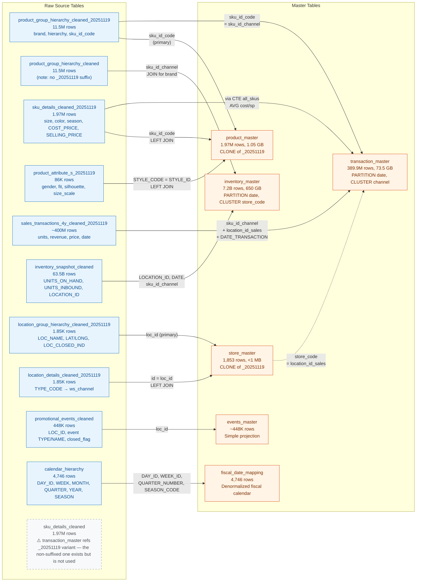
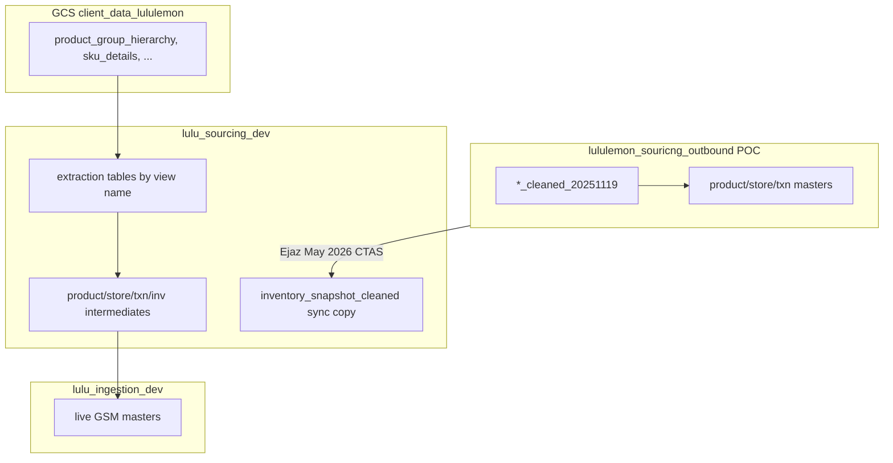
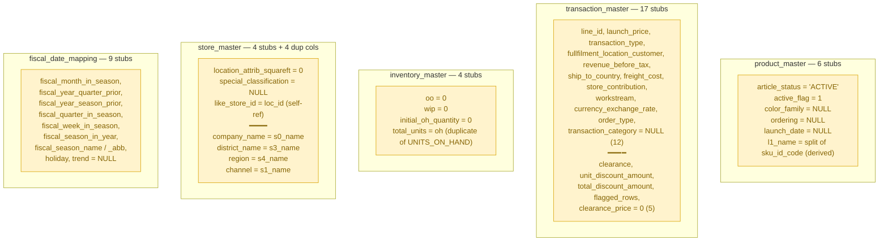

# Raw → Master Table Lineage

**As of:** 2026-06-22
**Owner:** Ejaz Anwar
**Purpose:** Single-page visualization of how every master table is built from raw source tables, including join keys, grain, hardcoded stubs, and how the POC outbound build path relates to the live GCS → `lulu_sourcing_dev` → `lulu_ingestion_dev` pipeline.

**Sources:** `reference_docs/Lululemon/Master Table Build Logic/master_table_build_queries_20251119.csv` (ground truth DDL) + `findings/master_table_build_logic.md` (column-by-column audit) + [`findings/lululemon_ingestion_end_to_end.md`](lululemon_ingestion_end_to_end.md) (live pipeline playbook).

---

## 1. One-page lineage diagram

**Legend:**

- 🟦 Blue box = raw source table
- 🟧 Orange box = master table
- ⬛ Dashed box / arrow = ghost dependency (referenced but broken or redundant)
- Solid arrow → = INNER JOIN
- Dashed arrow ⇢ = LEFT JOIN or indirect reference

---

## 2. Master → Raw mapping matrix

One row per master table. `Primary` = the driving table (FROM). `Join` = LEFT/INNER joined in. `Join Key` = the actual column predicate.

| Master | Rows | Primary source | Join source(s) | Join keys | Grain | Filter |
|---|---:|---|---|---|---|---|
| **product_master** | 1.97M | `product_group_hierarchy_cleaned_20251119` | `sku_details_cleaned_20251119` (LEFT), `product_attribute_s_20251119` (LEFT) | `sku_id_code = sku_id_code`; `STYLE_CODE = STYLE_ID` | One row per SKU (inc. channel suffix) | `WHERE sku_id_code IS NOT NULL` |
| **transaction_master** | 389.9M | `sales_transactions_4y_cleaned_20251119` | `product_group_hierarchy_cleaned_20251119` (INNER), CTE `all_skus` from `sku_details_cleaned_20251119` (INNER, AVG), `store_master_20251119` (INNER) | `sku_id_channel = sku_id_code`; `location_id_sales = store_code` | One row per (date × SKU × store × order_id)* | `SELECT DISTINCT` (no row filter) |
| **inventory_master** | 7.2B | `inventory_snapshot_cleaned` | `product_group_hierarchy_cleaned` (INNER) | `sku_id_channel = sku_id_channel` | One row per (date × SKU × store) | none — **but build drops pre-2023 dates** |
| **store_master** | 1,853 | `location_group_hierarchy_cleaned_20251119` | `location_details_cleaned_20251119` (LEFT) | `loc_id = id` | One row per store | none |
| **events_master** | ~448K | `promotional_events_cleaned` | — | — | One row per (store × event) | none |
| **fiscal_date_mapping** | 4,746 | `calendar_hierarchy` | — | — | One row per calendar day | none |

*DISTINCT dedup means transaction_master row count ≠ distinct SALES_ORDER_ID count (see build_logic.md Section 2).

---

## 3. Raw → Master reverse lookup

**"If I change this raw table, what downstream masters break?"**

| Raw table | Rows | Feeds into | Role |
|---|---:|---|---|
| `product_group_hierarchy_cleaned_20251119` | 11.5M | product_master, transaction_master | **Most-used raw** — hierarchy for 3 masters |
| `product_group_hierarchy_cleaned` (no suffix) | 11.5M | inventory_master | ⚠️ Different table (no _20251119). Brand lookup only. |
| `sku_details_cleaned_20251119` | 1.97M | product_master, transaction_master (CTE) | size, color, season + cost/msrp |
| `product_attribute_s_20251119` | 86K | product_master | gender, fit, size_scale |
| `sales_transactions_4y_cleaned_20251119` | ~400M | transaction_master | Primary txn source |
| `inventory_snapshot_cleaned` | 63.5B | inventory_master | Primary inventory source |
| `location_group_hierarchy_cleaned_20251119` | 1,853 | store_master, (transitively) transaction_master | Primary location source |
| `location_details_cleaned_20251119` | 1,853 | store_master | `ws_channel` only |
| `promotional_events_cleaned` | 448K | events_master | Primary events source |
| `calendar_hierarchy` | 4,746 | fiscal_date_mapping | Primary calendar source |

Raw inventory companion: [`inventory_snapshot_cleaned_eda.md`](inventory_snapshot_cleaned_eda.md) profiles `inventory_snapshot_cleaned` separately from `inventory_master`, including raw history, `SNAPSHOT_TIME`, `UNITS_AVAILABLE`, and channel/key quality.

---

## 4. Two parallel build paths

The PC-team master-build SQL (Nov 2025 snapshot) and the live periodic ingestion pipeline solve the same business problem but use **different datasets and table names**.

| Path | Dataset chain | When to use |
|---|---|---|
| **POC / PC-team build** | `lululemon_souricng_outbound.*_cleaned_20251119` → masters in same dataset (or CLONE to `lulu_ingestion_dev`) | Historical EDA, build-logic audit, anomaly triage |
| **Live periodic pipeline** | GCS → `lulu_sourcing_dev` (extraction + intermediates) → `lulu_ingestion_dev` GSM masters | Ongoing daily feeds, platform ingestion DAG |

Section 1–3 above document the **POC outbound path**. Sections 5–7 below map those same logical sources to GCS views and `lulu_sourcing_dev` extraction tables.

---

## 5. POC master-build source tables (PC team SQL)

All sources below live in `lululemon-01042025.lululemon_souricng_outbound`. Ground truth DDL: [`master_table_build_queries_20251119.csv`](../reference_docs/Lululemon/Master%20Table%20Build%20Logic/master_table_build_queries_20251119.csv).

| Target master | Source table(s) | Join keys / notes |
|---|---|---|
| **`inventory_master`** | `inventory_snapshot_cleaned`, `product_group_hierarchy_cleaned` | `A.sku_id_channel = B.sku_id_channel` for brand |
| **`transaction_master`** | `sales_transactions_4y_cleaned_20251119`, `product_group_hierarchy_cleaned_20251119`, `sku_details_cleaned_20251119` (CTE `all_skus`), `store_master_20251119` | txn↔pgh on `sku_id_code`; txn↔store on `location_id_sales = store_code` |
| **`store_master_20251119`** | `location_group_hierarchy_cleaned_20251119`, `location_details_cleaned_20251119` | `a.loc_id = b.id` |
| **`product_master_20251119`** | `product_group_hierarchy_cleaned_20251119`, `sku_details_cleaned_20251119`, `product_attribute_s_20251119` | pgh↔sku on `sku_id_code`; pgh↔attr on `STYLE_CODE = STYLE_ID` |
| **`events_master`** | `promotional_events_cleaned` | Simple projection |
| **`fiscal_date_mapping`** | `calendar_hierarchy` | Window functions only |

**Deduplicated source list (11 tables):**

1. `inventory_snapshot_cleaned`
2. `product_group_hierarchy_cleaned` (unsuffixed; inventory query only)
3. `product_group_hierarchy_cleaned_20251119`
4. `sku_details_cleaned_20251119`
5. `product_attribute_s_20251119`
6. `sales_transactions_4y_cleaned_20251119`
7. `store_master_20251119` (master used as source for txn build; must exist first)
8. `location_group_hierarchy_cleaned_20251119`
9. `location_details_cleaned_20251119`
10. `promotional_events_cleaned`
11. `calendar_hierarchy`

---

## 6. GCS view → `lulu_sourcing_dev` → POC outbound mapping

**"Which live sourcing_dev table corresponds to each POC cleaned table?"**

| POC outbound cleaned table | GCS view | `lulu_sourcing_dev` extraction table | Notes |
|---|---|---|---|
| `product_group_hierarchy_cleaned_20251119` | `product_group_hierarchy` | `product_group_hierarchy` | Periodic product/store/txn builds read unsuffixed name |
| `sku_details_cleaned_20251119` | `sku_details` | `sku_details` | |
| `product_attribute_s_20251119` | `product_attribute_s` | `product_attribute_s` | |
| `sales_transactions_4y_cleaned_20251119` | `sales_transactions` | `sales_transactions` | |
| `inventory_snapshot_cleaned` | `inventory_snapshot` | `inventory_snapshot` + **`inventory_snapshot_cleaned`** (sync copy) | Only table copied cross-dataset into sourcing_dev |
| `location_group_hierarchy_cleaned_20251119` | `location_group_hierarchy` | `location_group_hierarchy` | |
| `location_details_cleaned_20251119` | `location_details` | `location_details` | |
| `promotional_events_cleaned` | `promotional_events` | *(not in active extraction mapping)* | |
| `calendar_hierarchy` | *(none)* | `calendar_hierarchy` | BQ-only; bootstrap from outbound if needed |

References: [`lululemon_periodic_sourcing_setup.md`](lululemon_periodic_sourcing_setup.md), [`ia_platform_mapping_table_lulu_dev.csv`](../reference_docs/Lululemon/ia_platform_mapping_table_lulu_dev.csv).

---

## 7. Clone / copy naming (what exists where)

| Table | Pattern | Dataset | Who / when |
|---|---|---|---|
| `inventory_snapshot_cleaned` | `CREATE OR REPLACE TABLE AS SELECT *` (full copy, ~1.4 TB) | `lulu_sourcing_dev` ← from `souricng_outbound` | Ejaz, 2026-05-07 ([`inventory_snapshot_cleaned.sql`](../reference_docs/Lululemon/Cleaned%20Table%20Builds/inventory_snapshot_cleaned.sql)) |
| `product_group_hierarchy_cleaned` | BQ `CLONE` of `_20251119` (zero-byte) | `lululemon_souricng_outbound` | Ritik, Nov 2025 |
| `product_master`, `store_master`, `transaction_master` | BQ `CLONE` of `*_20251119` | `lululemon_souricng_outbound` | per [`schema_inventory.md`](schema_inventory.md) |

**Key takeaway:** The 11 POC source tables were **not** all cloned into `lulu_sourcing_dev`. The extraction DAG lands GCS view names (`product_group_hierarchy`, `sku_details`, etc.). Only `inventory_snapshot_cleaned` was explicitly synced across datasets (CTAS from outbound) so periodic inventory intermediate builds could read from `lulu_sourcing_dev`.

---

## 8. Columns with NO raw source (hardcoded stubs)

These columns exist in master tables but are **literally `NULL` / `0` / constant string in the build DDL** — not fed by any raw table. Fixing them needs either a new raw source or a build-script patch.

**Total hardcoded stubs across the 6 masters: ~44 columns.** ~70% of our originally-flagged "data quality anomalies" resolve to this bucket.

---

## 9. Ghost / broken dependencies

Issues the DDL exposes that are **not** pure data quality:

| # | Issue | Master affected | Severity |
|:-:|---|---|:-:|
| G1 | `transaction_master.cost / msrp` computed from CTE that averages **empty** `sku_details_cleaned_20251119` (all 1.97M rows have cost=0, sp=0) | transaction_master | 🔴 P0 |
| G2 | `inventory_master` filters out pre-2023 raw data (9.3B rows exist in `inventory_snapshot_cleaned` but are dropped) | inventory_master | 🔴 P0 |
| G3 | `inventory_master` uses `product_group_hierarchy_cleaned` (no `_20251119`) vs other masters use `_20251119` variant — inconsistent snapshot | inventory_master | 🟡 P1 |
| G4 | `product_master` build uses `product_attribute_s_20251119` (86K) but 2 other variants exist (`_cleaned` 80K, plain 83K) | product_master | 🟡 P1 |
| G5 | `transaction_master` uses AVG(cost)/AVG(selling_price) per SKU — collapses any price-history signal | transaction_master | 🟡 P1 |
| G6 | `store_master.active = LOC_CLOSED_IND` — column name mismatch (verified as correct semantically, just confusing) | store_master | 🟢 P2 |

---

## 10. What's NOT in any master table

Raw tables that exist and carry relevant data but feed no current master — candidate sources for missing / stubbed fields:

| Raw table | Rows | What it could populate |
|---|---:|---|
| `returns_transactions_20251119` | 733.7M | Returns signal → fix negative-price rows in transaction_master (see V9) |
| `price_book` | 440.5M | `launch_price`, `clearance_price`, `unit_discount_amount` (currently NULL/0 stubs) |
| `transfer_orders_cleaned_20251119` | 710.3M | `inventory_master.oo` (on-order) |
| `purchase_orders_cleaned_20251119` | 20.8M | `inventory_master.oo` + `wip` |
| `dc_store_mapping_cleaned_20251119` | 1.1M | DC-store relationships (not in store_master) |
| `spatial_ai_cleaned` | 22.8K | `store_master.location_attrib_*` (demography scores) |
| `anaplan_transit_calender_cleaned` | 51M | Lead times per DC × store |
| `eligibility_cleaned_20251119` | 2.3B | SKU × store × week eligibility (separate table, not folded into masters) |

---

## 11. Quick facts

| | |
|---|---|
| Total canonical raw tables | ~26 (out of ~300 in the dataset) |
| Raw tables actually feeding masters | **10** (listed in Section 3) |
| POC SQL source tables (deduplicated) | **11** (listed in Section 5; includes `store_master_20251119` as txn dependency) |
| Master tables | **6** (product, transaction, inventory, store, events, fiscal_date) |
| Master rows (sum) | ~7.6 B |
| Master storage (sum) | ~725 GB |
| Hardcoded stub columns (total) | **44** across all 6 masters |
| "Ghost" / broken dependencies | 6 (see Section 9) |

---

## 12. Source artifacts

- Ground-truth DDL → [`reference_docs/Lululemon/Master Table Build Logic/master_table_build_queries_20251119.csv`](../reference_docs/Lululemon/Master%20Table%20Build%20Logic/master_table_build_queries_20251119.csv)
- Column-by-column build audit → [`findings/master_table_build_logic.md`](master_table_build_logic.md)
- Live pipeline playbook → [`findings/lululemon_ingestion_end_to_end.md`](lululemon_ingestion_end_to_end.md)
- Periodic sourcing setup → [`findings/lululemon_periodic_sourcing_setup.md`](lululemon_periodic_sourcing_setup.md)
- Raw verification queries → [`queries/raw_source_verification_phase1.sql`](../queries/raw_source_verification_phase1.sql)
- Full schema reference → [`findings/schema_inventory.md`](schema_inventory.md)
- Dataset inventory (all ~300 tables) → [`findings/dataset_inventory.md`](dataset_inventory.md)
- Anomaly status table → [`findings/anomaly_status_with_verification_sql.md`](anomaly_status_with_verification_sql.md)
- Location full audit → [`findings/location_audit.md`](location_audit.md)
