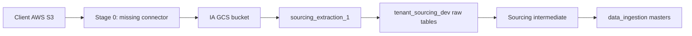
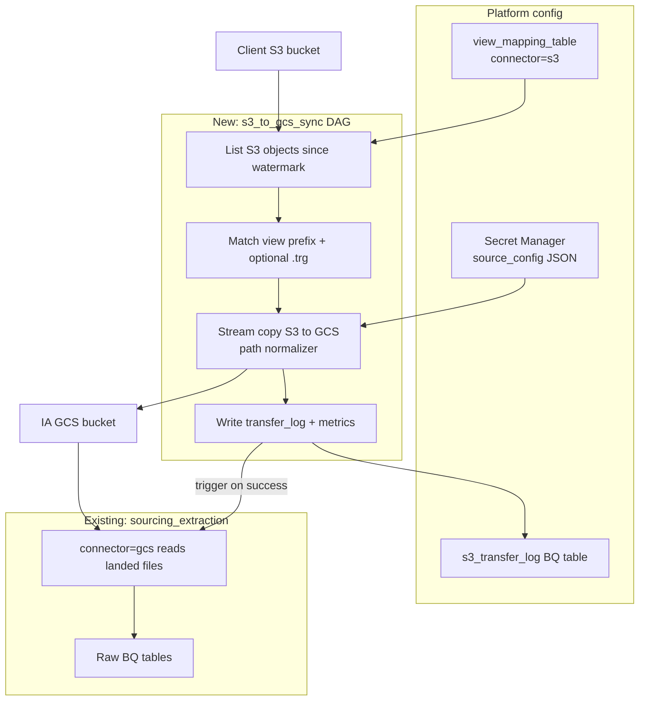

# Parked plan: AWS S3 to GCS platform connector

**Parked:** 2026-07-07  
**Status:** Not started — architecture complete, implementation deferred  
**Scope:** Generic IA platform connector (any client); Lululemon is the reference gap  
**Original Cursor plan:** `~/.cursor/plans/s3_gcs_platform_connector_ca4d8777.plan.md`

---

## One-line summary

Build a reusable IA platform `connector=s3` that syncs client S3 objects into the standard GCS layout (`YYYY-MM-DD/<view>_YYYYMMDDHHMMSS.csv`), then hands off to existing `gcs` extraction. **Hybrid recommendation:** Airflow DAG for steady-state; GCP Storage Transfer Service for TB-scale historic backfills.

---

## Current state

There is **no S3 connector today**. The IA platform only supports: `gcs`, `sftp`, `mssql`, `snowflake`, `mysql`, `bulkapi`, `pubsub` (see [DI Course 3](../reference_docs/Training/DI_Course_3_Ingestion_Basics_for_Analytics_Teams.md)).

Lululemon proves the gap: client data lives in **AWS S3**, but PC-era loads were **manual DevOps** into `gs://client_data_lululemon/Historic/s3_to_gcs/` ([`findings/lululemon_ingestion_end_to_end.md`](../findings/lululemon_ingestion_end_to_end.md)). Downstream platform extraction already works once files are in GCS.



---

## Option comparison

| Approach | Fit as platform connector | Ops burden | Incremental | Path rewrite | Large backfill (TB+) |
|---|---|---|---|---|---|
| **A. GCP Storage Transfer Service (STS)** | Poor (separate GCP jobs) | Low (managed) | Yes | Limited | Excellent |
| **B. Custom Airflow DAG (`connector=s3`)** | Excellent | Medium | Yes (watermark table) | Full control | Good |
| **C. Client pushes direct to GCS** | N/A (no S3 step) | Lowest for IA | Client-owned | Client-owned | Depends on client |
| **D. rclone / gsutil cron on VM** | Poor | High (fragile) | Manual | Manual | OK |

### Recommendation: **Hybrid B + A**

- **Steady-state (weekly/daily):** Option B as first-class `connector=s3`
- **Historic one-time loads:** Option A (STS), DevOps-owned
- **New client onboarding:** pitch Option C first; fall back to `s3` connector

---

## Target architecture



**Design principle:** `s3` connector only moves bytes and normalizes paths; `gcs` connector owns BQ load, `SYNCSTARTDATETIME`, and `extraction_sync_dt`.

**GCS layout required:**

```
YYYY-MM-DD/<view>_YYYYMMDDHHMMSS.csv[.gz]
```

---

## Connector contract (`source_config` in Secret Manager)

```json
{
  "aws_region": "us-west-2",
  "auth_mode": "access_keys | assume_role",
  "aws_access_key_id": "...",
  "aws_secret_access_key": "...",
  "aws_role_arn": "arn:aws:iam::...:role/IAReadOnly",
  "aws_external_id": "...",
  "s3_bucket": "client-outbound-bucket",
  "s3_prefix": "outbound/",
  "gcs_bucket": "client_data_<tenant>",
  "gcs_prefix": "",
  "path_mode": "platform_standard | preserve_source",
  "incremental_field": "last_modified",
  "delete_after_copy": false
}
```

---

## Implementation todos (when resumed)

| ID | Task |
|---|---|
| discovery-schema | Define `source_config` JSON schema, `s3_transfer_log` DDL, per-view path rewrite rules |
| prototype-sync | Build incremental S3→GCS streaming copy prototype with watermark table (single view) |
| path-normalizer | Implement `platform_standard` path rewriter (S3 key → `YYYY-MM-DD/<view>_timestamp.csv`) |
| airflow-dag | Wrap prototype as `s3_to_gcs_sync` Airflow DAG with trigger handoff to `sourcing_extraction` |
| platform-register | Add `connector=s3` to Self-Help UI validation + Confluence ISP runbook |
| iam-setup | Document cross-account AWS IAM role + GCP SA permissions template per client |
| sts-backfill | Document STS one-time backfill pattern for TB-scale historic loads (DevOps-owned) |

---

## Risks

| Risk | Mitigation |
|---|---|
| Path mismatch breaks `SYNCSTARTDATETIME` | Enforce `platform_standard` path normalizer; pre-flight filename validator |
| `extraction_sync_dt` already past new folder | Checkpoint reset per [`platform_checkpoint_columns_definitions.md`](../findings/platform_checkpoint_columns_definitions.md) |
| Re-copying TB on every run | `s3_transfer_log` watermark; STS only for backfill |
| AWS creds in git | Secret Manager only; cross-account role preferred |

---

## Out of scope for v1

- Reading S3 directly into BigQuery (skips GCS; breaks platform file conventions)
- STS as a Self-Help UI connector type
- Changes to downstream sourcing/ingestion DAGs

---

## Reference files

| File | Relevance |
|---|---|
| [`findings/lululemon_ingestion_end_to_end.md`](../findings/lululemon_ingestion_end_to_end.md) | Stage 0/1 gap; manual S3 hand-off |
| [`findings/platform_checkpoint_columns_definitions.md`](../findings/platform_checkpoint_columns_definitions.md) | GCS extraction checkpoints after landing |
| [`reference_docs/Training/DI_Course_3_Ingestion_Basics_for_Analytics_Teams.md`](../reference_docs/Training/DI_Course_3_Ingestion_Basics_for_Analytics_Teams.md) | Connector enum, GCS naming, `source_config` |
| [`findings/gcs_eda_2026/README.md`](../findings/gcs_eda_2026/README.md) | Post-transfer GCS layout from PC era |

---

## How to resume

Tell Cursor: **"Resume the parked plan on S3 GCS platform connector"** or open this file directly.
